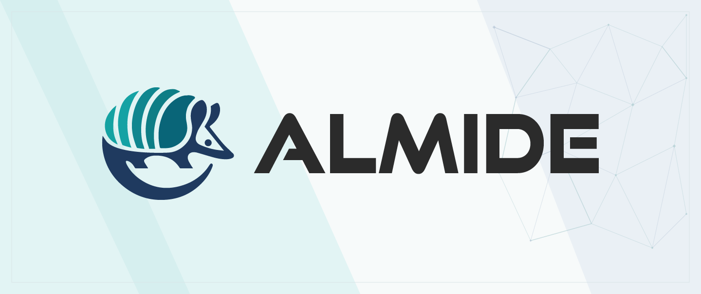

<p align="center">
  <picture>
    <source media="(prefers-color-scheme: dark)" srcset="./docs/assets/brand/almide-cover-dark.png">
    
  </picture>
</p>

<p align="center"><strong>モデルが間違えたとき、コンパイラが直し方を名指しする。</strong></p>

<p align="center">
  <a href="https://github.com/almide/almide/actions/workflows/ci.yml"></a>
  <a href="./LICENSE"></a>
  <a href="https://deepwiki.com/almide/almide"></a>
</p>

<p align="center">
  <a href="https://almide.github.io/playground/">Playground</a> ·
  <a href="./docs/CHEATSHEET.md">チートシート</a> ·
  <a href="./docs/SPEC.md">仕様</a> ·
  <a href="#クイックスタート">クイックスタート</a> ·
  <a href="./docs/benchmarks/README.md">証拠</a> ·
  <a href="./docs/how-it-works.md">仕組み</a> ·
  <a href="./docs/status.md">状態</a>
</p>

<p align="center">
  <a href="README.md"></a>
  <a href="README.ja.md"></a>
  <a href="README.zh-CN.md"></a>
</p>

---

Almide は、AI が書き AI が編集するコードのための静的型付け言語です。主張は「モデルが正しく書く」ことではありません。**モデルが間違えたとき、コンパイラが書いている時点でそれを指摘し、直し方を名指しする。モデルが正しかったとき、`almide verify` がプログラムの所有権・名前・能力の証跡を検査する。** 検査するのは独立した `almide-verify` で、これは Rocq で証明されたチェッカを Rust に書き写したものです。証明されたチェッカと判定が一致することをゲートで確かめていますが、`almide-verify` 自体は証明されていません（[証明済みと信頼の境界](./docs/contracts/proven-vs-trusted.md)）。出荷される wasm のバイト列そのものに対する証明書は、まだ保留中です（#2755–#2760）。ネイティブバイナリ（Rust 経由）と WebAssembly の両方にコンパイルされ、[契約台帳](./docs/contracts/)にある振る舞いについては、その二つはバイト単位で同一の出力を出します。

## 生き残る編集

モデルが型に case をひとつ足し、モデルがよくやるように、他には何も触らなかったとします。

```almd
type Shape =
  | Circle(Float)
  | Square(Float)
  | Triangle(Float, Float)   // この編集

fn area(s: Shape) -> Float =
  match s {
    Circle(r) => 3.14159 * r * r
    Square(w) => w * w
  }
```

```text
error[E010]: non-exhaustive match: missing Triangle(_, _)
  --> shape.almd:7:9
  in match
  here: match s {
  hint: add arms for Triangle(_, _):
  Triangle(arg1, arg2) => _
Or use `_ => todo()` to compile incrementally.
```

診断そのものが修正になっています。モデルの次の一手は `Triangle(b, h) => 0.5 * b * h` で、プログラムはネイティブでも wasm でも同じバイト列を出力します。同じ問いを Python に対して、8 件の注入した改変ミスで問うたもの：[demo/make-verify](./demo/make-verify/)。

## クイックスタート

**[ブラウザで試す →](https://almide.github.io/playground/)** —— インストール不要。

```bash
curl -fsSL https://raw.githubusercontent.com/almide/almide/main/tools/install.sh | sh   # macOS / Linux
irm https://raw.githubusercontent.com/almide/almide/main/tools/install.ps1 | iex        # Windows (PowerShell)
```

インストーラは展開前に、アーカイブをリリースの `almide-checksums.sha256` と照合します。すべてのリリース資産は Sigstore で証明されています（検証方法は [SECURITY.md](./SECURITY.md#release-integrity)）。各アーカイブには、`almide verify` が証跡を渡す証明書チェッカ `almide-verify` も入っています。ソースからは [Rust](https://rustup.rs/) 1.96 以上で `make install`。

```almd
fn main() -> Unit = {
  println("Hello, world!")
}
```

```bash
almide run hello.almd                 # ネイティブ
almide run hello.almd --target wasm   # 同じバイト列を wasmtime で
```

## 機能

- **マルチターゲット** —— 同じソースがネイティブバイナリ（Rust 経由）にも WebAssembly（直接出力、LLVM 不要）にもなり、契約台帳にある振る舞いについて出力はバイト単位で同一（[契約](./docs/contracts/)）
- **直し方を名指しする診断** —— どのエラーも位置と文脈を持ち、直し方がわかっているものには具体的な修正がつく（[コード一覧](./docs/diagnostics/)）
- **明示的な effect** —— `effect fn` と `expr!` による伝播。裸の可謬呼び出しはエラーで、黙って進むことはない（[チートシート](./docs/CHEATSHEET.md)）
- **型** —— ジェネリクス、レコード、網羅的な `match` つきの variant、双方向型推論、`Codec` の自動導出（[仕様](./docs/SPEC.md)）
- **注釈のいらないメモリ管理** —— Perceus 式の所有権推論。GC もライフタイムもない（[メモリ安全性](./docs/design/MEMORY-SAFETY.md)）
- **Fan** —— 構造化並行性。ネイティブではスレッドで、wasm でも同じ出力順で動く（[ADR-0024](./docs/adr/0024-fan-effect-callbacks-run-concurrently-as-if-sequential.md)）
- **標準ライブラリ** —— 自己ホストの `.almd` モジュール。公開関数はどれも両ターゲットで検品済み（[リファレンス](./docs/stdlib/)）
- **組み込みのツール** —— `almide test`、`almide fmt`、`almide check`、ダイヤモンド依存を解決するモジュール（[仕組み](./docs/how-it-works.md)）

## さらに読む

以下のページは英語です。

- [チートシート](./docs/CHEATSHEET.md) —— 構文、stdlib、イディオム。モデルが最初に読むページ（[`llms.txt`](./llms.txt) も）
- [仕様](./docs/SPEC.md) · [文法](./docs/GRAMMAR.md) · [標準ライブラリ](./docs/stdlib/) · [設計哲学](./docs/design/DESIGN.md) · [安定性の方針](./docs/STABILITY.md)
- [何を測っているか](./docs/benchmarks/README.md) —— LLM 可読性、バイト同一性、メモリ安全性、サイズと速度。どれも日付とゲートつき · [ベンチマークの方法](./docs/project/BENCHMARKS.md)
- [振る舞い契約](./docs/contracts/) —— ネイティブ ⇄ wasm のすべての約束とその証拠 · [証明と信頼の境界](./docs/contracts/proven-vs-trusted.md)
- [仕組み](./docs/how-it-works.md) —— パイプラインとトラストスパイン · [アーキテクチャ](./docs/ARCHITECTURE.md)
- [プロジェクトの状態](./docs/status.md) —— 1.0 前。LLM 向けの表面は、移行用の診断つきの dialect epoch でのみ変わる（[安定性方針](./docs/STABILITY.md)） · [ロードマップ](./docs/roadmap/README.md)
- [Almide で書かれたもの](./docs/written-in-almide.md) —— このリポジトリの外のエージェント、パーサ、グラフィックス、ライブラリ · エディタ：[vscode-almide](https://github.com/almide/vscode-almide)、[tree-sitter-almide](https://github.com/almide/tree-sitter-almide)

## コントリビュート

Issue と Pull Request を歓迎します。クローン後に `brew install lefthook && lefthook install` を実行してください。コミットは英語で書きます（commit-msg フックが強制）。規約は [CLAUDE.md](./CLAUDE.md)。

## ライセンス

[MIT](./LICENSE-MIT) または [Apache 2.0](./LICENSE-APACHE) のいずれか、お好きなほうで。
