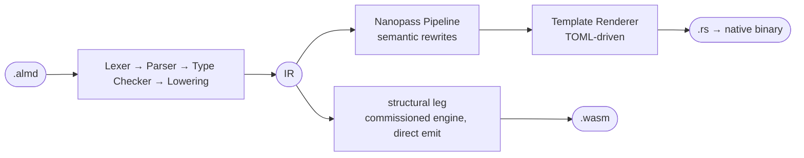

<p align="center">
  <picture>
    <source media="(prefers-color-scheme: dark)" srcset="./docs/assets/brand/almide-cover-dark.png">
    
  </picture>
</p>

<p align="center"><strong>モデルが間違えたとき、コンパイラが直し方を名指しする。</strong></p>

<p align="center">
  <a href="https://github.com/almide/almide/actions/workflows/ci.yml"></a>
  <a href="./LICENSE"></a>
  <a href="https://deepwiki.com/almide/almide"></a>
</p>

<p align="center">
  <a href="https://almide.github.io/playground/">Playground</a> ·
  <a href="./docs/CHEATSHEET.md">チートシート</a> ·
  <a href="./docs/SPEC.md">仕様</a> ·
  <a href="#なぜ-almide-か">なぜ</a> ·
  <a href="#クイックスタート">クイックスタート</a> ·
  <a href="#何を測っているか">証拠</a> ·
  <a href="#仕組み">仕組み</a> ·
  <a href="#プロジェクトの状態">状態</a>
</p>

<p align="center">
  <a href="README.md"></a>
  <a href="README.ja.md"></a>
  <a href="README.zh-CN.md"></a>
</p>

---

## 生き残る編集

Almide は、AI が書き AI が編集するコードのための静的型付け言語です。主張は「モデルが正しく書く」ことではありません。**モデルが間違えたとき、コンパイラが書いている時点でそれを指摘し、直し方を名指しする。モデルが正しかったとき、Rocq で証明されたチェッカが、そのプログラムがメモリ安全であることを証明する。** `almide verify` がプログラムの所有権・名前・能力の証跡を独立した `almide-verify` に渡します（出荷される wasm のバイト列そのものに対する証明書は、まだ保留中です。#2755–#2760）。ネイティブバイナリ（Rust 経由）と WebAssembly の両方にコンパイルされ、その二つはバイト単位で同一の出力を出します。

主張の前半を 1 画面で。モデルが型に case をひとつ足し、モデルがよくやるように、他には何も触らなかったとします。

```almd
type Shape =
  | Circle(Float)
  | Square(Float)
  | Triangle(Float, Float)   // この編集

fn area(s: Shape) -> Float =
  match s {
    Circle(r) => 3.14159 * r * r
    Square(w) => w * w
  }
```

```text
error[E010]: non-exhaustive match: missing Triangle(_, _)
  --> shape.almd:7:9
  in match
  here: match s {
  hint: add arms for Triangle(_, _):
  Triangle(arg1, arg2) => _
Or use `_ => todo()` to compile incrementally.
```

コンパイラは欠けた case をその場で名指しし、足すべき arm を書き下し、残りを書く間もコンパイルを通し続ける方法を示します。モデルの次の一手は `Triangle(b, h) => 0.5 * b * h` です。プログラムはそのままネイティブでも wasm でも走り、同じバイト列を出力します。編集、それ自体が修正になっている診断、通るビルド —— このループが、以下のすべての決定が仕えている対象です。同じ問いを Python に対して、8 件の注入した改変ミスで問うたもの：[demo/make-verify](./demo/make-verify/)。

## なぜ Almide か

- **予測可能** —— 各概念に正準形がひとつだけ。LLM のトークン分岐を減らす
- **局所的** —— どのコードを理解するにも、近くの文脈だけで足りる
- **修復可能** —— 診断は複数の可能性ではなく、特定の修正へ導く（上の例のように）
- **簡潔** —— 意味の密度が高く、構文の雑音が少ない

設計の全論拠は [Design Philosophy](./docs/design/DESIGN.md)。凍結された表面と破壊的変更の方針は [STABILITY.md](./docs/STABILITY.md)（2026-08-20 宣言）—— チートシートと `llms.txt` に載っているものは、意味が変わりません。

## クイックスタート

**[ブラウザで試す →](https://almide.github.io/playground/)** —— インストール不要。

```bash
curl -fsSL https://raw.githubusercontent.com/almide/almide/main/tools/install.sh | sh   # macOS / Linux
irm https://raw.githubusercontent.com/almide/almide/main/tools/install.ps1 | iex        # Windows (PowerShell)
```

インストーラは展開前に、アーカイブをリリースの `almide-checksums.sha256` と照合します。ダウンロードした資産を自分で検証するには —— チェックサムファイルを含むすべてのリリース資産が、リリースワークフローによって Sigstore で証明されています（[SECURITY.md](./SECURITY.md) を参照）：

```bash
gh attestation verify almide-macos-aarch64.tar.gz -R almide/almide   # 来歴: almide/almide のリリースワークフローが作った
sha256sum -c --ignore-missing almide-checksums.sha256                # ダイジェストが公開チェックサムと一致する
```

各アーカイブには `almide-verify`（独立してバージョン管理される証明書チェッカ）も入っています。`almide verify app.almd` はプログラムの所有権・名前・能力・呼び出しモードの証跡を出力し、それを渡します（`almide` の隣か `PATH` 上に置く必要があります。組み込みのフォールバックはありません）。

ソースからは、[Rust](https://rustup.rs/) 1.96 以上で（`almide` パッケージの `rust-version`。バイナリが wasmtime ホストを埋め込むためです。CI は 1.96.0 でビルドします）：`cargo build --release && cp target/release/almide target/release/almide-verify ~/.local/bin/`（または `make install`）。

```almd
fn main() -> Unit = {
  println("Hello, world!")
}
```

```bash
almide run hello.almd                 # ネイティブ
almide run hello.almd --target wasm   # 同じバイト列を wasmtime で
```

## 機能

- **マルチターゲット** —— 同じソースがネイティブバイナリ（Rust 経由）にも WebAssembly（直接出力、LLVM 不要）にもなる
- **ジェネリクス** —— 関数（`fn id[T](x: T) -> T`）、レコード、variant 型、自動 Box 包みつきの再帰 variant
- **パターンマッチ** —— variant の分解を伴う網羅的な `match`
- **effect 関数** —— 明示的なエラー伝播のための `effect fn`。`expr!` が伝播し、裸の可謬呼び出しはエラーになる。黙って進むことはない
- **双方向型推論** —— 注釈が式へ流れ込む（`let xs: List[Int] = []`）
- **Codec** —— `Type.decode(value)` / `Type.encode(value)` を自動導出
- **Map リテラル** —— `["key": value]`、`m[key]`、`for (k, v) in m`
- **Fan** —— 構造化並行性。`fan { a(), b() }` はネイティブでは各 arm を自分のスレッドで、wasm では順に実行する。`fan.map` / `fan.settle` は両方で結果をリスト順に返し、`fan.map` はすべての要素を実行して最小インデックスの `Err` を返す（dialect epoch 7）。ネイティブでスレッドを使うのは、スカラー上の純粋なコールバックのときだけ（effect コールバックは 1 要素ずつ実行される）。ネイティブの各 arm と各要素は自分専用の出力タイムラインに書き、リスト順に吐き出されるので、並行する arm の出力は両ターゲットでソース順に並ぶ。trap はそれより前の要素を待つ（[ADR-0024](./docs/adr/0024-fan-effect-callbacks-run-concurrently-as-if-sequential.md) の手順 1 と 3、C-004、C-005、C-200）。`fan.min(compute.ms(n))` は決定的な計算量をもっとも使わなかった arm を選ぶので、勝者は両ターゲットで同じになる。順番で最初の `Ok` は fan の形ではない —— `a() ?? b()`、リストなら `list.find_map` と書く（dialect epoch 14 で `fan.any` は削除され、`fan.race` は `fan.min` に改名された）
- **どの文字体系でも名前に** —— 識別子は Unicode UAX #31 に従い、NFC で保持される（`let 合計 = 価格 * 数量`）。キーワードは ASCII のまま
- **パイプライン演算子** —— `data |> transform |> output`
- **モジュールシステム** —— パッケージ、サブ名前空間、可視性制御、ダイヤモンド依存の解決
- **標準ライブラリ** —— 自己ホストの `.almd` モジュール。string、list、map、json、http、fs ほか（[リファレンス](./docs/stdlib/)。関数の数は[プロジェクトの状態](#プロジェクトの状態)で導出）。領域固有のカーネルは言語ではなくパッケージに置く。LLM プロバイダのクライアントは [almide/llm](https://github.com/almide/llm)、ニューラルネットの行列カーネルは [almide/nnlib](https://github.com/almide/nnlib)（dialect epoch 14）
- **組み込みテスト** —— `test "name" { assert_eq(a, b) }` を `almide test` で。中断しなければならない呼び出しには `testing.assert_aborts(expected, () => …)`

## 何を測っているか

この節のすべての主張は、スクリプトによって導出されているか、測定した日付を持っています。`scripts/check-readme-numbers.sh` は CI で裸の数字を拒否し、90 日より古い、あるいは由来する almide-dojo の run を名指ししない LLM 可読性スコアカードも拒否します。

### LLM 可読性

[almide-dojo](https://github.com/almide/almide-dojo) により 2026-09-22 に、38 タスク（basic / intermediate / advanced）のバンクに対し、固定コンパイラ `almide 0.62.0` で、同リポジトリの CI レーンが測定。両 run ともハーネスによって **`comparable`** と刻印されています —— 計画されたタスクがすべてモデルに届いたので、各率は区間ではなく点です。いずれも固定シード（`20260922`）・温度 0 でサンプリングされ、プロバイダが実際に送出した値として run のマニフェストに記録されています。run はコミット済み（[`almide-dojo@8af34bc`](https://github.com/almide/almide-dojo/commit/8af34bc3)）なので、下の表は信じる対象ではなく `summary.md` から再計算できます。以降の run は[ライブダッシュボード](https://almide.github.io/almide-dojo/)にあります。方針として CI に Anthropic / OpenAI の鍵を置いていないので、ここに並ぶのはレーンが鍵なしで到達できるモデルです：

| Model | Pass Rate | 1-Shot Rate |
|---|---|---|
| Llama 3.3 70B (fp8-fast) | 65% (25/38) | 39% (15/38) |
| Llama 3.1 8B | 44% (17/38) | 34% (13/38) |

同一モデルでの最新の比較は MiniGit ベンチです。2026-07-15、Sonnet 5 × 20 試行、almide 0.29.0（それ以降のコンパイラでは再実行していません）、100% 通過、5 言語中もっとも簡潔（233 LOC）、エージェントの実時間は Gleam と MoonBit より速く、Rust と TypeScript より遅い（573 秒対 297 秒）。これは 6〜9 倍の自己並列下で測った **LLM 可読性**の数字であって、生成コードの速度では**ありません**（[図](docs/figures/lang-bench-snapshot-2026-07.png) · [方法](research/benchmark/lang-bench/README.md) · [上流](https://github.com/mame/ai-coding-lang-bench)）。

### ターゲット間でバイト単位に同一

**両ターゲットでコンパイルできるすべてのプログラムは、ネイティブバイナリとして走ろうと WebAssembly として走ろうと、観測可能な出力 —— stdout、stderr、終了コード —— がバイト単位で同一になります。** ネイティブが基準であり、`native == wasm` は「ターゲット差異」として文書で回避するものではなく、硬い不変条件です。

この保証は**継続的で、台帳で管理された明示的な範囲**を持ちます。「バイト単位に同一」が指すのは実行の出力であって、コンパイル済み成果物ではありません。本質的に非決定的な源は、正確なバイト列の代わりに決定的な*不変条件*を証明します。wasm で未実装の API はコンパイル時または実行時の*拒否*であり、誤ったバイト列には決してなりません。そして役割がホストの報告そのものである 2 つの fn —— `env.os()` と `env.temp_dir()` —— だけが C-189 に区切られて除外されます。これらをターゲット間で一致させることは、保証ではなく欠陥になるからです。並行する `fan { }` の arm が出力するものも保証の内側です。ネイティブの各 arm は自分のタイムラインに書き、ソース順に吐き出されるので、wasm と同じに読めます（C-004、ADR-0024 手順 1）。

この主張は散文ではありません。観測可能な約束はすべて[振る舞い契約台帳](docs/contracts/)の名前付き契約であり、それぞれが実行可能な証拠まで辿れます。下の数字は台帳から再生成されます（`scripts/gen-claims.sh`、CI では `scripts/check-contracts.sh` が強制）：

<!-- claims:generated:start — derived from docs/contracts/contracts.toml by scripts/gen-claims.sh; DO NOT EDIT between the markers -->
> <!-- counts:generated:start (as of 2026-10-10) — stamped totals from proofs/ledger-counts.toml; refreshed only by scripts/gen-ledger-counts.sh, never by a fixture/contract PR; DO NOT EDIT between the markers -->
> **Ledger: 376 contracts — 376 active, 0 flagged-for-revision.**
> <!-- counts:generated:end -->
>
> **Divergences awaiting a fix: none.** Every contract in the ledger is
> `active`, carrying executable evidence of class >= `fixture`. The one
> by-design carve-out in the law — the platform-reporting fns `env.os`
> and `env.temp_dir` — is bounded by C-189.
<!-- claims:generated:end -->

範囲、台帳の仕組み、証拠の積み重ね（契約台帳、クロスターゲット fixture ゲート、差分ファジング、出力時 Σ プローブ、Lean ベルト、org 横断のバイト検証掃引）：**[docs/design/EQUIVALENCE.md](./docs/design/EQUIVALENCE.md)**。

### メモリ安全性 —— 証明された所は証明で、信頼している所は信頼で

所有権注釈もライフタイムも `free` も書きません。コンパイラ内の [Perceus](https://www.microsoft.com/en-us/research/publication/perceus-garbage-free-reference-counting-with-reuse/) 式の所有権推論が、すべてのヒープ値をどこで生成し、複製し、消費するかを決めます —— GC なし、停止なし。その決定のチェッカは**カーネル証明済み**です（Rocq/Coq の背骨、100 の監査済み定理と補題、公理クリーン、`coqchk` による独立再検査。数は `proofs/check.sh` が表明）。`almide verify --emit` は今もそれが検査する MIR 所有権の証跡を出力します。ビルドごとの証明書はかつて incumbent wasm leg に乗っていましたが、#2761 がそれを削除しました。**structural wasm leg**（唯一の wasm レンダラ）と**ネイティブ leg** は信頼であり、証明書は保留中です（#2755–#2760）。その証拠は差分的です —— 契約コーパス上で互いに、またインタプリタとバイト単位に同一の出力であること。単調増加の下限とセマンティック変異ネットで保持され、structural ランタイムのバイト列は `proofs/check-structural-bytes.sh` が Coq のデコーダモデルと照合します。段階ごとの境界は **[proven-vs-trusted.md](docs/contracts/proven-vs-trusted.md)**、設計の出発点となった Lean 4 Perceus ベルトを含む全体像は **[docs/design/MEMORY-SAFETY.md](./docs/design/MEMORY-SAFETY.md)**。

### 性能

VM なし、GC なし、インタプリタなし —— ネイティブは Rust を通って機械語になり、WASM は自己完結したモジュールとして直接出力されます（プログラムが到達するランタイム支援だけがリンクされ、残りは刈り取られます）。

<!-- wasm-size:generated:start — rendered from docs/benchmarks/wasm-size.txt by scripts/gen-readme-stats.sh; DO NOT EDIT between the markers -->
| Program (`almide build --target wasm`, as shipped) | develop | released v0.66.0 |
|---|---:|---:|
| Hello, world | **325 B** | **953 B** |

The develop column is the develop build at 5f39c06ba, after the v0.66.0 release (`almide --version`: `almide 0.66.0 (dev, 5f39c06ba)`), measured 2026-10-03; CI rebuilds it on every push and fails if the bytes move without a restamp of `docs/benchmarks/wasm-size.txt`. The released column is the compiler from the v0.66.0 release asset (`almide 0.66.0 (release, 819bbc74f)`, `gh release download v0.66.0 -R almide/almide`), measured 2026-10-03. No post-hoc optimizer touches the shipped bytes (`--wasm-opt` is opt-in and its output is not the renderer's own module).
<!-- wasm-size:generated:end -->

同じ wasm ターゲットの Rust は、サイズを詰め切っても Hello, world で 40 KB 以上になります。`rustc 1.96.1`、`wasm32-wasip1`、`opt-level="z"`、`lto`、`strip`、`panic="abort"`、`codegen-units=1` で 40,379 B（既定の release プロファイルでは 64,844 B）、2026-10-03 に [WASM-OUTPUT.md](./docs/wasm/WASM-OUTPUT.md) 末尾の手順で測定。ネイティブの CLI 型ベンチマーク（`research/benchmark/perf/native/cli_app.almd`、`research/benchmark/perf/native/measure.sh` でビルド）は macOS arm64 で strip 後 464,488 B、crate 依存なし（リンクされるのは `libSystem` のみ）、2026-10-03 に develop ビルドと v0.66.0 リリースの両方で測定。バイト単位の解剖（2026-07-23 測定。#2761 で退役した incumbent leg も扱う）：**[docs/wasm/WASM-OUTPUT.md](./docs/wasm/WASM-OUTPUT.md)**。

手書き Rust に対して、算術カーネルは同等です。n-body と spectral-norm は Apple M4 Pro で 1.00×（2026-07-30）、ubuntu-latest の CI ランナーで 1.065× と 1.032×（develop CI run [37092258733](https://github.com/almide/almide/actions/runs/37092258733)、2026-10-03）。Almide が Rust の持たない情報を持つ場合 —— 木の寿命全体が `check(make(depth))` という 1 つの式であることを effect system が証明している場合 —— 同じプログラムに対する普通の Rust より速くなります：

<!-- native-victory:generated:start — rendered from docs/benchmarks/native-victory.txt by scripts/gen-readme-stats.sh; DO NOT EDIT between the markers -->
| Workload (`bench.py`, median of 9, interleaved) | optimization | Almide / ordinary Rust, M4 Pro | without it (`ALMIDE_REGION_OFF=1` / `ALMIDE_FAN_SEQUENTIAL=1`), M4 Pro | ubuntu-latest CI runner |
|---|---|---:|---:|---:|
| binarytrees | region window (#1991) | **0.35 (d17)** / **0.32 (d19)** | 1.25 | 0.581 (d17) |
| treealloc | region window (#1991) | **0.30 (d20)** / **0.30 (d21)** | 1.10 | 0.365 (d20) |
| fannkuchredux | parallel fan (#2044) | **0.21 (n10)** / **0.12 (n11)** | 1.06 | 0.315 (n11) |

Two ratios per row are the two input sizes (the win holds at both); the Rust side is the ordinary program a person writes for it — a `Box` per node, one thread, no arena, no `unsafe`, no SIMD — compiled with the same `rustc` flags, and the "without it" column is the same Almide source with the region window turned off, so the whole gap is that one optimization. The absolute ratio is allocator-dependent (the CI runner frees a `Box` cheaper), the direction is not: the `perf-ratchet` job fails if either row reaches 1.0 or the ablation stops paying. Declaration and methodology: [docs/project/BENCHMARKS.md](./docs/project/BENCHMARKS.md#faster-than-ordinary-rust-1330). Ledger: `docs/benchmarks/native-victory.txt`. The M4 Pro columns were measured on almide 0.62.0, 2026-09-08 and have not been re-measured since; the runner column is what the `perf-ratchet` job of develop CI run [37092258733](https://github.com/almide/almide/actions/runs/37092258733) printed at `466cac59b` (a develop build carrying version 0.66.0, not the 0.66.0 release), 2026-10-03 (the size is in each cell).
<!-- native-victory:generated:end -->

<!-- build-speed:generated:start — derived from docs/benchmarks/build-speed.txt by the almide-gates `bench` subcommand; DO NOT EDIT between the markers -->
Measured on almide 0.59.1, arm64 Darwin, `examples/lisp.almd` (268 lines), 2026-08-27. Every row is an N-run MEAN —
a single run of a 30ms process is scheduler noise. Cold clears BOTH `$TMPDIR/almide-run`
and the dependency cache before each repetition; clearing only the latter measures a warm
build. Regenerate with `almide run tools/almide-gates/src/main.almd -- bench`; the ratchet
(`-- bench --check`) fails CI at 1.5x.

| scenario | time | runs |
|---|---|---|
| `almide check` | **15.2 ms** | 20 |
| build, warm (content-cache hit) | **237.2 ms** | 5 |
| build, cold | **635.3 ms** | 3 |
| build, cold, `--target wasm` | **61.7 ms** | 3 |
<!-- build-speed:generated:end -->

`almide check` はほぼ線形にスケールします。このリポジトリ自身の stdlib による 2k → 30k 行の階段で、検査時間のプロジェクト行数に対する両対数の傾きは **1.13**（1.0 が線形、2.0 が二次）、10k 行の段は空プロジェクトの床の **4.4 倍** —— 2026-08-13 測定、`scripts/check-edit-loop-scale.sh` が保持、表は [BENCHMARKS.md](./docs/project/BENCHMARKS.md#edit-loop-scale-1334)。手書き Rust に対するネイティブ実行時間は、Apple M4 Pro（2026-07-30、FFT は 2026-08-13 に再測定）で n-body と spectral-norm が **1.00×**、fasta が 1.16×、FFT が 1.18×（[スコアボード](./docs/project/BENCHMARKS.md)）。listbuild の行はそこで 1.47〜1.69×、CI ランナーでは 0.87〜1.05×（2026-10-03）。M4 Pro での差は、バイト同一性に必要な決定的なソフトウェア `sin`/`cos` によるもので、リスト構築によるものではありません（2026-08-13 測定、`scripts/perf-ratio-baseline.txt`）。ubuntu-latest ランナーは develop の CI run ごとに全行を測り直し、`perf-ratchet` ジョブは固定行（n-body、spectral-norm、fasta、FFT、wordfreq）がコミット済みの基準から 40% を超えてずれると失敗します（run [37092258733](https://github.com/almide/almide/actions/runs/37092258733)、2026-10-03: fasta 0.757×、FFT 1.002×）。wasm 実行時間も測定・ゲート済み（#1701）：

<!-- wasm-runtime:generated:start — rendered from docs/benchmarks/wasm-runtime.txt by scripts/gen-readme-stats.sh; DO NOT EDIT between the markers -->
| Benchmark (`almide bench`, verify-then-time, min of 2×5 interleaved) | wasm/native, `main` only | cold start (spawn vs compile + instantiate) |
|---|---:|---:|
| nbody | **1.10×** | 1.14× |
| spectralnorm | **1.21×** | 1.22× |
| binarytrees | **1.07×** | 1.06× |
| treealloc | **1.04×** | 1.04× |
| fasta | **1.52×** | 1.50× |
| fannkuchredux | **1.28×** | 1.28× |
| mandelbrot | **1.11×** | 1.10× |
| onebrc | **1.26×** | 1.33× |
| fft | **1.53×** | 1.53× |
| strchurn | **0.85×** | 0.85× |
| listbuild_append | **1.96×** | 1.95× |
| listbuild_combinator | **1.88×** | 1.86× |
| listbuild_prealloc | **1.68×** | 1.68× |
| mapbuild | **0.67×** | 0.72× |

Embedded wasm host (Perceus RC in linear memory) against the native binary, same machine, same run. The ratio times the program's own `main`, entry to return, on both legs (native in-process, wasm around the host call): process spawn and module compile/instantiate are outside it, and the cold-start column shows them (#2980). Small workloads run at a ledger-fixed size (`args=`) so `main` is long enough to time. Cross-engine ratios do NOT cancel hardware (a 2-core CI runner measures nbody ~10x worse), so the stamped ratio verdict runs on the stamping machine class; CI gates the STATUS taxonomy below and judges the wasm leg by a same-runner A/B against the latest release binary (interleaved, min-of-runs, `ab_band` in the ledger — #2143) (`scripts/check-wasm-runtime-ratio.sh`). Of these rows only fannkuchredux runs its `fan` in parallel: native on threads (#2044), the embedded wasm host on separate instances of the module (#3003, ADR-0011 §D2a; every other wasm host runs it sequentially, byte-identical); binarytrees' and mandelbrot's `fan.map` callbacks run sequentially on both legs (user time equals wall time on both, measured 2026-10-03). The unmeasured corpus cells stay honest instead of estimated: 0 wall on the wasm build path, 0 exhaust the embedded heap (#1729) — each re-measured every gate run, so a cell that starts benching fails the gate until its row is promoted. Ledger: `docs/benchmarks/wasm-runtime.txt` (a develop build carrying version 0.65.1, not the 0.65.1 release, 2026-09-29).
<!-- wasm-runtime:generated:end -->

## 仕組み

フロントエンドひとつ、IR ひとつ、ターゲットごとにレンダラひとつ：



**ネイティブ。** Nanopass パイプラインがターゲット固有の変換を適用します —— `ResultPropagation`（Rust の `?`）、`CloneInsertion`（Rust の借用解析）、`LICM`（ループ不変式の移動）。Template Renderer は純粋に構文的で、意味に関わる決定はすべて IR の時点で済んでいます。

**WebAssembly。** **structural leg** —— [#1599](https://github.com/almide/almide/pull/1599) で commissioning されたエンジン、`almide::wasm_leg` フロント + `crates/almide-wasm` エミッタ、入口は `src/cli/build.rs` の `render_wasm_module_routed` —— が唯一の wasm レンダラです。`wasm_cross` コーパスで 610/610 がネイティブとバイト単位に同一として受理され、そのビルド成果物は WASI 形式（[#1588](https://github.com/almide/almide/issues/1588)）で出荷されるので素のランタイムで走ります。降ろせないプログラムは正直なエラー（`error[E082]`。壁と関数を名指しする）になり、フォールバックはしません。かつてその形を受け取っていた incumbent v1 leg は #2752 で最後の経路を失い、#2761 で削除されました。`ALMIDE_VERIFIED_DEBUG=1` で経路を実況します。

```bash
almide run app.almd                  # コンパイル + 実行（ネイティブ）
almide build app.almd --target wasm  # WebAssembly をビルド（WASI）
almide test                          # test ブロックを再帰的に探して実行
almide check app.almd                # 型検査のみ
almide check app.almd --target wasm  # + wasm ビルド経路: 検査時に E081/E082（#1922）
almide fmt app.almd                  # ソースを整形
```

全コマンド一覧は `almide --help`（compile、add、deps、clean …）。パイプラインとモジュールの地図は [docs/ARCHITECTURE.md](./docs/ARCHITECTURE.md)、wasm leg の詳細は [docs/wasm/](./docs/wasm/README.md)。

### 次に来るもの —— v1、トラストスパイン

上の Perceus 証明が証明するのは、コンパイラの 1 パスを 1 回だけです。v1 はその原理を**パイプライン全体**に一般化します —— コンパイラ全体を証明する代わりに、小さな*チェッカ*を証明し、コンパイラにはビルドごとに証明書を出させて、チェッカがそれを再検証します。チェッカが受理すれば、その成果物はその性質を持つ —— コンパイラの内部に一切言及しない定理です。これにより信頼基盤はコンパイラ全体（`src/` と `crates/` の下の Rust 約 30 万行、テストディレクトリを除く、2026-10-03 計数）から、抽出されたチェッカ（証明から機械導出された OCaml 約 1,400 行）まで縮みます。そしてテストより難しい問いを立てます。**「テストは通るか」ではなく「出力が正しいと機械が証明できるか」。** 構成、受領証（C-SAFE / C-REPRO / C-FAITHFUL / C-PROVEN）、そしてビルドが意図的に遅い理由は **[docs/TRUST-SPINE.md](./docs/TRUST-SPINE.md)**。

## プロジェクトの状態

| 項目 | 状態 |
|----------|--------|
| 成熟度 | 1.0 前、`develop` で活発に開発中。LLM に面する表面は [STABILITY.md](docs/STABILITY.md) で凍結（2026-08-20 宣言） |
| サポート | 最新リリースラインのみ、1.0 前 —— 方針とバージョニングの保証は [SUPPORT.md](./SUPPORT.md) · 脆弱性は [SECURITY.md](./SECURITY.md) |
| コンパイラ | 純 Rust、単一バイナリ |
| ターゲット | Rust（ネイティブ）、WASM（直接出力 —— structural leg。[仕組み](#仕組み)を参照） |
| 検証済みコード生成 | structural wasm leg: バイト厳密なコーパスと変異ゲート。信頼であり、ビルドごとの証明書は保留中（#2755–#2760）。PCC 証明つきの incumbent leg（0.29.0 以降、毎ビルドで再検証）は #2761 で退役 |
| コード生成 | Rust: Nanopass + TOML テンプレート。wasm: structural エンジン → 直接出力（v0 エミッタと incumbent の MIR→WAT レンダラは退役。壁はエラーであって、フォールバックではない） |
| 標準ライブラリの検品 | 公開されている stdlib の全関数が [`proofs/stdlib-inspection.toml`](./proofs/stdlib-inspection.toml) で `inspected` の印を持つ。ネイティブと wasm で同じバイト列、呼び出しあたりのコストが宣言した次数以内、codopsy A、毎回新しく生成するファジングの組み合わせ、モジュールのダイヤモンド越しの呼び出し。2026-10-19 時点（almide 0.68.0）で未検品 0。`tests/stdlib_inspection_test.rs` はシグネチャか本体が変わると印を無効にし、未検品の数は減る方向にしか動かない |
| 成果物 | `almide compile` による `.almdi` モジュールインタフェースファイル |
| Playground | [稼働中](https://almide.github.io/playground/) —— コンパイラがブラウザで WASM として動く |

<!-- stats:generated:start — derived from docs/stdlib/*.md, spec/, and docs/contracts/contracts.toml by scripts/gen-readme-stats.sh; DO NOT EDIT between the markers -->
<!-- counts:generated:start (as of 2026-10-10) — stamped totals from proofs/ledger-counts.toml; refreshed only by scripts/gen-ledger-counts.sh, never by a fixture/contract PR; DO NOT EDIT between the markers -->
| Derived count | Value |
|---|---|
| Stdlib | 1031 functions across 45 modules — self-hosted `.almd`, signature indexes regenerated from the compiler by `tools/gen-stdlib-doc-index.py` |
| Tests | 512 `.almd` test files under `spec/` (`almide test spec/`) + the 376-contract cross-target ledger |
<!-- counts:generated:end -->
<!-- stats:generated:end -->

<!-- mutation-score:generated:start (as of 2026-09-22) — stamped from proofs/mutation-score.toml by scripts/gen-mutation-score.sh; re-measured by every mutation-sweep run, refreshed only by `--from-run`; DO NOT EDIT between the markers -->
**Mutation score** — 41/41 mutants caught (100.0 %), 0 survived, 0 stale: the full release-shape net sweep of `ci/mutations/` ([`scripts/check-mutation-gate.sh`](./scripts/check-mutation-gate.sh)), stamped 2026-09-22 from mutation-sweep run [35650396971](https://github.com/almide/almide/actions/runs/35650396971) at `3b02f7dc4`.
<!-- mutation-score:generated:end -->

## Almide で書かれたもの

このリポジトリの中で最大の Almide プログラムは標準ライブラリです。以下は別の場所で Almide で書かれたもので、表面上の主張が「言語をよく見せるために書かれたのではないコード」と出会う場所です。

- **コーディングエージェント** —— [comide](https://github.com/O6lvl4/comide)、ディレクトリの中の会話 · [golemide](https://github.com/O6lvl4/golemide)、単一の静的バイナリ、観察してから編集し、すべての書き込みが構文ゲートを通る · [homullus](https://github.com/almide-ai/homullus)、モジュラーなエージェントランタイム · [manus](https://github.com/almide-ai/manus)、macOS のコンピュータ操作
- **エージェント基盤** —— [porta](https://github.com/almide/porta)、WASM 隔離と OS サンドボックス、Docker 不要 · [ctxgate](https://github.com/O6lvl4/ctxgate)、ツールフックに住むコンテキストファイアウォール · [hew](https://github.com/O6lvl4/hew)、エージェント向けの構造認識 `cat`/`grep`/`sed` · [almai](https://github.com/almide-ai/almai)、あらゆるプロバイダを覆う単一の LLM インタフェース
- **構文解析** —— [gramide](https://github.com/O6lvl4/gramide)、コーディングエージェントのための構文木。文法パッケージは [TypeScript](https://github.com/O6lvl4/gramide-typescript)、[Python](https://github.com/O6lvl4/gramide-python)、[Rust](https://github.com/O6lvl4/gramide-rust)、[Go](https://github.com/O6lvl4/gramide-go)、[JavaScript](https://github.com/O6lvl4/gramide-javascript)、[Almide](https://github.com/O6lvl4/gramide-almide) 用があり、それぞれその言語自身のパーサと突き合わせて検査されている · [parsegen](https://github.com/almide/parsegen)、C も動的ロードもない tree-sitter 互換パーサジェネレータ
- **グラフィックス** —— [ceangal2](https://github.com/almide-graphics/ceangal2)、コンピュートシェーダ優先の 2D/3D レンダラ snaidhm と、その上のレイアウトとウィジェット ceangal。1 つの Almide プログラムが web、iOS、macOS、Android、Windows、Linux で動く（[ceangal-hello](https://github.com/almide-graphics/ceangal-hello) から始められる） · [obsid](https://github.com/almide-graphics/obsid)、WASM 経由の Canvas 2D / WebGL / 3D · [nn](https://github.com/almide-graphics/nn) と [slabhra](https://github.com/almide-graphics/slabhra)、ニューラルネット基盤と逆モード自動微分 · [cruth](https://github.com/almide-graphics/cruth)、VRM/glTF キャラクタ · [lumen](https://github.com/almide-graphics/lumen)、`@extern` を要さないグラフィックス数学
- **デスクトップ** —— [almide-shell](https://github.com/almide-graphics/almide-shell)、Hyprland のシェル（バー、ランチャー、通知、オンスクリーン表示） · [sprid](https://github.com/O6lvl4/sprid)、厳しいメモリ予算の下でスクロールバックを持つ端末エミュレータ
- **バインディングと配布** —— [almide-bindgen](https://github.com/almide/almide-bindgen)、20 言語ターゲットへの FFI · [almide-wasm-bindgen](https://github.com/almide/almide-wasm-bindgen) · [almide-lander](https://github.com/almide/almide-lander)、Almide をネイティブ共有ライブラリとして · [almide-web](https://github.com/almide/almide-web)、ブラウザ API
- **ライブラリ** —— [toml](https://github.com/almide/toml) · [yaml](https://github.com/almide/yaml) · [csv](https://github.com/almide/csv) · [svg](https://github.com/almide/svg) · [dfa](https://github.com/almide/dfa) · [bigint](https://github.com/almide/bigint) · [aes](https://github.com/almide/aes) · [rsa](https://github.com/almide/rsa) · [sha1](https://github.com/almide/sha1) · [base64](https://github.com/almide/base64) · [almide-sqlite](https://github.com/almide/almide-sqlite) · [llm](https://github.com/almide/llm)、LLM プロバイダのストリーミングクライアント · [nnlib](https://github.com/almide/nnlib)、ニューラルネットのカーネル（attention、RoPE、正規化、量子化された行）
- **適合性と測定** —— [als](https://github.com/almide/als)、独自の判定器を持つ規範的仕様。任意の `almide` バイナリに対して走る · [almide-dojo](https://github.com/almide/almide-dojo)、LLM 可読性の測定場。ハーネス自体が Almide で書かれている · [bonsai-almide](https://github.com/almide/bonsai-almide)、ブラウザで動く 1-bit LLM

2026-09-30 測定：このリポジトリの外にある 144 の公開リポジトリが Almide のソースを含みます。生成物を除いた手書きの行数は、[nn](https://github.com/almide-graphics/nn) 21,815 行、[gramide](https://github.com/O6lvl4/gramide) ファミリが 8 リポジトリ合計 19,780 行、[almide-shell](https://github.com/almide-graphics/almide-shell) 8,502 行、[snaidhm](https://github.com/almide-graphics/snaidhm) 6,800 行、[almide-bindgen](https://github.com/almide/almide-bindgen) 5,871 行、[ceangal](https://github.com/almide-graphics/ceangal) 5,099 行、[sprid](https://github.com/O6lvl4/sprid) 4,565 行、[porta](https://github.com/almide/porta) 4,419 行。snaidhm と ceangal はそれぞれ自分のリポジトリで数えたもので、それらのリポジトリはその後アーカイブされ、ceangal2 に移りました。

## エコシステムとドキュメント

- [almide-grammar](https://github.com/almide/almide-grammar) —— エディタと tree-sitter のツールが生成される元になる構文記述（キーワード、演算子、優先順位、TextMate スコープ）。Almide で書かれている。コンパイラの字句解析器に供給するのではなくそれを写したもので、週次の `downstream-sync` ワークフロー（`scripts/check-downstream-grammar.sh`）が 2 つのトークン集合の食い違いで失敗する
- [vscode-almide](https://github.com/almide/vscode-almide) · [tree-sitter-almide](https://github.com/almide/tree-sitter-almide)（Neovim、Helix、Zed） · [playground](https://github.com/almide/playground)
- [docs/CHEATSHEET.md](./docs/CHEATSHEET.md) —— AI コード生成向けクイックリファレンス · [docs/SPEC.md](./docs/SPEC.md) —— 言語仕様 · [docs/GRAMMAR.md](./docs/GRAMMAR.md) —— EBNF 文法 + stdlib リファレンス
- [docs/design/DESIGN.md](./docs/design/DESIGN.md) —— 設計哲学 · [docs/design/EQUIVALENCE.md](./docs/design/EQUIVALENCE.md) —— バイト同一性の主張 · [docs/design/MEMORY-SAFETY.md](./docs/design/MEMORY-SAFETY.md) —— 証明と信頼の区分 · [docs/TRUST-SPINE.md](./docs/TRUST-SPINE.md) —— v1
- [docs/contracts/](./docs/contracts/) —— 振る舞い契約台帳 · [docs/stdlib/](./docs/stdlib/) —— モジュール別の標準ライブラリ · [docs/project/BENCHMARKS.md](./docs/project/BENCHMARKS.md) —— サイズ、実行時間、編集ループのスケール · [docs/roadmap/](./docs/roadmap/README.md) —— 進化計画

## コントリビュート

Issue と Pull Request を [GitHub](https://github.com/almide/almide) で歓迎します。クローン後、git フックを入れてください（`brew install lefthook && lefthook install`）。コミットは英語である必要があります（commit-msg フックが強制）。プロジェクトの規約は [CLAUDE.md](./CLAUDE.md)。

## ライセンス

[MIT](./LICENSE-MIT) または [Apache 2.0](./LICENSE-APACHE) のいずれか、お好きなほうで。
