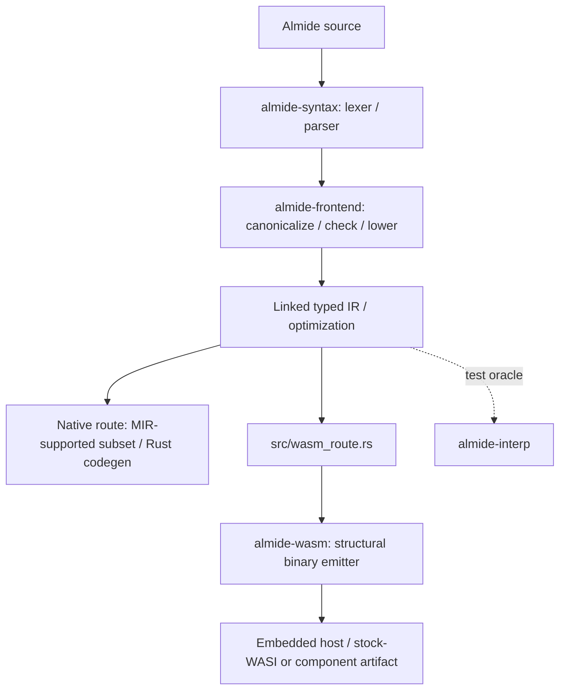

# Almide ワークスペースのクレート

  

> 2026-10-31 更新。この文書は案内図であり、網羅的な依存関係グラフでも、規模や性能の計測結果でもありません。ワークスペースと依存関係の正本は [Cargo.toml](../Cargo.toml) と各クレートのマニフェストです。

## コンパイラの経路

共通の Wasm 経路には structural emitter が1つあります。処理できないプログラムは未対応の境界を明示し、廃止された MIR/WAT または v0 Wasm レンダラーにはフォールバックしません。ネイティブ経路の境界は別です。図から普遍的な正しさの保証を読み取るのではなく、[ARCHITECTURE](../docs/ARCHITECTURE.md)、[WASM-OUTPUT](../docs/wasm/WASM-OUTPUT.md)、[wasm_route.rs](../src/wasm_route.rs) を参照してください。

## 主な領域

| クレート／グループ | 役割 |
|---|---|
| `almide-base` | シンボル、ソース範囲、診断 |
| `almide-syntax` | AST、字句解析器、構文解析器 |
| `almide-types`, `almide-lang` | 型表現、標準ライブラリのメタデータ、互換性のための再エクスポート |
| `almide-ir` | 型付き IR、visitor、エフェクト、注釈 |
| `almide-frontend`, `almide-driver` | 検査／低水準化とコンパイラの処理統括 |
| `almide-optimize` | 共通 IR の変換と単相化 |
| `almide-codegen` | Rust nanopass／テンプレート walker と、限定的な `@gpu` WGSL ソース出力 |
| `almide-mir` | MIR への低水準化、所有権／証明書の仕組み、ネイティブの検証付きレンダラーが扱う部分集合。配布用 Wasm レンダラーではありません |
| `almide-wasm`, `almide-layout`, `almide-corpus` | structural Wasm 出力、レイアウト、そのコーパス用ツール |
| `almide-wasm-run`, `almide-wasi`, `almide-wasm-vm` | 組み込み実行、WASI への適合処理、Wasm 実行支援 |
| `almide-spine`, `almide-verify`, `almide-anchor-check` | 証明書／検査の構成要素。`almide-verify` は別の実行ファイルです |
| `almide-interp` | 差分検証の基準として使うコード生成前 IR インタープリター。判定を控える場合を明示します |
| `almide-egg-lab` | コード生成が使う等式飽和の規則と橋渡し。使い捨ての独立 PoC ではなくなっています |
| `almide-dialect` | MLIR 型の dialect スキーマ |
| `almide-rt-core`, `almide-str`, `almide-gpu-run` | ランタイムサービス、共有文字列表現、GPU 実行 |
| `almide-tools` | フォーマッター、インターフェース抽出、`.almdi` シリアライズ |
| ルートの `almide` | CLI／ライブラリの入口、プロジェクト解決、依存関係の取得、ビルド経路の選択 |

ルートの既定ビルドには `almide` と `almide-verify` の両方が含まれます。
`almide-kernel` はこの Cargo ワークスペースから除外され、独自のワークスペースを持ちます。`almide-perceus-belt` には Lean による証明開発が含まれます。ビルド前に各マニフェストとローカルの指示を確認してください。

## 生成される入力

廃止された `stdlib/defs/*.toml` シグネチャ表を復活させないでください。

- [`almide-types/build.rs`](almide-types/build.rs) は `.almd` 標準ライブラリソースを埋め込み、`///` ドキュメントコメントを保持し、宣言に基づくメタデータ（セルフホスト実装の登録を含む）を生成します。
- [`almide-codegen/build.rs`](almide-codegen/build.rs) は現在のソースからランタイムソースと関連するコード生成表を組み立てます。
- [`almide-frontend/build.rs`](almide-frontend/build.rs) はパッケージビルド用にコミットされる dialect 台帳と正規表現ランタイムのコピーを維持します。

ほかのクレートにもビルドスクリプトがあるため、上記3つは網羅的な一覧ではありません。出力を手編集するのではなく、各生成器のソースと検査モードに従ってください。現在の標準ライブラリの作業手順は [stdlib/README.md](../stdlib/README.md) にあります。

## 依存関係と API の変更

Cargo は実際の依存関係グラフで独立する枝を並列ビルドできます。このページは特定の再コンパイル回数や実行時間を約束するものではありません。依存関係の変更を計画する際は `cargo tree` とマニフェストを使ってください。
公開の互換性再エクスポートは [src/lib.rs](../src/lib.rs) と [almide-lang/src/lib.rs](almide-lang/src/lib.rs) で定義されています。内部クレートのすべてのモジュールが自動的に安定した公開 API になるとは考えないでください。
