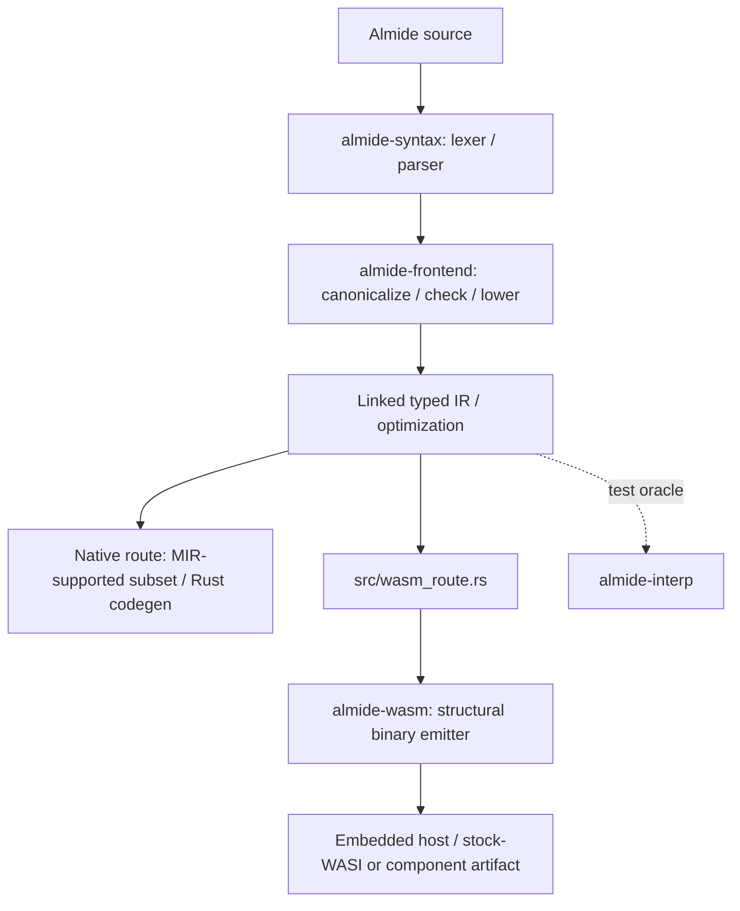

# Almide Workspace Crates

> Updated 2026-10-31. This is a navigation map, not an exhaustive dependency
> graph or a size/performance measurement. [Cargo.toml](../Cargo.toml) and each
> crate's manifest are the authoritative workspace and dependency inventories.

## Compiler path

The shared Wasm route has one structural emitter. A declined program produces
an explicit wall; there is no fallback to the retired MIR/WAT or v0 Wasm
renderer. Native routing has a different boundary. See
[ARCHITECTURE](../docs/ARCHITECTURE.md), [WASM-OUTPUT](../docs/wasm/WASM-OUTPUT.md)
and [wasm_route.rs](../src/wasm_route.rs) rather than inferring a universal
correctness guarantee from the diagram.

## Main areas

| Crate / group | Role |
|---|---|
| `almide-base` | Symbols, source spans and diagnostics |
| `almide-syntax` | AST, lexer and parser |
| `almide-types`, `almide-lang` | Type representation, stdlib metadata and compatibility re-exports |
| `almide-ir` | Typed IR, visitors, effects and annotations |
| `almide-frontend`, `almide-driver` | Checking/lowering and compiler orchestration |
| `almide-optimize` | Shared IR transformations and monomorphization |
| `almide-codegen` | Rust nanopasses/template walker and limited `@gpu` WGSL source emission |
| `almide-mir` | MIR lowering, ownership/certificate machinery and the native verified-renderer subset; not the shipping Wasm renderer |
| `almide-wasm`, `almide-layout`, `almide-corpus` | Structural Wasm emission, layout and its corpus tooling |
| `almide-wasm-run`, `almide-wasi`, `almide-wasm-vm` | Embedded execution, WASI adaptation and Wasm execution support |
| `almide-spine`, `almide-verify`, `almide-anchor-check` | Certificate/checking components; `almide-verify` is a separate executable |
| `almide-interp` | Pre-codegen IR interpreter used as a differential oracle, with explicit abstentions |
| `almide-egg-lab` | Equality-saturation rules/bridge used by codegen; no longer a disposable isolated PoC |
| `almide-dialect` | MLIR-shaped dialect schema |
| `almide-rt-core`, `almide-str`, `almide-gpu-run` | Runtime services, shared string representation and GPU execution |
| `almide-tools` | Formatter, interface extraction and `.almdi` serialization |
| root `almide` | CLI/library entry points, project resolution, dependency fetching and build routing |

The root default build includes both `almide` and `almide-verify`.
`almide-kernel` is excluded from this Cargo workspace and has its own workspace;
`almide-perceus-belt` contains Lean proof development. Consult their manifests
and local instructions before building them.

## Generated inputs

Do not restore the retired `stdlib/defs/*.toml` signature tables.

- [`almide-types/build.rs`](almide-types/build.rs) embeds `.almd` stdlib sources,
  preserving `///` documentation comments, and generates declaration-driven
  metadata (including self-hosted implementation registrations).
- [`almide-codegen/build.rs`](almide-codegen/build.rs) assembles runtime-source
  and related codegen tables from their current sources.
- [`almide-frontend/build.rs`](almide-frontend/build.rs) maintains committed
  dialect-ledger and regex-runtime copies for packaged builds.

Other crates also have build scripts; the three links above are not a complete
list. Follow each generator's source and check mode instead of editing output
by hand. The current stdlib workflow is in [stdlib/README.md](../stdlib/README.md).

## Dependency and API changes

Cargo can build independent branches of the actual dependency graph in parallel;
this page does not promise a particular recompilation count or wall time.
Use `cargo tree` and the manifests when planning a dependency change.
The public compatibility re-exports are defined in [src/lib.rs](../src/lib.rs)
and [almide-lang/src/lib.rs](almide-lang/src/lib.rs); do not assume that every
internal crate module is automatically a stable public API.
