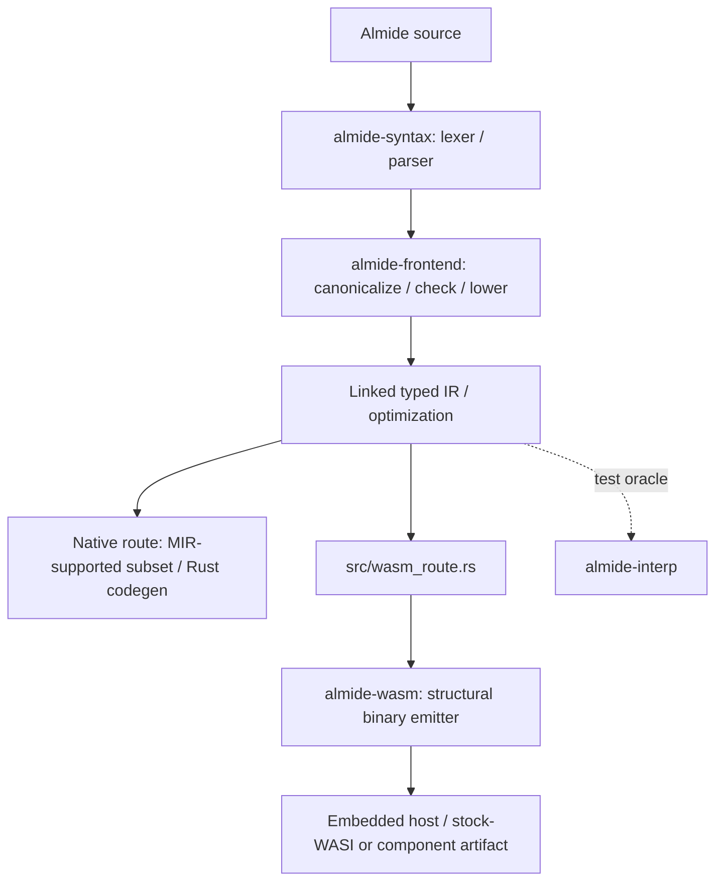

# Almide 工作区 crate

  

> 更新于 2026-10-31。这是一份导航图，而非完整的依赖关系图或规模／性能测量。[Cargo.toml](../Cargo.toml) 和各 crate 的清单才是工作区及依赖项的权威清单。

## 编译器路径

共用的 Wasm 路径只有一个 structural emitter。不接受的程序会明确报告不支持的边界，不会回退到已退役的 MIR/WAT 或 v0 Wasm 渲染器。原生路径有不同的边界。请参阅 [ARCHITECTURE](../docs/ARCHITECTURE.md)、[WASM-OUTPUT](../docs/wasm/WASM-OUTPUT.md) 和 [wasm_route.rs](../src/wasm_route.rs)，不要从图中推导普遍的正确性保证。

## 主要领域

| Crate／分组 | 职责 |
|---|---|
| `almide-base` | 符号、源码位置范围和诊断 |
| `almide-syntax` | AST、词法分析器和语法分析器 |
| `almide-types`, `almide-lang` | 类型表示、标准库元数据和兼容性重新导出 |
| `almide-ir` | 带类型的 IR、访问器、效应和注解 |
| `almide-frontend`, `almide-driver` | 检查／降级转换以及编译器流程协调 |
| `almide-optimize` | 共用 IR 转换和单态化 |
| `almide-codegen` | Rust nanopass／模板遍历器，以及有限的 `@gpu` WGSL 源码输出 |
| `almide-mir` | MIR 降级转换、所有权／证书机制及原生验证渲染器所支持的子集；不是交付用的 Wasm 渲染器 |
| `almide-wasm`, `almide-layout`, `almide-corpus` | structural Wasm 输出、布局及其语料集工具 |
| `almide-wasm-run`, `almide-wasi`, `almide-wasm-vm` | 嵌入式执行、WASI 适配和 Wasm 执行支持 |
| `almide-spine`, `almide-verify`, `almide-anchor-check` | 证书／检查组件；`almide-verify` 是独立的可执行程序 |
| `almide-interp` | 在代码生成前解释 IR，作为差分测试的参考判定器，并明确标记无法判定的情况 |
| `almide-egg-lab` | 代码生成使用的等式饱和规则及桥接；不再是一次性的独立 PoC |
| `almide-dialect` | MLIR 风格的 dialect 模式 |
| `almide-rt-core`, `almide-str`, `almide-gpu-run` | 运行时服务、共享字符串表示和 GPU 执行 |
| `almide-tools` | 格式化器、接口提取和 `.almdi` 序列化 |
| 根 `almide` | CLI／库入口、项目解析、依赖获取和构建路径选择 |

根目录的默认构建同时包含 `almide` 和 `almide-verify`。
`almide-kernel` 不属于这个 Cargo 工作区，而是拥有独立的工作区；`almide-perceus-belt` 包含 Lean 证明开发内容。构建之前请查阅各自的清单和本地说明。

## 生成的输入

不要恢复已退役的 `stdlib/defs/*.toml` 签名表。

- [`almide-types/build.rs`](almide-types/build.rs) 嵌入 `.almd` 标准库源码，保留 `///` 文档注释，并生成由声明驱动的元数据（包括自举实现注册信息）。
- [`almide-codegen/build.rs`](almide-codegen/build.rs) 从当前源码组装运行时源码及相关代码生成表。
- [`almide-frontend/build.rs`](almide-frontend/build.rs) 维护为打包构建而提交的 dialect 台账和正则表达式运行时副本。

其他 crate 也有构建脚本，以上三个链接并非完整列表。请遵循各生成器的源码和检查模式，不要手动编辑输出。当前标准库工作流程见 [stdlib/README.md](../stdlib/README.md)。

## 依赖与 API 变更

Cargo 可以并行构建实际依赖图中相互独立的分支；本页不承诺特定的重新编译次数或耗时。规划依赖变更时，请使用 `cargo tree` 和清单。
公开的兼容性重新导出定义在 [src/lib.rs](../src/lib.rs) 和 [almide-lang/src/lib.rs](almide-lang/src/lib.rs) 中；不要假定每个内部 crate 模块都会自动成为稳定的公开 API。
