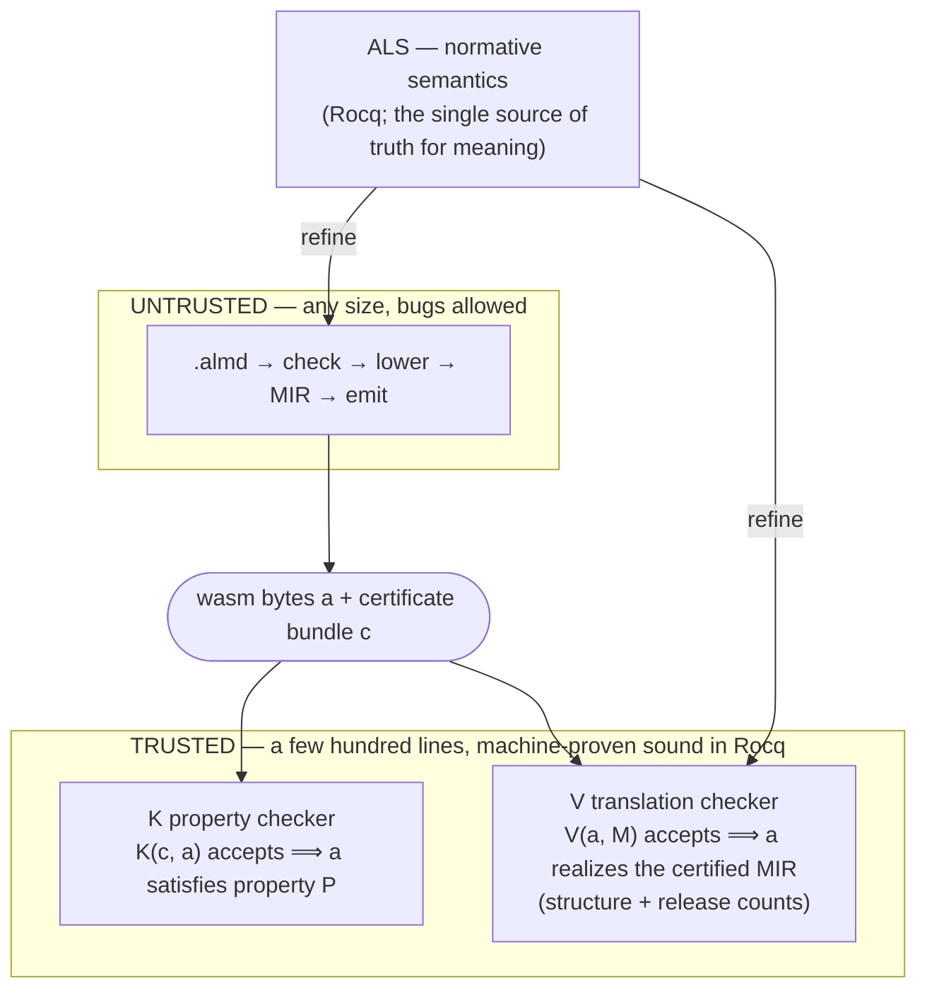

# v1: The Trust Spine — Proof-Carrying Compilation

> **Shipped — as the certificate spine; its wasm renderer is retired.** v1 replaced the v0 wasm emitter (#782, 2026-07-20) and was the only wasm compilation path until the commissioned **structural leg** became the default `--target wasm` route (#1599, v0.60.0). The structural leg is now the only wasm renderer, and it records its own certificate at emission time (#1696, closed): `proofs/structural-wall.sh` re-verifies it for every certified fixture, pinned to the shipped file's SHA-256, and `almide verify app.almd` checks supported core artifacts, not components (#4011) — the per-clause account is the gap table in [MEMORY-SAFETY.md](./design/MEMORY-SAFETY.md). Its runtime's bytes are grounded against `StructuralDecode.v` by `proofs/check-structural-bytes.sh`. The v1 wasm renderer that emitted and kernel-re-verified the MIR certificate below lost its last route in #2752 and was deleted in #2761; what remains of v1 is MIR lowering (serving the native leg), the native renderers, and the MIR witness producer `proofs/gate.sh` judges. The Coq theorems WasmEncode/WasmExec/WasmRcDec now stand about the retired renderer's modeled runtime. The structural certificate has shipped; recording trust and coverage limits remain. This page preserves the v1 design and distinguishes it from the current route.

The [Perceus proof](../crates/almide-perceus-belt/) proves one compiler pass, once. v1 extends that idea with certificate checking for specific modeled properties.
It does not prove the whole compiler pipeline or require every ordinary build
to run every verification gate.

The retired v0 compiler took the shortest path: `AST → IR → codegen`. It was fast, and correct *as far as the tests could tell*. v1 asks a harder question: **not "do the tests pass?" but "can a machine prove the output is correct?"**

## The idea

You don't make a compiler trustworthy by making it perfect — a correct 100k-line compiler is a proof obligation no one can discharge. Instead:

> **Don't prove the compiler. Prove a tiny checker — and have the compiler emit a certificate on every build that the checker re-verifies.**

This rests on an asymmetry the whole field stands on: **building is hard, checking is cheap.** Solving a sudoku is work; verifying a solved one is a glance. The compiler may contain bugs, but a checker can reject a witness that violates
its modeled property. A semantically wrong artifact can still satisfy that
property. Extending the result from a witness to shipped bytes depends on the
recording, binding, coverage, and checker-execution trust boundaries. The design
goal is:

> *If the checker accepts, the artifact has the property* — and this theorem never mentions the compiler's internals.

This reduces the proof obligation for the checked property; it does not erase
the remaining trusted producers, adapters, runtime behavior, or toolchain.
The extracted checker's regenerated size is recorded below. The full trust
ledger is [TRUSTED_BASE](../proofs/TRUSTED_BASE.md).

## Historical v1 pipeline design (proof-carrying code)

- **K (property checker)** — the extracted, kernel-proven checker — re-verifies the certificate (on every build while the incumbent wasm leg shipped; today over MIR in `proofs/gate.sh`, while `almide verify` judges the structural leg's own certificate, #4011): RC balance (not complete memory safety), name totality, and the capability upper bound. (Stack balance and termination are *proven in the Rocq spine* but not yet extracted into K or witnessed per build — [`Extract.v`](../proofs/Extract.v) is the extraction boundary.)
- **V (translation checker)** *(retired with the incumbent wasm renderer by #2761; described as it ran)* checked — *on every build* — that the emitted wasm **realizes** the certified MIR: every op's required instruction pattern is present in the emitted module, and the release count matches the certificate's drops (leak-freedom — an under-freeing renderer fails; see `translation_validation.rs`'s own contract). It is a structural realization check, **not** a semantic refinement proof: the answer to *"does the running thing match the model?"* is V's structure check **plus** the differential evidence below.
- **ALS** (Almide Language Specification) names the normative semantics. What exists in Rocq today is the RC-discipline model ([`proofs/ALS.v`](../proofs/ALS.v)) — there is no mechanized evaluation relation for Almide source yet, and no theorem of the shape `⟦s⟧ ≈ ⟦compile(s)⟧`. **Byte-for-byte agreement between targets is established empirically**, and heavily: the [contract ledger](contracts/README.md)'s cross-target fixture gate, `proofs/output-parity.sh`, the nightly differential fuzz, and the 3-way `almide-interp` oracle. The design *aims* the pipeline at a single semantics; the agreement itself is measured, not derived.

The **trusted base includes** the Rocq kernel, checker extraction and execution,
recording/binding assumptions, relevant runtime/toolchain components, hardware,
and the adequacy of the model. Verified extraction (CertiRocq) is future work,
not a present fact. See [`proofs/TRUSTED_BASE.md`](../proofs/TRUSTED_BASE.md)
for the explicit ledger and the generated checker-size count below. The stage-by-stage boundary — which rows are proven, which are trusted, and what every gate does and does not claim — is **[proven-vs-trusted.md](contracts/proven-vs-trusted.md)**.

<!-- tcb:generated:start — derived by scripts/gen-claims.sh; DO NOT EDIT between the markers -->
> **Measured, regenerated:** extracted checker `proofs/checker.ml` = **1835 lines** (+ 430
> `.mli`); Rocq spine = **447 theorems+lemmas** (axiom-clean, asserted by `proofs/check.sh`);
> Lean Perceus belt = **41 theorems**, 0 sorry (CI-gated).
<!-- tcb:generated:end -->

## Receipts — verify it yourself

The receipt vocabulary names different evidence claims, not interchangeable
proofs of whole-program correctness:

| Receipt | Claim |
|---|---|
| **C-SAFE** | Checked safety/capability witness properties within coverage and recording assumptions; not all undefined behavior excluded |
| **C-REPRO** | Reproducibility evidence under the recorded source, toolchain and environment assumptions |
| **C-FAITHFUL** | Behavioral agreement evidence; not a mechanized source-to-object refinement theorem |
| **C-PROVEN** | Kernel-checked theorems about their models; not every theorem is extracted or witnessed per build |

Run `make verify-trust` **on your own machine** and you re-derive the proof spine (kernel + `coqchk` + the asserted axiom audit), the PCC gate (the extracted checker re-verifying real witnesses), and the corpus wall. The remaining receipts (cross-target parity, the differential fuzz, the contract gate) have their own commands, listed per claim in [`proofs/TRUSTED_BASE.md`](../proofs/TRUSTED_BASE.md). CI is a courtesy pre-run, deliberately *outside* the trusted base — you never have to trust our infrastructure to trust the artifact.

## Why it's slower — on purpose

The verification commands and CI gates run more work than ordinary compilation: the property checker (the *corpus-wall*) re-verifies ownership / name / capability certificates for every function; the 3-way oracle (native / wasm / `almide-interp`) and the `spec/wasm_cross` fixture gate hold observable behavior byte-identical across targets; and where needed the Rocq kernel plus an independent `coqchk` re-check confirm the proofs introduce no stray axioms (`Print Assumptions ⊆ standard`). A single change can trigger minutes of checking.

That work provides complementary evidence: kernel-checked model properties,
artifact-bound witness checks where supported, and differential observations.
None should be described as proving all behavior of every shipped artifact.

## Where it stands

The v1 route carried the then-current byte-gate corpus before v0 was deleted
(#782); its Wasm renderer has since been retired. The current structural route
and its certificate coverage are described above. Performance comparisons are
workload- and measurement-specific, not a consequence of accepting a
certificate; see the dated results in [project/BENCHMARKS.md](project/BENCHMARKS.md)
and [wasm/WASM-OUTPUT.md](wasm/WASM-OUTPUT.md). Remaining hardening work is tracked in [`roadmap/active/v1-proof-architecture.md`](./roadmap/active/v1-proof-architecture.md) and [`v1-system-map.md`](./roadmap/active/v1-system-map.md).
