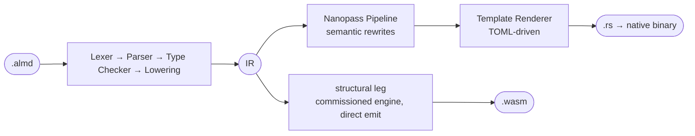

# 仕組み

[English](./how-it-works.md) | [日本語](./how-it-works.ja.md) | [简体中文](./how-it-works.zh-CN.md)

コンパイラの処理の流れを1ページにまとめています。モジュール構成と各パスの詳細は [ARCHITECTURE.md](./ARCHITECTURE.md) を参照してください。

共通のフロントエンドとリンク済みの IR が、主な2つの出力経路に入力されます（簡略図）。



**ネイティブ。** Nanopass パイプラインは、`ResultPropagation`（Rust の `?`）、`CloneInsertion`（Rust の借用解析）、`LICM`（ループ不変式の移動）など、ターゲット固有の変換を適用します。Template Renderer が扱うのは構文だけであり、意味に関する判断はすべて IR に織り込み済みです。ネイティブの trust-spine レンダラーは、プログラムを低水準表現へ変換できる場合、この生成 Rust を置き換えます。未対応の境界（wall）に達した場合は、標準のコード生成出力にフォールバックします。この分岐は[アーキテクチャの構成図](./ARCHITECTURE.md#targets)に示しています。

**WebAssembly。** **structural leg** は唯一の wasm レンダラーです。[#1599](https://github.com/almide/almide/pull/1599) で採用されたエンジンで、`almide::wasm_leg` フロントと `crates/almide-wasm` エミッターからなり、`src/cli/build.rs` の `render_wasm_module_routed` を入口とします。`wasm_cross` コーパスで 610/610 件がネイティブとバイト単位で一致した状態で受け入れられ、ビルド成果物は一般的なランタイムで実行できる WASI 形式（[#1588](https://github.com/almide/almide/issues/1588)）で配布されます。変換できないプログラムは明確なエラー（未対応の境界と関数を示す `error[E082]`）となり、フォールバックはしません。かつてそのような構造を引き受けていた旧 v1 経路は、#2752 で最後の経路を失い、#2761 で削除されました。`ALMIDE_VERIFIED_DEBUG=1` を指定すると、通った経路が表示されます。

```bash
almide run app.almd                  # Compile + execute (native)
almide build app.almd --target wasm  # Build WebAssembly (WASI)
almide test                          # Find and run all test blocks (recursive)
almide check app.almd                # Type check only
almide check app.almd --target wasm  # + the wasm build route: E081/E082 at check time (#1922)
almide fmt app.almd                  # Format source code
```

コマンドの全一覧（compile、add、deps、clean など）は `almide --help` で確認できます。パイプラインとモジュール構成は [docs/ARCHITECTURE.md](./ARCHITECTURE.md)、wasm 経路の詳細は [docs/wasm/](./wasm/README.md) を参照してください。

<a id="whats-next--v1-the-trust-spine"></a>

## 検証とその限界

証明書を中心とする検証基盤はすでに提供されており、将来テストに取って代わるものではありません。
structural wasm エミッターは、所有権、境界、名前、ケイパビリティの検証用証拠（witness）を記録します。
`almide verify` は同じビルド経路でバンドルを生成し、独立した `almide-verify` バイナリに検査を委ねます。
ビルド済み成果物を指定した場合、または既定のパスに成果物が見つかった場合、バンドルは SHA-256 でそのファイルに結び付けられます。
廃止された MIR→WAT レンダラーが、配布されるその wasm バイト列を生成しているわけではありません。
実装と回帰テストは [`src/cli/verify.rs`](../src/cli/verify.rs) と [`tests/verify_shim_test.rs`](../tests/verify_shim_test.rs) にあります。

受理された証明書は、明示された検査器と記録処理の前提の下で、witness が対象とする性質の証拠になります。
**プログラムが意図した答えを計算することの証明でも、成果物全体のメモリ安全性の保証でもありません。**
対象範囲の不足と、信頼を置く必要のある構成要素は残ります。クロスターゲットテスト、ミューテーションテスト、参照インタープリターは補完的な証拠を提供します。
現在の境界は[証明済みの事項と信頼に依存する事項](./contracts/proven-vs-trusted.md)および[メモリ安全性の不足事項一覧](./design/MEMORY-SAFETY.md#the-gap-table-2026-10-24-4011)、アーキテクチャと検証記録（receipts）は [TRUST-SPINE.md](./TRUST-SPINE.md) を参照してください。
