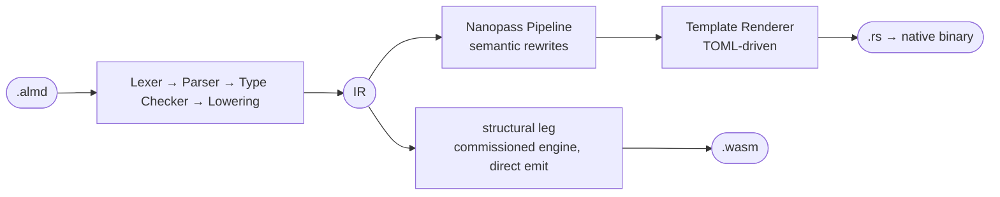

# How It Works

The compiler pipeline in one page. The module map and every pass in detail: [ARCHITECTURE.md](./ARCHITECTURE.md).

A shared frontend and linked IR feed the two main output routes (simplified):



**Native.** The Nanopass pipeline applies target-specific transformations — `ResultPropagation` (Rust `?`), `CloneInsertion` (Rust borrow analysis), `LICM` (loop-invariant code motion). The Template Renderer is purely syntactic: every semantic decision is already encoded in the IR. The native trust-spine renderer replaces this generated Rust where it can lower the program; the standard codegen output is its fallback on a wall. The [architecture map](./ARCHITECTURE.md#targets) shows that split.

**WebAssembly.** The **structural leg** — the engine commissioned in [#1599](https://github.com/almide/almide/pull/1599), `almide::wasm_leg` front + `crates/almide-wasm` emitter, entered through `render_wasm_module_routed` in `src/cli/build.rs` — is the only wasm renderer. It was accepted at 610/610 byte-identical to native on the `wasm_cross` corpus, and its build artifacts ship in the WASI form ([#1588](https://github.com/almide/almide/issues/1588)) so they run on stock runtimes. A program it does not lower is an honest error (`error[E082]`, naming the wall and the function), never a fallback: the incumbent v1 leg that once took those shapes lost its last route in #2752 and was deleted in #2761. `ALMIDE_VERIFIED_DEBUG=1` narrates the route.

```bash
almide run app.almd                  # Compile + execute (native)
almide build app.almd --target wasm  # Build WebAssembly (WASI)
almide test                          # Find and run all test blocks (recursive)
almide check app.almd                # Type check only
almide check app.almd --target wasm  # + the wasm build route: E081/E082 at check time (#1922)
almide fmt app.almd                  # Format source code
```

Run `almide --help` for the full command list (compile, add, deps, clean, …). Pipeline and module map: [docs/ARCHITECTURE.md](./ARCHITECTURE.md); the wasm leg in detail: [docs/wasm/](./wasm/README.md).

<a id="whats-next--v1-the-trust-spine"></a>

## Verification and its limits

The certificate spine is shipped, not a future replacement for testing.
The structural wasm emitter records ownership, bounds, name and capability
witnesses. `almide verify` produces a bundle through that same build route
and delegates checking to the independent `almide-verify` binary; when a
built artifact is supplied or found at the default path, the bundle is bound
to that file by SHA-256. The retired MIR→WAT renderer is not the producer of
those shipped wasm bytes. The implementation and regression tests are
[`src/cli/verify.rs`](../src/cli/verify.rs) and
[`tests/verify_shim_test.rs`](../tests/verify_shim_test.rs).

An accepted certificate is evidence for the properties its witnesses cover,
under the stated checker and recording assumptions — **not a proof that the
program computes the intended answer, nor a whole-artifact memory-safety
guarantee**. Coverage gaps and trusted components remain; cross-target tests,
mutation tests and the reference interpreter provide complementary evidence.
See [proven vs trusted](./contracts/proven-vs-trusted.md) and the
[memory-safety gap table](./design/MEMORY-SAFETY.md#the-gap-table-2026-10-24-4011)
for the current boundary, and [TRUST-SPINE.md](./TRUST-SPINE.md) for the
architecture and receipts.
