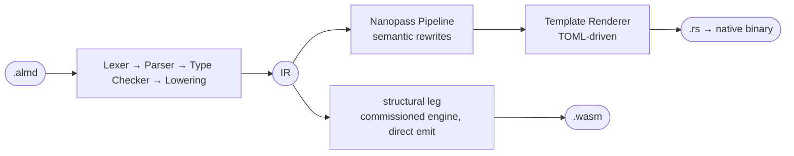

# 工作原理

[](./how-it-works.md) [](./how-it-works.ja.md) [](./how-it-works.zh-CN.md)

用一页介绍编译器流水线。模块结构和各个处理阶段的详细说明见 [ARCHITECTURE.md](./ARCHITECTURE.md)。

共用的前端和链接后的 IR 为两条主要输出路径提供输入（简化图）：



**原生。** Nanopass 流水线执行针对目标的转换，包括 `ResultPropagation`（Rust 的 `?`）、`CloneInsertion`（Rust 借用分析）和 `LICM`（循环不变量外提）。Template Renderer 只处理语法：所有语义决策都已编码在 IR 中。原生 trust-spine 渲染器在能够对程序进行降级转换时，会替换这段生成的 Rust；遇到不支持的边界（wall）时，则回退到标准代码生成输出。[架构图](./ARCHITECTURE.md#targets)展示了这一分支。

**WebAssembly。** **structural leg** 是唯一的 wasm 渲染器。它是在 [#1599](https://github.com/almide/almide/pull/1599) 中启用的引擎，由 `almide::wasm_leg` 前端和 `crates/almide-wasm` 发射器组成，入口是 `src/cli/build.rs` 中的 `render_wasm_module_routed`。它在 `wasm_cross` 语料集上以 610/610 项与原生输出逐字节一致的结果通过验收，其构建产物以 WASI 形式（[#1588](https://github.com/almide/almide/issues/1588)）发布，因此可以在标准运行时上运行。无法转换的程序会明确报错（`error[E082]`，指出不支持的边界和函数），绝不回退：此前承接这些结构的旧 v1 路径在 #2752 中失去了最后一个入口，并在 #2761 中被删除。`ALMIDE_VERIFIED_DEBUG=1` 会显示所经过的路径。

```bash
almide run app.almd                  # Compile + execute (native)
almide build app.almd --target wasm  # Build WebAssembly (WASI)
almide test                          # Find and run all test blocks (recursive)
almide check app.almd                # Type check only
almide check app.almd --target wasm  # + the wasm build route: E081/E082 at check time (#1922)
almide fmt app.almd                  # Format source code
```

运行 `almide --help` 可查看完整的命令列表（compile、add、deps、clean 等）。流水线和模块结构见 [docs/ARCHITECTURE.md](./ARCHITECTURE.md)；wasm 路径的详细说明见 [docs/wasm/](./wasm/README.md)。

<a id="whats-next--v1-the-trust-spine"></a>

## 验证及其局限

以证书为核心的验证体系已经交付，并非未来用于替代测试的方案。
structural wasm 发射器会记录所有权、边界、名称和能力的验证证据（witness）。
`almide verify` 通过同一条构建路径生成一个包，并将检查交给独立的 `almide-verify` 二进制程序。
如果指定了已构建产物，或在默认路径下找到了产物，该包会通过 SHA-256 绑定到该文件。
已退役的 MIR→WAT 渲染器并不生成这些交付的 wasm 字节。
实现和回归测试分别位于 [`src/cli/verify.rs`](../src/cli/verify.rs) 和 [`tests/verify_shim_test.rs`](../tests/verify_shim_test.rs)。

通过检查的证书，是在已说明的检查器与记录过程假设下，对其 witness 所覆盖性质的证据；
**它既不证明程序会计算出预期答案，也不保证整个产物的内存安全。**
覆盖缺口和需要信任的组件仍然存在；跨目标测试、变异测试和参考解释器提供补充证据。
当前边界见[已证明与依赖信任的部分](./contracts/proven-vs-trusted.md)和[内存安全缺口表](./design/MEMORY-SAFETY.md#the-gap-table-2026-10-24-4011)；架构及验证记录（receipts）见 [TRUST-SPINE.md](./TRUST-SPINE.md)。
