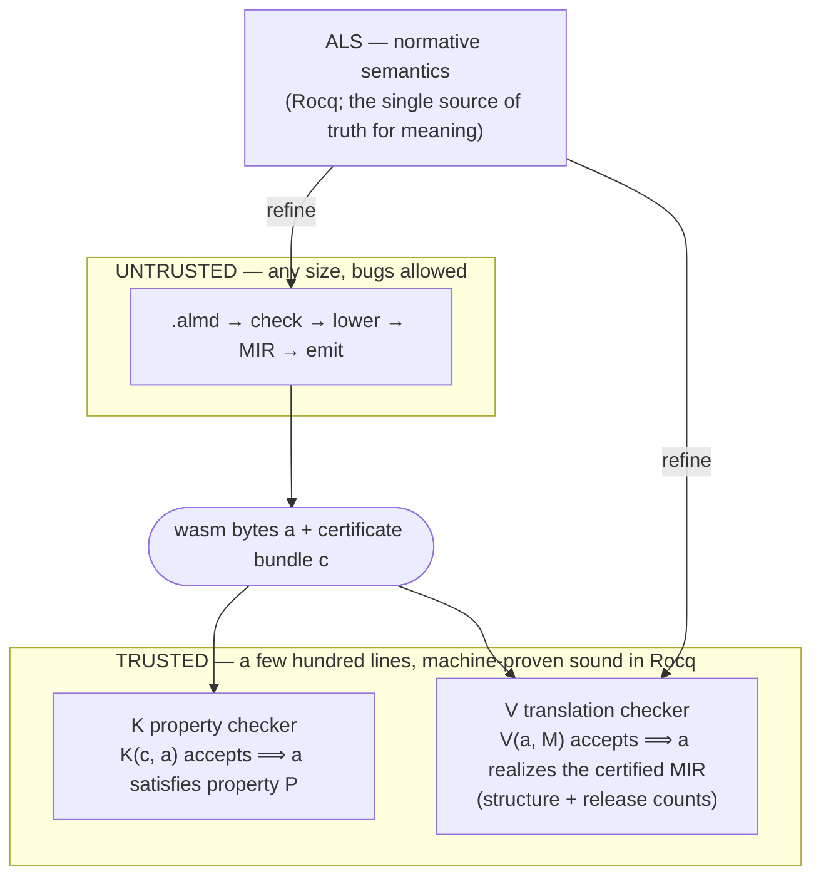

# v1：Trust Spine — 証明を伴うコンパイル

  

> 非規範的な履歴参照資料。固定原文を正本とし、自動同期しない。測定・証明 gate・現行実装の検査を独立に再実行していない。引用コマンドは実行しない。 [Source](https://github.com/almide/almide/blob/35297a612fb29e3f78f6587aba253aa91d51f466/docs/TRUST-SPINE.md)
> 図は過去の設計であり、現行の端から端までの定理ではない。下の生成 count marker は reader tree 内の不活性コピーであり、生成入力でも同期済み count でもない。モデルの性質はコンパイラ全体の正しさや全 artifact のメモリ安全性を確立しない。

> **証明書の基幹として出荷済み。ただし wasm renderer は廃止済み。** v1 は v0 wasm emitter を置き換え（#782、2026-07-20）、commissioned **structural leg** が既定 `--target wasm` 経路になるまで唯一の wasm コンパイル経路だった（#1599、v0.60.0）。現在は structural leg が唯一の wasm renderer であり、出力時に独自証明書を記録する（#1696、closed）。`proofs/structural-wall.sh` は各 certified fixture について、出荷ファイルの SHA-256 に固定して再検証し、`almide verify app.almd` は対応する core artifact を検査するが component は検査しない（#4011）。条項ごとの説明は [MEMORY-SAFETY.md](https://github.com/almide/almide/blob/35297a612fb29e3f78f6587aba253aa91d51f466/docs/design/MEMORY-SAFETY.md) の gap table にある。その runtime の bytes は `proofs/check-structural-bytes.sh` により `StructuralDecode.v` と照合される。下記 MIR 証明書を出力し kernel で再検証していた v1 wasm renderer は #2752 で最後の経路を失い、#2761 で削除された。v1 に残るのは、native leg に使う MIR lowering、native renderer、`proofs/gate.sh` が判定する MIR witness producer である。Coq 定理 WasmEncode/WasmExec/WasmRcDec は、現在では廃止 renderer のモデル化された runtime についての定理である。structural certificate は出荷済みだが、記録の信頼と coverage の制限は残る。本ページは v1 設計を保存し、現行経路と区別する。

[Perceus proof](https://github.com/almide/almide/blob/35297a612fb29e3f78f6587aba253aa91d51f466/crates/almide-perceus-belt) は、1 つのコンパイラパスを一度証明する。v1 はこの考えを、特定のモデル化された性質の証明書検査へ拡張する。コンパイラの pipeline 全体を証明するものでも、通常の全 build に全検証 gate の実行を要求するものでもない。

廃止済みの v0 コンパイラは最短経路 `AST → IR → codegen` を取った。高速で、*テストで分かる限り*正しかった。v1 はより難しい問いを立てる。**「テストに合格するか」ではなく、「出力の正しさを機械が証明できるか」。**

## 考え方

コンパイラを完璧にすることで信頼可能にするのではない。10 万行のコンパイラの正しさは、誰にも果たせない証明責務である。代わりに：

> **コンパイラを証明しない。小さな checker を証明し、コンパイラが毎 build 証明書を出力して checker が再検証する。**

これは分野全体が立脚する非対称性、**構築は難しく、検査は安い**という考えによる。数独を解くのは仕事だが、解の検査は一見で済む。コンパイラに bug があっても checker はモデル化した性質に違反する witness を拒否できる。意味的に誤った artifact でも、その性質を満たす可能性はある。witness に関する結果を出荷 bytes に拡張できるかは、記録、結合、coverage、checker 実行の信頼境界に依存する。設計目標は：

> *checker が受理すれば artifact はその性質を持つ*。この定理はコンパイラ内部に一切言及しない。

これは検査対象の性質に対する証明責務を減らすが、残る trusted producer、adapter、runtime 挙動、toolchain を消すものではない。抽出 checker の再生成サイズを下に記録する。完全な信頼台帳は [TRUSTED_BASE](https://github.com/almide/almide/blob/35297a612fb29e3f78f6587aba253aa91d51f466/proofs/TRUSTED_BASE.md) にある。

## 過去の v1 pipeline 設計（proof-carrying code）

- **K（property checker）** — 抽出され kernel で証明された checker — は証明書を再検証する（incumbent wasm leg が出荷されていた間は毎 build。現在は `proofs/gate.sh` で MIR を扱い、`almide verify` は structural leg 独自の証明書を判定する、#4011）。対象は RC balance（完全なメモリ安全性ではない）、name totality、capability 上限。（stack balance と停止性は *Rocq spine で証明済み*だが、まだ K に抽出されず build ごとの witness もない。[`Extract.v`](https://github.com/almide/almide/blob/35297a612fb29e3f78f6587aba253aa91d51f466/proofs/Extract.v) が抽出境界である。）
- **V（translation checker）** *（#2761 で incumbent wasm renderer とともに廃止。稼働当時の説明）* は、出力 wasm が certified MIR を**実現する**ことを *毎 build* 検査した。各 op が要求する命令パターンが出力 module に存在し、release count が証明書の drop に一致することを確認する（leak-freedom。解放不足の renderer は失敗する。`translation_validation.rs` 自身の契約参照）。これは構造的な実現検査であり、意味論的 refinement proof **ではない**。「実行されるものがモデルに一致するか」への答えは、V の構造検査**に加えて**下記の differential evidence による。
- **ALS**（Almide Language Specification）は規範的な意味論を指す。現在 Rocq に存在するのは RC-discipline model（[`proofs/ALS.v`](https://github.com/almide/almide/blob/35297a612fb29e3f78f6587aba253aa91d51f466/proofs/ALS.v)）である。Almide ソースの機械化された評価関係はまだなく、`⟦s⟧ ≈ ⟦compile(s)⟧` 形の定理もない。**target 間の byte-for-byte 一致は実験的に**、かつ手厚く確立する。[contract ledger](https://github.com/almide/almide/blob/35297a612fb29e3f78f6587aba253aa91d51f466/docs/contracts/README.md) の cross-target fixture gate、`proofs/output-parity.sh`、nightly differential fuzz、3-way `almide-interp` oracle による。設計は pipeline を単一意味論へ*向ける*が、一致自体は導出ではなく測定される。

**信頼基盤に含むもの**は Rocq kernel、checker の抽出と実行、記録／結合の仮定、関連 runtime/toolchain component、hardware、モデルの適切さである。検証済み抽出（CertiRocq）は将来の作業であり現在の事実ではない。明示的な台帳は [`proofs/TRUSTED_BASE.md`](https://github.com/almide/almide/blob/35297a612fb29e3f78f6587aba253aa91d51f466/proofs/TRUSTED_BASE.md)、生成された checker サイズは下記を参照。段階ごとの境界、どの行が証明済みでどれが信頼対象か、各 gate が主張すること／しないことは **[proven-vs-trusted.md](https://github.com/almide/almide/blob/35297a612fb29e3f78f6587aba253aa91d51f466/docs/contracts/proven-vs-trusted.md)** にある。

<!-- tcb:generated:start — derived by scripts/gen-claims.sh; DO NOT EDIT between the markers -->
> **測定・再生成済み：** 抽出 checker `proofs/checker.ml` = **2127 行**（+ 498 `.mli`）。Rocq spine = **477 定理＋補題**（axiom-clean、`proofs/check.sh` が assert）。Lean Perceus belt = **41 定理**、sorry 0（CI gate 対象）。
<!-- tcb:generated:end -->

## Receipt — 自分で検証する

receipt の語彙は異なる証拠の主張を指し、program 全体の正しさの証明として互換ではない。

| Receipt | 主張 |
|---|---|
| **C-SAFE** | coverage と記録の仮定内で検査した safety/capability witness の性質。すべての未定義動作を排除するものではない |
| **C-REPRO** | 記録された source、toolchain、environment の仮定の下での再現性の証拠 |
| **C-FAITHFUL** | 挙動一致の証拠。機械化された source-to-object refinement 定理ではない |
| **C-PROVEN** | モデルに関する kernel 検査済み定理。全定理が抽出済み、または build ごとに witness を持つわけではない |

**自身の機械で** `make verify-trust` を実行すると、proof spine（kernel + `coqchk` + assert される axiom audit）、PCC gate（抽出 checker が実際の witness を再検証）、corpus wall を再導出する。残る receipt（cross-target parity、differential fuzz、contract gate）にはそれぞれコマンドがあり、[`proofs/TRUSTED_BASE.md`](https://github.com/almide/almide/blob/35297a612fb29e3f78f6587aba253aa91d51f466/proofs/TRUSTED_BASE.md) に主張ごとに列挙する。CI は便宜上の事前実行であり、意図的に信頼基盤の**外**に置く。artifact を信頼するために、私たちの infrastructure を信頼する必要はない。

## 意図的に遅くなる理由

検証コマンドと CI gate は通常のコンパイルより多くの作業を行う。property checker（*corpus-wall*）は全関数の ownership/name/capability 証明書を再検証し、3-way oracle（native / wasm / `almide-interp`）と `spec/wasm_cross` fixture gate は target 間の観測可能な挙動を byte-identical に保つ。必要な箇所では、Rocq kernel と独立した `coqchk` 再検査により、証明に余分な axiom が入らないこと（`Print Assumptions ⊆ standard`）を確認する。1 つの変更が数分の検査を引き起こし得る。

その作業は相補的な証拠を提供する。kernel で検査したモデルの性質、対応範囲での artifact に結合された witness 検査、differential observation である。どれも、出荷する全 artifact の全挙動を証明すると説明してはならない。

## 現在の位置づけ

v1 経路は、v0 削除（#782）前に当時の byte-gate corpus を担っていたが、その Wasm renderer はその後廃止された。現行 structural 経路と証明書 coverage は上述のとおり。性能比較は workload と測定に依存し、証明書受理の帰結ではない。[project/BENCHMARKS.md](https://github.com/almide/almide/blob/35297a612fb29e3f78f6587aba253aa91d51f466/docs/project/BENCHMARKS.md) と [wasm/WASM-OUTPUT.md](https://github.com/almide/almide/blob/35297a612fb29e3f78f6587aba253aa91d51f466/docs/wasm/WASM-OUTPUT.md) の日付付き結果参照。残る強化作業は [`roadmap/active/v1-proof-architecture.md`](https://github.com/almide/almide/blob/35297a612fb29e3f78f6587aba253aa91d51f466/docs/roadmap/active/v1-proof-architecture.md) と [`v1-system-map.md`](https://github.com/almide/almide/blob/35297a612fb29e3f78f6587aba253aa91d51f466/docs/roadmap/active/v1-system-map.md) で追跡する。

> 図内表記の訳（図コードは原文保持）：ALS は規範意味論で、Rocq による意味の唯一の正本。UNTRUSTED はサイズ不問で bug を許す領域。TRUSTED は Rocq で機械的に健全性を証明した数百行という設計上の領域。K は property checker（K(c, a) が受理 ⇒ a は性質 P を満たす）、V は translation checker（V(a, M) が受理 ⇒ a は certified MIR を構造と release count の点で実現）。refine は詳細化を表す。この図の小さな trusted 領域だけが現在の信頼基盤全体だとは解釈しない。
