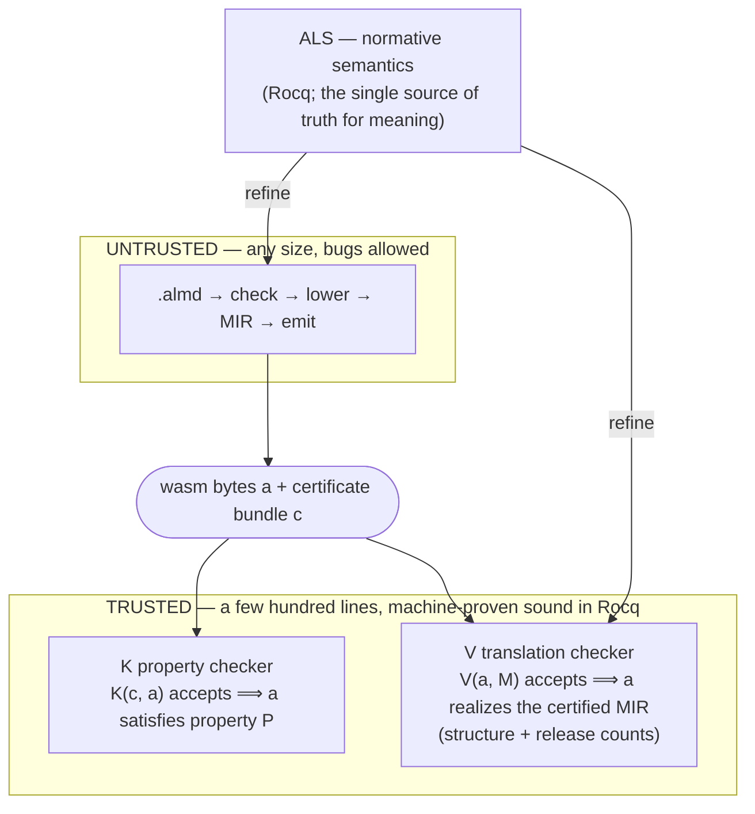

# v1：Trust Spine — 携带证明的编译

  

> 非规范性历史阅读快照。以固定原文为准，不自动同步。未独立重跑测量、证明 gate 或当前实现检查。未执行引用命令。 [Source](https://github.com/almide/almide/blob/35297a612fb29e3f78f6587aba253aa91d51f466/docs/TRUST-SPINE.md)
> 图是历史设计，不是当前端到端定理。下方生成 count marker 是 reader tree 内不活性副本，不是生成器输入或同步数量。模型性质不确立整个编译器正确性或所有 artifact 的内存安全。

> **已作为证书主干交付；其 wasm renderer 已退役。** v1 替换了 v0 wasm emitter（#782，2026-07-20），在 commissioned **structural leg** 成为默认 `--target wasm` 路线之前是唯一 wasm 编译路径（#1599，v0.60.0）。structural leg 现为唯一 wasm renderer，并在生成时记录自己的证书（#1696，closed）：`proofs/structural-wall.sh` 对每个 certified fixture 重新验证，固定到交付文件的 SHA-256；`almide verify app.almd` 检查受支持的 core artifact，而非 component（#4011）。逐条说明见 [MEMORY-SAFETY.md](https://github.com/almide/almide/blob/35297a612fb29e3f78f6587aba253aa91d51f466/docs/design/MEMORY-SAFETY.md) 的 gap table。其 runtime 字节由 `proofs/check-structural-bytes.sh` 对照 `StructuralDecode.v` 落实。曾生成并由 kernel 重新验证下述 MIR 证书的 v1 wasm renderer，在 #2752 失去最后路径，于 #2761 删除；v1 剩余部分是服务 native leg 的 MIR lowering、native renderer，以及 `proofs/gate.sh` 判定的 MIR witness producer。Coq 定理 WasmEncode/WasmExec/WasmRcDec 现针对退役 renderer 的模型化 runtime。structural certificate 已交付，但记录信任与覆盖限制仍在。此页保存 v1 设计，并与当前路线区分。

[Perceus proof](https://github.com/almide/almide/blob/35297a612fb29e3f78f6587aba253aa91d51f466/crates/almide-perceus-belt) 对一个编译器 pass 证明一次。v1 将这一想法扩展为针对特定模型化性质的证书检查。它不证明整个编译器流水线，也不要求每次普通 build 都运行每项验证 gate。

退役 v0 编译器走最短路径：`AST → IR → codegen`。它很快，并且*在测试能够判断的范围内*正确。v1 提出更难的问题：**不是“测试通过吗”，而是“机器能证明输出正确吗”？**

## 思路

不是把编译器做得完美就能使它可信——正确的 100k 行编译器是无人能完成的证明义务。相反：

> **不要证明编译器。证明一个小 checker，让编译器在每次 build 生成证书，由 checker 重新验证。**

这依赖整个领域立足的不对称性：**构建困难，检查便宜。** 解数独需要工作，检查已解数独只需一看。编译器可能有 bug，但 checker 能拒绝违反其模型化性质的 witness。语义错误的 artifact 仍可能满足该性质。把 witness 的结论延伸到交付字节，依赖记录、绑定、覆盖和 checker 执行的信任边界。设计目标是：

> *如果 checker 接受，artifact 就具有该性质*——此定理完全不提编译器内部。

这减少所检查性质的证明义务，但不消除剩余可信 producer、adapter、runtime 行为或 toolchain。抽取 checker 的再生成大小记录在下方。完整信任台账见 [TRUSTED_BASE](https://github.com/almide/almide/blob/35297a612fb29e3f78f6587aba253aa91d51f466/proofs/TRUSTED_BASE.md)。

## 历史 v1 流水线设计（proof-carrying code）

- **K（property checker）**——抽取并经 kernel 证明的 checker——重新验证证书（incumbent wasm leg 交付期间每次 build 执行；如今在 `proofs/gate.sh` 中针对 MIR，`almide verify` 则判定 structural leg 自己的证书，#4011）：RC balance（并非完整内存安全）、name totality 和 capability 上界。（stack balance 与终止性在 *Rocq spine 中已证明*，但尚未抽取进 K，也未为每次 build 提供 witness；[`Extract.v`](https://github.com/almide/almide/blob/35297a612fb29e3f78f6587aba253aa91d51f466/proofs/Extract.v) 是抽取边界。）
- **V（translation checker）** *（随 incumbent wasm renderer 在 #2761 退役；此处描述当时运行方式）* 在*每次 build* 检查生成 wasm **实现了** certified MIR：每个 op 所需指令模式存在于生成模块，release count 匹配证书 drop（leak-freedom——释放不足的 renderer 会失败；见 `translation_validation.rs` 自身契约）。它是结构实现检查，**不是**语义 refinement proof；“运行对象是否匹配模型”的答案，是 V 的结构检查**加上**下方差分证据。
- **ALS**（Almide Language Specification）指规范语义。如今 Rocq 中存在的是 RC-discipline model（[`proofs/ALS.v`](https://github.com/almide/almide/blob/35297a612fb29e3f78f6587aba253aa91d51f466/proofs/ALS.v)）；还没有 Almide 源码的机械化求值关系，也没有形如 `⟦s⟧ ≈ ⟦compile(s)⟧` 的定理。**target 间逐字节一致通过经验验证建立**，且验证很多：[contract ledger](https://github.com/almide/almide/blob/35297a612fb29e3f78f6587aba253aa91d51f466/docs/contracts/README.md) 的 cross-target fixture gate、`proofs/output-parity.sh`、nightly differential fuzz，以及三方 `almide-interp` oracle。设计*旨在*让流水线指向单一语义；一致性本身是测得而非推导出的。

**可信基包括** Rocq kernel、checker 抽取与执行、记录／绑定假设、相关 runtime/toolchain component、硬件及模型的充分性。验证过的抽取（CertiRocq）是未来工作，不是当前事实。明确台账见 [`proofs/TRUSTED_BASE.md`](https://github.com/almide/almide/blob/35297a612fb29e3f78f6587aba253aa91d51f466/proofs/TRUSTED_BASE.md)，生成的 checker 大小见下方。逐阶段边界——哪些行已证明、哪些受信任、每个 gate 声称与不声称什么——见 **[proven-vs-trusted.md](https://github.com/almide/almide/blob/35297a612fb29e3f78f6587aba253aa91d51f466/docs/contracts/proven-vs-trusted.md)**。

<!-- tcb:generated:start — derived by scripts/gen-claims.sh; DO NOT EDIT between the markers -->
> **已测量、再生成：** 抽取 checker `proofs/checker.ml` = **2127 行**（+ 498 `.mli`）；Rocq spine = **477 定理＋引理**（axiom-clean，由 `proofs/check.sh` 断言）；Lean Perceus belt = **41 定理**，0 sorry（受 CI 门禁约束）。
<!-- tcb:generated:end -->

## Receipt — 自行验证

receipt 词汇指不同的证据主张，不是可互换的整程序正确性证明：

| Receipt | 主张 |
|---|---|
| **C-SAFE** | 在覆盖和记录假设内检查的 safety/capability witness 性质；未排除所有未定义行为 |
| **C-REPRO** | 在所记录 source、toolchain 和 environment 假设下的可复现性证据 |
| **C-FAITHFUL** | 行为一致证据；不是机械化 source-to-object refinement 定理 |
| **C-PROVEN** | 针对模型的 kernel 检查定理；并非每条定理均已抽取或每次 build 有 witness |

在**自己的机器上**运行 `make verify-trust`，即可重新推导 proof spine（kernel + `coqchk` + 所断言的 axiom audit）、PCC gate（抽取 checker 重新验证真实 witness）及 corpus wall。其余 receipt（cross-target parity、differential fuzz、contract gate）各有命令，按主张列在 [`proofs/TRUSTED_BASE.md`](https://github.com/almide/almide/blob/35297a612fb29e3f78f6587aba253aa91d51f466/proofs/TRUSTED_BASE.md)。CI 是便利用的预运行，刻意置于可信基**之外**——信任 artifact 不需要信任我们的基础设施。

## 为什么刻意更慢

验证命令与 CI gate 比普通编译做更多工作：property checker（*corpus-wall*）为每个函数重新验证 ownership/name/capability 证书；三方 oracle（native / wasm / `almide-interp`）及 `spec/wasm_cross` fixture gate 保持 target 间可观察行为逐字节一致；必要时 Rocq kernel 加独立 `coqchk` 复查，确认没有引入额外 axiom（`Print Assumptions ⊆ standard`）。一次改动可触发数分钟检查。

这些工作提供互补证据：kernel 检查的模型性质、在支持范围内绑定 artifact 的 witness 检查及差分观察。任何一项都不应被描述为证明每个交付 artifact 的所有行为。

## 当前定位

v1 路线在 v0 删除（#782）前承载当时的 byte-gate corpus；其 Wasm renderer 后来已退役。当前 structural 路线与证书覆盖如上所述。性能比较依赖 workload 与测量，不是证书获接受的结果；见 [project/BENCHMARKS.md](https://github.com/almide/almide/blob/35297a612fb29e3f78f6587aba253aa91d51f466/docs/project/BENCHMARKS.md) 及 [wasm/WASM-OUTPUT.md](https://github.com/almide/almide/blob/35297a612fb29e3f78f6587aba253aa91d51f466/docs/wasm/WASM-OUTPUT.md) 的带日期结果。剩余加固工作追踪于 [`roadmap/active/v1-proof-architecture.md`](https://github.com/almide/almide/blob/35297a612fb29e3f78f6587aba253aa91d51f466/docs/roadmap/active/v1-proof-architecture.md) 与 [`v1-system-map.md`](https://github.com/almide/almide/blob/35297a612fb29e3f78f6587aba253aa91d51f466/docs/roadmap/active/v1-system-map.md)。

> 图内文字译文（图代码保持原文）：ALS 是规范语义，由 Rocq 表达，是意义的唯一正本。UNTRUSTED 为任意大小、允许 bug 的区域。TRUSTED 是设计中由 Rocq 机械证明健全的数百行区域。K 为 property checker（K(c, a) 接受 ⇒ a 满足性质 P）；V 为 translation checker（V(a, M) 接受 ⇒ a 在结构与 release count 上实现 certified MIR）。refine 表示精化。不能把图中小型 trusted 区域理解为当前全部可信基。
