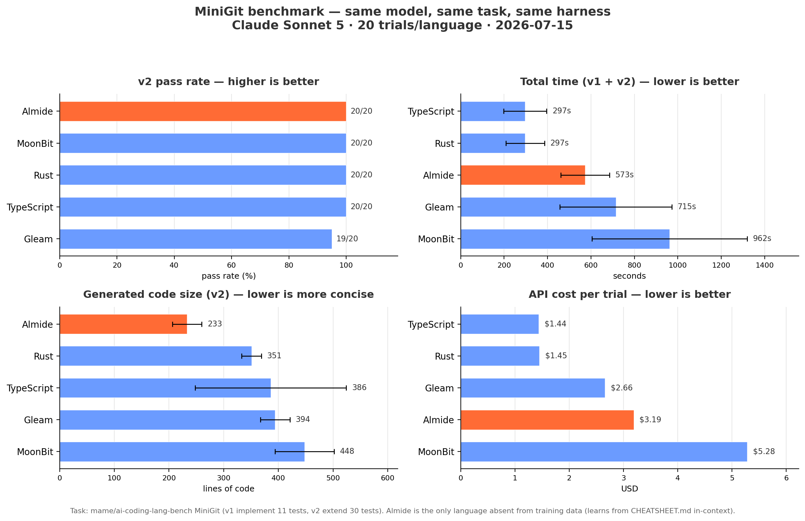
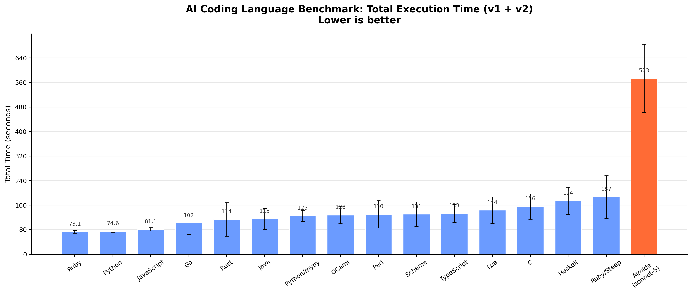
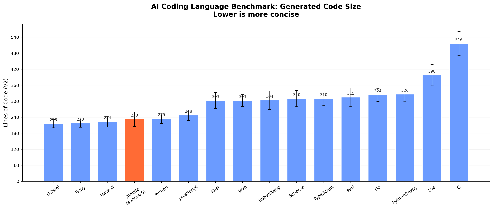
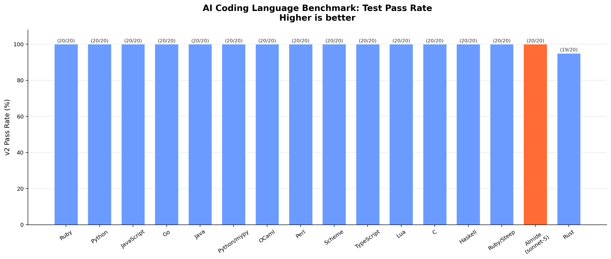

# ベンチマーク

  

> 固定原文の非規範読者用スナップショット。正本は原文であり、自動同期しない。benchmark の独立再実行、現 CI 確認、実装検証は行わない。日付・機種・モデル条件・歴史的主張は原文の範囲に限定する。
> [Original source (English) / 原文（英語）](https://github.com/almide/almide/blob/35297a612fb29e3f78f6587aba253aa91d51f466/docs/project/BENCHMARKS.md)

> 原文注記：本書は日付付き測定と実装状態の記述を組み合わせたもので、現在の普遍的な性能保証ではない。歴史的 AI 比較は事前学習データがないと断言する一方、同一モデルの注記はその不在を立証しないと明示している。両方を解消せず保持する。歴史的比較では Almide と他言語でモデルが異なり、同一モデル比較ではない。30 課題の日次 MSR、CI 状態、過去の wasm の極端な低下や leak、依存関係、すべての比率は原文時点の主張であり、ここで独立再検証していない。バイナリサイズのラベルは証明書の範囲を広げず、wasm-opt はその検証範囲外にある。

## WASM バイナリサイズ

Almide の構造化 emitter は、プログラムが到達する guest runtime の補助機能とともに Wasm バイトを直接生成する。実行には依然として成果物の import に適合する host が必要となる。旧 MIR/WAT 経路は廃止された。ビルド時の packaging は、生成された core module を標準 WASI module や component に変換できる。`--wasm-opt` は別途 opt-in する機能である。証明書の範囲と core 成果物への結び付けは [WASM-OUTPUT](../../../../wasm/WASM-OUTPUT.md) と [MEMORY-SAFETY](../../../../design/MEMORY-SAFETY.md) に記載されており、バイナリサイズから推測するものではない。以下の表は 2026-07-23 の歴史的測定であり、現在のコンパイラが生成する成果物のサイズではない。

| プログラム | 検証済み・出荷状態 | 処理後：`wasm-opt -Oz --all-features` |
|---------|-----:|-----:|
| Hello World | **703 B** | **545 B** |
| FizzBuzz 1–100 | **1,793 B** | **1,092 B** |
| Fibonacci（再帰） | **1,441 B** | **771 B** |
| Closure + call_indirect（クロージャと間接呼出し） | **2,744 B** | **1,672 B** |
| Variant（match + float） | **11,965 B** | **6,868 B** |

「出荷状態」列は `almide build --target wasm` の未加工出力（2026-07-23 測定）である。`wasm-opt` の実行は明示的な opt-in であり、検証された範囲を外れる。renderer 自身の到達可能性 DCE を超えて、命令単位の書換え（local の統合、inlining、より積極的な dead-code 除去）を行うためである。float 行の大部分は `float.to_string` が必要に応じてリンクする、自前実装の Dragon4 最短 round-trip printer による。Float を表示しないプログラムにはそのコストがかからない。詳しい分析：[WASM-OUTPUT.md](../../../../wasm/WASM-OUTPUT.md)。

## ネイティブ性能

Almide は Rust にコンパイルされ、その Rust がネイティブ機械語にコンパイルされる。runtime の補助機能は必要に応じてリンクまたは埋込みされる。実行に言語 VM や tracing GC は不要である。

| 指標 | 値 |
|--------|-------|
| バイナリサイズ (`perf/native/cli_app.almd`, minigit 型の CLI) | **507,960 B** strip 済み、x86_64 Linux (GCE c4-standard-8), **463,720 B** aarch64 Linux (GCE c4a-standard-8) — 2026-10-20 に v0.68.0-rc2 release binary で build、これは `research/benchmark/perf/native/measure.sh` が行う build |
| 依存関係 | **0** crate（動的 link は platform C library のみ： `libc` と `libgcc_s` Linux 上） |
| WASM target（出力先） | `almide build app.almd --target wasm` |

### Runtime スコアボード

Benchmarks Game 形式のプログラムで、Almide `--release` と同じフラグでコンパイルした手書き Rust を比較する（opt-level=3、LTO、1 CGU、および native `--release` build が追加する target CPU と LLVM のオプション。x86_64 は `-C target-cpu=x86-64-v3`、aarch64 は generic CPU。`almide build --print-release-rustflags` の表示どおり）。交互に実行した 5 回の中央値を取る。harness は測定前に小さい workload の stdout を比較する。FFT は最初の行だけを比較する（次の行は所要時間）。これは検証用 workload における出力確認であり、計時するすべてのサイズでの完全な正しさの証明ではない。2026-10-20 に v0.68.0-rc2 release binary（`almide 0.68.0 (release, fcba2bcd5)`、両側とも rustc 1.99.1）で GCE c4-standard-8（x86、Intel Xeon Platinum 8581C、8 vCPU）と c4a-standard-8（arm、Neoverse-V2、8 vCPU）上で測定した。[research/benchmark/perf/bench.py](../../../../../research/benchmark/perf/README.md)（`--runs 5 --legs native,rust`）で生成。各実行の生データ：[x86](../../../../../research/benchmark/perf/results/2026-10-20-gce-c4-standard-8.json)、[arm](../../../../../research/benchmark/perf/results/2026-10-20-gce-c4a-standard-8.json)。

| Benchmark（workload） | Almide native（ネイティブ）, x86 / arm | 手書き Rust, x86 / arm | 比率, x86 / arm |
|---|---:|---:|---:|
| n-body (50M step) | **2.040s** / **2.766s** | 2.172s / 2.720s 同じ形; 1.812s / 3.470s 配列ベース | **0.94×** / 1.02× 同じ形; 1.13× / **0.80×** 配列ベース |
| spectral-norm (n=5500) | **0.966s** / **1.099s** | 0.969s / 1.107s | **1.00×** / **0.99×** |
| fasta (25M) | **3.176s** / **3.232s** | 2.748s / 2.934s | 1.16× / 1.10× |
| FFT (2^22) | **0.309s** / **0.346s** | 0.351s / 0.369s | **0.88×** / **0.94×** |
| wordfreq (8M 回抽出) † | **0.215s** / **0.198s** | 0.293s / 0.338s | **0.73×** / **0.59×** |
| listbuild 事前確保 / append（追加） / combinator (2^23) | **0.269 / 0.276 / 0.270s** / **0.333 / 0.340 / 0.338s** | 0.307s / 0.358s | **0.87 / 0.89 / 0.87×** / **0.93 / 0.95 / 0.94×** |

† wordfreq は ratchet 用サイズ（`bench.py --quick`、8M 回の抽出）で計時する。suite の 2M では Almide 行が約 0.05 s となり、ratchet が判定を拒むプロセス起動ノイズの下限 0.08 s を下回る。生の行：[x86](../../../../../research/benchmark/perf/results/2026-10-20-gce-c4-standard-8-wordfreq-quick.json)、[arm](../../../../../research/benchmark/perf/results/2026-10-20-gce-c4a-standard-8-wordfreq-quick.json)。

同じ形の n-body 参照実装（`nbody_unrolled.rs`）は codegen の overhead を切り分ける。Almide は arm では 2% 遅く、x86 では 6% 速い。`perf-ratchet` CI job（[scripts/check-perf-ratio.sh](../../../../../scripts/check-perf-ratio.sh)）は commit 済み baseline に対してこれらの比を gate し、意図的な場合だけ動かせるようにする。

### 通常の Rust より速い例 (#1330)

宣言の軸 B2 が求めたものは、almide-native / 手書き Rust の比が **1.0 未満**となる名前付き workload、それを維持する CI ratchet、そして最初から明示された誠実な比較上の制約である。

**方法。** Rust 側は、その workload に習熟した人が書く*通常の*プログラムである。`rust-ref/binarytrees.rs` と `rust-ref/treealloc.rs` は `Box` でつないだ再帰 enum で、`make` / `check` は値渡し。`rust-ref/fannkuchredux.rs` は逐次プログラムである。1 thread、arena なし、独自 allocator なし、`unsafe` なし、SIMD なしで、Almide が生成する Rust と同じ `rustc` フラグ（opt-level=3、LTO、1 CGU、上のスコアボードで示した release target CPU と LLVM オプション）でコンパイルする。両側の stdout はバイト単位で一致する（計時前に検証）。各数値は warmup 後に交互実行した 9 回の中央値であり、各行を 2 つの入力サイズで測定して、1 サイズだけの勝利なら見えるようにする。ablation 列は*同じ Almide ソース*を該当する 1 つの最適化だけ無効にして（`ALMIDE_REGION_OFF=1`、`ALMIDE_FAN_SEQUENTIAL=1`）再ビルド・実行し、同じ交互実行 loop で測定したもの。したがって Almide の 2 列の差はその最適化だけによる。2026-10-20 に v0.68.0-rc2 release binary（rustc 1.99.1）で GCE c4-standard-8（x86）と c4a-standard-8（arm）上で測定した。生の行：[x86](../../../../../research/benchmark/perf/results/2026-10-20-gce-c4-standard-8-victory.json) / [arm](../../../../../research/benchmark/perf/results/2026-10-20-gce-c4a-standard-8-victory.json)。

| Workload（処理） | サイズ | 機種 | Almide native（ネイティブ） | 通常の Rust | **比率** | Almide、最適化無効 | 無効時の比率 |
|---|---:|---|---:|---:|---:|---:|---:|
| binarytrees | d17 | x86 | **118 ms** | 417 ms | **0.28×** | 382 ms | 0.92× |
| binarytrees | d19 | x86 | **541 ms** | 2021 ms | **0.27×** | 1800 ms | 0.89× |
| binarytrees | d17 | arm | **150 ms** | 450 ms | **0.33×** | 471 ms | 1.05× |
| binarytrees | d19 | arm | **682 ms** | 2108 ms | **0.32×** | 2188 ms | 1.04× |
| treealloc | d20 | x86 | **170 ms** | 766 ms | **0.22×** | 630 ms | 0.82× |
| treealloc | d21 | x86 | **371 ms** | 1558 ms | **0.24×** | 1416 ms | 0.91× |
| treealloc | d20 | arm | **135 ms** | 498 ms | **0.27×** | 499 ms | 1.00× |
| treealloc | d21 | arm | **279 ms** | 980 ms | **0.28×** | 1007 ms | 1.03× |
| fannkuchredux | n10 | x86 | **46 ms** | 185 ms | **0.25×** | 182 ms | 0.98× |
| fannkuchredux | n11 | x86 | **502 ms** | 2182 ms | **0.23×** | 2116 ms | 0.97× |
| fannkuchredux | n10 | arm | **35 ms** | 168 ms | **0.21×** | 171 ms | 1.01× |
| fannkuchredux | n11 | arm | **376 ms** | 2034 ms | **0.18×** | 2074 ms | 1.02× |

**どの最適化によるものか。** binarytrees と treealloc は、寿命全体が 1 つの式に収まる木を扱う `check(make(depth))` に時間を使う。effect system は組が region-pure（effect なし、global なし、`mut` param なし、scalar result）であることを証明するため、native 側は thread-local bump arena 上の `__rgn_` twin fn で実行し、木ごとに 1 回巻き戻す（region window、#1991）。通常の Rust はノードごとに入る際の `malloc` と出る際の `free` を払い、それを省いてよいとは判断できない。window を無効にすると同じ Almide source は arm で参照実装の 1.00–1.05×、x86 で 0.82–0.92× になる。生成された `Box` code はもともとの参照実装と同じ形で、window 単独の効果は両機種で 3.1–3.8× となる。Int capture を使う fannkuchredux の `fan { list.map }` は、native 側が core ごとの thread で実行する Send-safe-scalar 部分集合（#2044）である。`ALMIDE_FAN_SEQUENTIAL=1` なら 1 thread の参照実装に対して 0.97–1.02× なので、勝利の全体は parallel map によるものであり、core 数に応じて伸びる。すべての行の両サイズ、両機種で優位が保たれる。

**数値が意味しないこと。** 絶対比は機種と allocator に依存する（region 行は x86 で低く、fan 行は arm で低い）。方向は機種間で安定しており、ratchet が gate するのはその点である。[scripts/check-perf-ratio.sh](../../../../../scripts/check-perf-ratio.sh) の VICTORY 行は、行が 1.0 に達したとき、commit 済み runner-class baseline に対して +40% を超えて退行したとき、または ablation のコストが最適化ありの行の 1.3× 以上でなくなったときに build を失敗させる（最後の場合、宣言が優位を誤った原因に帰していることになる）。仕組みは 2 つ、workload は 3 つ。これを飾り立てず明示する。2 つ目の region 行は、window が単一 benchmark の性質ではなく `consume(produce(scalars))` という形の性質であることを示すためにある。

**issue が挙げたもう 1 つの候補は、測定したが優位として主張しない。** 同じ実行、通常の逐次 Rust 参照実装（`rust-ref/mandelbrot.rs`、出力はバイト単位で一致）：

| Workload（処理） | サイズ | Almide native（ネイティブ）, x86 / arm | 通常の Rust (1 thread), x86 / arm | 比率, x86 / arm |
|---|---:|---:|---:|---:|
| mandelbrot (`fan.map`) | 1000 | 49 ms / 63 ms | 50 ms / 63 ms | 0.97× / 1.00× |
| mandelbrot (`fan.map`) | 4000 | 721 ms / 985 ms | 740 ms / 985 ms | 0.98× / 1.00× |

- *決定的データ並列（`fan`）*は native 側の mandelbrot に効果を与えない。`fan.map` callback は `Bytes` を返し、その native repr は `Rc` なので、#2044 の Send-safe-scalar routing が対象外とし、map は逐次実行される（`ALMIDE_FAN_SEQUENTIAL=1` でも同じ時間）。したがって 1 thread 参照実装が誠実な比較対象であり、行は同等になる。ratchet はこれを REPORT し、本当に並列化による優位が実装された日に数値になるようにする。
- *`|>` chain の stream fusion* は Rust target で実行される。perf suite の「まだカバーしていない」節は 2026-10-20 の counted-iterator 続報を記録している（手書き Rust 参照実装の 1.29x、過去の 6.6x から低下）。この形には専用 benchmark gate がまだない。昔 fusion がなかったことを、現在の実装の主張にしてはならない。

### Allocation：native 側の region window (2026-09-08, #1991)

`binarytrees` は allocation の行である。`check(make(depth))` は寿命全体がその 1 つの式である木を構築する。以前の生成 Rust は人が書くものそのもので、ノードごとに `Box` を作り、ノードごとに解放していた。そのプログラムと手書き Rust の `Box` プログラムは同じ計測値で、両方とも arena に 2.6× 劣った（issue #1991：228 ms 対 Zig の 88 ms、d16、arm64）。構造化 wasm 側は region window（#1961/#1980）ですでに差を埋めていた。native 側にも今は同じ recogniser（`RegionWindowPass`）があり、組を `__rgn_` twin fn で実行する。再帰 field は prelude の thread-local bump arena への handle となり、呼出し site はノードごとの解放ではなく arena を 1 回巻き戻す。同じ機種、同じ session、交互実行、9 回の中央値（arg 16 — issue の workload。括弧内は arg 18）：

| binarytrees | 変更前 | 変更後 | |
|---|---:|---:|---|
| Almide native（ネイティブ） | 230 ms [1027 ms] | **72 ms** [309 ms] | 自身より 3.2× 高速 |
| Rust, 同じ形 `Box` (`rust-ref/binarytrees.rs`) | 222 ms | 222 ms | 現在の Almide 0.33× |
| Zig 0.16 arena (issue #1991、同じ形) | 88 ms | 88 ms | Almide 0.82× — 1.3× の受入基準内 |

この行は ratchet の VICTORY 行（`binarytrees=rust:binarytrees`、quick arg 17、上の「通常の Rust より速い例」参照）であって、±band で固定する行ではない。同じ commit が M4 Pro では 0.31、ubuntu-latest runner では 0.61 となる。違うのは window ではなく、*参照実装*が `Box` をどれだけ安く解放するか（glibc malloc 対 macOS）だからである。これは listbuild 行を reported のままにする allocator 依存性と同じである。window 自身の A/B は、同じ source と機種の `ALMIDE_REGION_OFF=1`（ここでは 3.5×）であり、ratchet が gate するのはその A/B である。発火するもの：組が region-pure で、生成される型が scalar / region-enum payload を持つ root variant enum である、すべての `consume(produce(scalars))` site。発火しないもの：保持する木（`let t = make(d)` を 2 回読む場合は `Box` を保つ）、木の形を `String` として返す consumer、global、`mut` param、lambda、非 scalar stdlib module に到達するもの。`spec/lang/region_window_test.almd` 内のすべての形で、native、wasm、参照実装の出力はバイト単位で一致する。

### 構築の形：推奨 idiom のコスト (2026-08-13)

`listbuild` は 1 つの workload を 3 通りに書いたもの。同じ 2^23 要素の interleaved `Float` 配列、同じ演算、同じ checksum consumer で、build loop だけが異なる。idiom 文書が推奨する形が 3 つのうち最も遅かったために用意した。これは perf の問題である前に MSR の問題である。idiom 文書は生成 code を導く in-context 資料なので、「推奨」と「高速」が同じ形を指さなければならない。

| 構築の形 (2^23) | Almide native（ネイティブ） | 手書き Rust | 比率 |
|---|---:|---:|---:|
| 事前確保 + indexed write | **0.166s** | 0.105s | 1.57× |
| `var` + `for` + `data = data + [x]` | **0.176s** | 0.110s | 1.60× |
| `list.range \|> list.flat_map` （推奨） | **0.172s** | 0.105s | 1.64× |

交互実行 15 回の中央値。3 つの形はすべてバイト単位で同じ出力を生成し、計時前に確認した。この機種では 3 つの比の差は実行間ノイズの範囲内である。表が示すのは、その開きがなくなったことである。

**比の列は言語の性質ではなく、機種固有の値として読む。** 上の演算 kernel と違い、この workload のコストは allocation であり、2 つの allocator の結果は異なる。同じ commit を ubuntu-latest CI runner で測定すると事前確保の行は **0.91×**、つまり Almide が参照実装に*勝つ*。glibc `calloc` がゼロ page を返す一方、`Vec::with_capacity` + push は page fault で page を取り込まなければならないためで、ここでの 1.57× とは異なる。両機種で安定し、したがって CI が gate するのは、各行の絶対比ではなく 3 つの形の*関係*（ここでは 1.018×、runner では 1.045×）である。

以前はそうではなかった。2^22 での A/B（11 回の中央値、同じ実行）：

| 構築の形 (2^22) | 変更前 | 変更後 |
|---|---:|---:|
| 事前確保 + indexed write | 0.084s | 0.083s |
| `var` + `for` + append（追加） | 0.084s | 0.083s |
| `list.range \|> list.flat_map` | **0.140s** | **0.085s** |

`flat_map` の lambda は runtime signature のため、要素ごとに中間 list を heap 上に確保せざるを得なかった。79 ms の build のうち 44 ms、差の全体である。今は代わりに固定長配列を返し、推奨 idiom は**置き換える append loop の 1.67× から 1.02×**になった。

3 つの形に共通する手書き Rust に対する約 1.6× は、長く materialization（#1004）のせいとされていた。**そうではない**（2026-08-13 測定）。生成 Rust 内の `almide_rt_libm_sin`/`_cos` — cross-target のバイト同一性契約に必要な決定的 software libm — だけを platform のものに替えると、123.9 ms の参照実装に対して行は 194.5 ms から 105.5 ms になる。1.6× の全体は超越関数の決定性のコストで、それがなければ生成 code は手書き参照実装に 1.17× *勝つ*。構築の形に責任はない。`list.repeat` と境界検査付き indexed write は 75.5 ms、`Vec::with_capacity` + push は 90.6 ms である。証拠と方法：[string-gap-1004.md](../../../../../research/benchmark/perf/string-gap-1004.md)。`check-perf-ratio.sh` はこれらの行を報告し、相互の関係を gate するので、idiom が黙って遅い経路に戻ることはできない。

### 文字列：stdlib の契約のコスト (2026-08-13)

`strchurn` は #1004 の allocation が多い文字列 workload である：`int.to_string` → `list.join` → `string.split` → `string.len` → `list.sum`。参照実装を 2 つ持ち、どちらと比べるかが話のすべてである（`bench.py --quick`、2M、3 回の中央値、M4 Pro）：

| strchurn (2M) | 時間 | 比率 |
|---|---:|---:|
| Almide native（ネイティブ） | **0.123s** | — |
| Rust、同じ形 + 同じ意味（所有する `String`、生成元 `split`, `chars().count()`) | 0.109s | **1.12×** |
| Rust、idiomatic（借用 `&str`, バイト単位の `len()`) | 0.059s | 2.08× |

2 つ目の参照実装は Rust プログラマが書くものを行う。1 つ目は Almide の stdlib がプログラムに要求するものを行う。Almide は同じ仕事をする Rust の **1.12×** 以内で、idiomatic Rust までの残りの差は **codegen ではなく API 契約**による。75% は `string.split` が所有する `String` を返すこと（`List[String]` には借用要素型がない）、11% は `string.len` が文字数を数えることによる。issue の題名が原因としていた `RcCow` 表現はこの経路にまったくない。Almide の `String` は Rust の `String` に lower され、`RcCow` は `Bytes` と `Matrix` にのみ用いる。全段階、否定された rlib 境界仮説、そこからの作業リスト：[string-gap-1004.md](../../../../../research/benchmark/perf/string-gap-1004.md)。listbuild 行と同様、これは anchored ではなく reported である。allocation 主体の比はまず allocator の比較だからである。

### Codec decode：導出した `T.decode` のコスト (2026-09-08, #1679)

`decode` は #1673/#1679 の workload である。固定の 8-field `User` 文書（入れ子の `Address`、3 要素の `List[String]`）を 1 回 parse し、その後 N 回の導出 `User.decode` が record を accumulator に渡す。参照実装（`rust-ref/decode.rs`）は**同じ** `AlmideValue` の形に対する通常の手書き decode である。借用しながら線形に field を scan し、所有する `String` record field にする issue の 168 ns 行であり、言語で表現できない借用 `&str` record（53 ns）ではない。同じ機種、同じ session、交互実行、7 回の中央値、2M decode、arm64。process 下限を差し引く：

| decode（操作ごと） | ns/op | |
|---|---:|---|
| Almide native（ネイティブ）, field scan（slot hint 導入前） | 422 | — |
| Almide native（ネイティブ）, slot index による lookup (`_field_ref_at`, 今回の変更) | **412** | 参照実装の 2.0× |
| Almide native（ネイティブ）, 同じ生成 code の `___erratw_*` frame を畳んだ場合 | 205 | 参照実装と同等 |
| Rust、同じ形 (`rust-ref/decode.rs`) | 205 | — |
| zod 4.5.2 `safeParse` / `z.compile`, 同じ schema（issue #1679、同機種） | 78 / 17 | 参考情報、同じ data model ではない |

slot hint は issue の「形の特殊化」段階である。導出 decode は各 field の宣言 index、つまり `T.encode` が書き込む slot を知っており、`almide_rt_value_field_ref_at` は scan に fallback する前にその slot を試す（`spec/wasm_cross/codec_decode_field_order.almd` は並べ替え、位置ずれ、疎、key 欠落の fallback を両側で駆動する）。8-field record で 10 ns 得られるが、scan はもともと主なコストではなかった。この行の 2× 全体は #1675 の error-path frame（`T___erratw_<field>`）によるもので、成功経路上で `Ok` payload を clone し path segment `"name".to_string()` を確保する。decode ごとに 11 個、約 200 ns である。生成 Rust でそれらを潰したのが 3 行目で、参照実装とまったく同じ値となる。この frame が行の次の作業であり、表現側（所有する `String` field 対共有 string）は #1679 が記録する ADR-level の決定のままとする。この行は ratchet の REPORTED 行（`decode=rust:decode`、quick arg 1M）に加わる。両側に操作ごと 8 回の短文字列確保があるため、strchurn と同様まず allocator を読む値である。行が入った日に ratchet 自体が同じ build で読んだ値は 2.46 だった（process 全体の実時間、下限差引きなし、同じ機種で他の仕事も実行中）。rlib-linked release build と monolithic build は同じ測定値なので、上の 2.0 との差は link ではなく負荷による。wasm 側は #2046 が閉じるまで行から外す。loop 内の導出 decode がそこで call ごとに約 800 B を保持するため（1M で peak 786 MB、計時引数 5M では out of memory）、その側を計ると leak を計ってしまう。小さい N では出力はバイト単位で一致する。

wasm 側は同じ日付付き results file で測定されている。計算 kernel では native の 1.1–1.2× 以内（n-body 1.278s、spectral-norm 0.764s、fannkuch-redux 1.892s）、binary-trees では native より*速い*（0.239s 対 0.835s）が、その歴史的実行では hot list index write（FFT：2^18 で約 3,500×）と mandelbrot（約 130×）で極端に悪化した。これらは保管された測定であり、現在のコンパイラ revision にも同じ落差が残るという主張ではない。状態は後続の日付付き実行と現在の ratio ledger を参照する。

### Map：native の key lookup のコスト (2026-09-14, #2150, #2157)

`wordfreq` は key 集約の行である。5 000 語の語彙からの 2M 回の抽出を `Map[String, Int]` に数え、count 降順 / word 昇順で上位 10 件を取る。word-count、group-by、histogram の各プログラムの形である。#2157 は native 側が wasmtime 上の同じプログラムより 1.5–2.3× **遅い**ことを発見した。その probe では native の差全体が Map にあり、同じ loop から Map を除くと 87 ms、あると 180 ms だった（`almide bench`、5–7 回の中央値、M4 Pro、負荷のある機種）。3 変更、1 行（`research/benchmark/perf/wordfreq/` の両記法を、抽出ごとに所有 key を持つ `HashMap<String, i64>` である `rust-ref/wordfreq.rs` と比較）：

| wordfreq、命令型 (2M) | 変更前 | 変更後 | |
|---|---:|---:|---|
| Almide native（ネイティブ） | 180 ms | **142 ms** | |
| … うち Map（loop から Map なし probe を引く） | 93 ms | **55 ms** | `get_or` + `m[w] = …` の組あたり 46 ns → 27 ns |
| Almide wasm（構造化側） | 127 ms | 130 ms | Map：57 ms の probe に対して追加約 73 ms |
| Rust、同じ形 (`rust-ref/wordfreq.rs`) | 80 ms | 80 ms | |

1. **index は compact-ordered-dict**（CPython 3.6+、Roc の `Dict`）である。挿入順 entry vector が順序、等価性、repr の正本のままで、その隣に entry の**位置**を入れる open-addressing slot table が置かれる。entry ごとに完全な 64-bit hash を cache し、操作ごとに multiply-fold hash を 1 回行う。以前の sidecar は key を `dyn Any` 越しに SipHash し、次いで `HashMap<u64, u32>` 内で fingerprint をもう 1 度 SipHash した。`get_or` + insert の組ごとに SipHash が 4 回である。閾値（16 entry）、挿入順、順序非依存の等価性、Float/NaN の線形経路はすべて不変で、`spec/wasm_cross` の 77 個の Map/Set fixture に固定され、native == wasm がバイト単位で一致する。
2. **読み取り側は key を借用する。** `map.get` / `contains` と `set.contains` は `@borrow_ref(key)` である。runtime は `K: Borrow<Q>` の `&Q` を受けるので、`&str` parameter は `String` を実体化せずに `Map[String, _]` を probe し、`map.get(counts, w) ?? 0` はもはや `w` を消費しない。
3. **書込みは key を move する。** plain-variable key を持つ `m[w] = f(&w)` は**先に**値を評価する（var 読取りには effect がなく、順序は観測不能で、wasm 側の key-first ANF とバイト同一性を保つ）。これにより key の位置が var の最終使用になり、clone pass は `w` を clone せず insert に move する。`tests/map_key_move_test.rs` が生成 Rust の borrow と move の両方を固定する。

生成 Rust を単独測定（素の `rustc`、同じ source）すると、旧形 152 ms、借用 lookup だけで 128 ms、single-lookup get-or-insert では 110 ms である。key clone と 2 回目の lookup はそれぞれ hashing 以上のコストだった。native Map 自体は今や構造化 wasm 側より安い（同じ 2M 操作で 55 対約 73 ms）。native 行を wasm 行より高くしているのは Map **なし**の loop（87 対 57 ms。`let w = vocab[i]` の読取りが 2 回 clone し、`list.range` が本物の 16 MB `Vec`）で、これは codegen であり #2157 の未解決 probe であって、Map ではない。推奨記法（`wordfreq-group`：`list.group_by` + `map.map`）は native で 229 ms となる。コストは lookup ではなく、`group_by` の `Rc<dyn Fn(A) -> B>` callback が要求する要素ごとの key clone と中間 `List[String]` にある。この行が今監視する T5 の関係である。`mapbuild`（20k Int + 20k String key を build 後に読取り）は 6.6 から 5.6 ms となる。wordfreq の両行は ratchet の REPORTED 行（`wordfreq=rust:wordfreq wordfreq-group=rust:wordfreq`、quick arg 1M）に加わった。hash-map 行は strchurn と同様、codegen の前に allocator と hasher を比較する。#2150 以降 `wordfreq` は gate 対象の PAIRS で ANCHORED である（4M quick arg で baseline 1.90）。2M の develop 成功実行 5 回で runner は 1.66-1.75、M4 Pro は 1.77 だったので、listbuild と違いこの比は 2 つの機種 class 間で移せる。`wordfreq-group` は reported のままで、`wordfreq` との関係が gate 対象の wasm idiom 行である。

### Ablation：IR optimizer がもたらす効果 (2026-08-18)

Koka の benchmark 方法は ablation 側（`std` = FIP reuse 最適化なし）を公開し、性能の主張を言語だけでなく*optimizer*についてのものにする。`#1466` は同じ軸を採用する。`ALMIDE_DISABLE_OPT=1` は IR perf pass（constant fold、DCE、constant propagation）を skip する。lowering を可能にする pass と unsigned-lane の正しさのための再 fold は残る。perf gate は毎回の CI で各 anchored benchmark を両方の設定で実行する。差（ablated / optimized）は `scripts/perf-ratio-baseline.txt` に anchored され、下限 0.90 と通常の意図的 re-anchor 上限を持つ。

| bench | 最適化除去 / 最適化あり |
|---|---:|
| nbody | 1.00 |
| spectralnorm | 1.00 |
| fasta | 1.00 |
| fft | 1.00 |

**測定結果を率直に言うと：** rustc-backed native 側では、これらの benchmark に対する IR perf pass の利益は約 0% である。LLVM が後段で同じ fold を実行して包含するからである。これが現時点での誠実な ablation の答えであり、まさにこの軸の目的である。効果を出す pass なら差が 1.00 を離れて見え、可視的に re-anchor される。*コスト*を生み始める pass なら 0.90 下限に引っかかる。pass の現在の価値は compile-time の形と wasm 側にある（後段に LLVM がなく、そこで ablate すると file は速度ではなく lowering を失う。`optimize_program` の header note 参照）。

## 編集 loop の規模 (#1334)

[測定ページ](../../../../benchmarks/README.md)の build-speed 行は 268 行の file で測定しており、編集 loop が*規模に依存しない*ことは示さない。小さな file での高速な check は、二次的に増加するコンパイラでもまさに得られるものだからである。そこで同じコマンドを、この repo 自身の stdlib の入れ子になった prefix の段階ごとに測る（手書き 285 module、31,729 行、合成データなし）。段階ごとに交互実行 40 回：

| project 行数 | `almide check` p50, x86 / arm | p95, x86 / arm | µs/line, x86 / arm |
|---:|---:|---:|---:|
| 2,480 行 | 37.5 / 41.4 ms | 38.4 / 42.1 ms | 5.50 / 6.35 |
| 5,577 行 | 56.3 / 63.7 ms | 58.3 / 64.3 ms | 5.81 / 6.74 |
| **10,669 行** | **97.4 / 109.6 ms** | **99.9 / 110.6 ms** | 6.75 / 7.75 |
| 21,080 行 | 175.3 / 195.5 ms | 178.5 / 197.3 ms | 6.87 / 7.96 |
| 32,666 行 | 260.2 / 295.3 ms | 268.3 / 297.7 ms | 7.03 / 8.12 |

2026-10-20 に v0.68.0-rc2 release binary（`scale.py --runs 40`）で GCE c4-standard-8（x86）と c4a-standard-8（arm）上で測定した。**p95 列は観測であって約束ではない**。負荷のある機種では tail はコンパイラではなく負荷に追随するので、CI ratchet（`scripts/check-edit-loop-scale.sh`）は代わりに、同じ実行内の無次元比 2 つを anchor する。project 行数に対する限界 check 時間の log-log 傾き（両機種 **1.10**。1.0 は線形、2.0 は二次）と、空 project 下限を単位とする 10k 行段階のコスト（x86 **4.2×** / arm **4.3×**）である。`python3 research/benchmark/editloop/scale.py` で再現する。

## AI コーディング言語ベンチマーク

[mame/ai-coding-lang-bench](https://github.com/mame/ai-coding-lang-bench) に基づく（MiniGit 実装課題：v1 実装、v2 拡張）。

### 同一モデルのスナップショット (2026-07)

5 言語、1 モデル（Claude Sonnet 5）、各 20 試行、同一 prompt と harness。Almide を同時代の比較群（Gleam、MoonBit）と主流の基準（Rust、TypeScript）と比較する：

> Almide には in-context 参照として CHEATSHEET.md を渡した。この benchmark は学習データの不在を立証しない。この snapshot では 40/40 phase に合格し、5 言語中最も簡潔な code（233 LOC）を生成し、同時代の比較言語 2 つより速く完了する。方法、retry 方針、試行ごとの生記録：[research/benchmark/lang-bench](../../../../../research/benchmark/lang-bench/README.md)。

### 既存 15 言語との歴史的比較

> Almide 行は 2026-07-15 に更新された（Sonnet 5、20 試行、上の snapshot より）。他の 15 言語は upstream の Opus 4.6 実行を使う。モデルにはこの言語の事前学習データがないためにより時間を要するものの、Almide は大半の言語より少ない行数で 100% の合格率を達成する。

## MSR — Modification Survival Rate（変更生存率）

この言語の主要指標であり、[almide-dojo](https://github.com/almide/almide-dojo) が 30 課題（basic / intermediate / advanced）で日次測定する。主要スコアカードは[測定ページ](../../../../benchmarks/README.md#llm-writability)にある。
