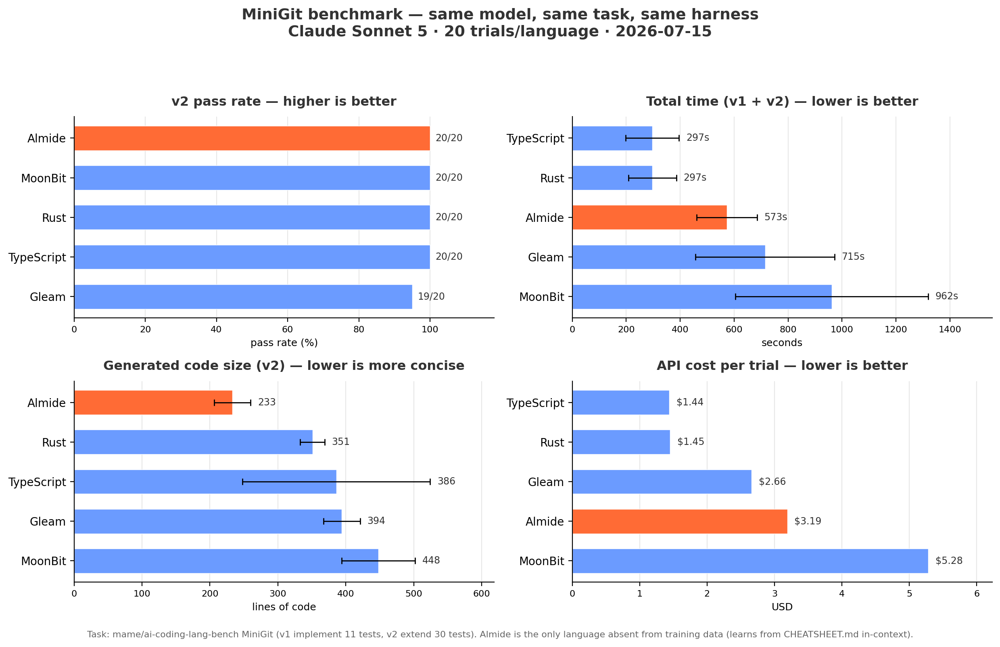
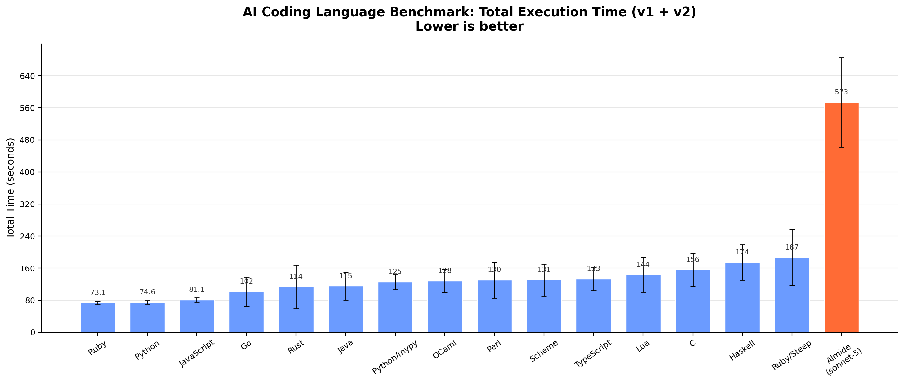
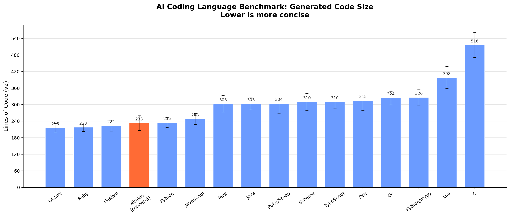
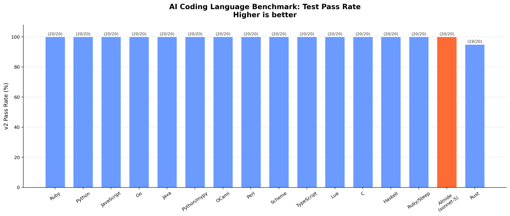

# 基准测试

  

> 固定原文的非规范读者快照；原文仍为权威来源，不自动同步。未独立重跑 benchmark、检查当前 CI 或验证实现。日期、机器、模型条件及历史主张均限定在原文范围内。
> [Original source (English) / 原文（英語）](https://github.com/almide/almide/blob/35297a612fb29e3f78f6587aba253aa91d51f466/docs/project/BENCHMARKS.md)

> 原文注记：本文组合了带日期测量及实现状态说明，不是当前普遍性能保证。历史 AI 比较断言没有先前训练数据，而同一模型注记明确说未证明该数据不存在；两者保留，不替原文调和。历史比较对 Almide 与其他语言使用不同模型，并非同模型比较。30 任务每日 MSR、CI 状态、旧 wasm 性能悬崖及 leak、依赖与所有比率，均为原文时点主张，未在此独立复核。二进制大小标签不扩大证书范围，wasm-opt 位于该验证范围之外。

## WASM 二进制大小

Almide 的结构化 emitter 直接生成 Wasm 字节，并带上程序可达的 guest runtime 支持。执行仍需兼容制品 import 的 host。旧 MIR/WAT 路径已退役。构建打包可把生成的 core module 转换为标准 WASI module 或 component；`--wasm-opt` 是单独主动启用的选项。证书范围及其与 core 制品的绑定见 [WASM-OUTPUT](../../../../wasm/WASM-OUTPUT.md) 和 [MEMORY-SAFETY](../../../../design/MEMORY-SAFETY.md)，不能从二进制大小推断。下表是 2026-07-23 的历史测量，不是当前编译器生成的制品大小。

| 程序 | 已验证，交付状态 | 处理后：`wasm-opt -Oz --all-features` |
|---------|-----:|-----:|
| Hello World | **703 B** | **545 B** |
| FizzBuzz 1–100 | **1,793 B** | **1,092 B** |
| Fibonacci（递归） | **1,441 B** | **771 B** |
| Closure + call_indirect（闭包及间接调用） | **2,744 B** | **1,672 B** |
| Variant（match + float） | **11,965 B** | **6,868 B** |

“交付状态”列是 `almide build --target wasm` 的原始输出（测于 2026-07-23）。运行 `wasm-opt` 需明确主动选择，并会离开已验证范围：它超出了 renderer 自身的可达性 DCE，进行指令级重写（local 合并、内联、更激进的死代码删除）。float 行主要由 `float.to_string` 按需链接的自实现 Dragon4 最短往返 printer 占据；从不显示 Float 的程序无需承担此成本。完整分析：[WASM-OUTPUT.md](../../../../wasm/WASM-OUTPUT.md)。

## 原生性能

Almide 编译成 Rust，后者再编译成原生机器码。runtime 支持按需链接或嵌入；执行不需要语言 VM 或 tracing GC。

| 指标 | 值 |
|--------|-------|
| 二进制大小 (`perf/native/cli_app.almd`, minigit 形状的 CLI) | **507,960 B** 已 strip，x86_64 Linux (GCE c4-standard-8), **463,720 B** aarch64 Linux (GCE c4a-standard-8) — 于 2026-10-20 由 v0.68.0-rc2 release binary 构建，即 `research/benchmark/perf/native/measure.sh` 所做的构建 |
| 依赖 | **0** crate（仅动态链接平台 C library： `libc` 和 `libgcc_s` Linux 上） |
| WASM target（输出目标） | `almide build app.almd --target wasm` |

### Runtime 成绩表

以 Benchmarks Game 风格的程序比较 Almide `--release` 与使用相同标志编译的手写 Rust（opt-level=3、LTO、1 CGU，以及 native `--release` 构建添加的 target CPU 和 LLVM 选项：x86_64 使用 `-C target-cpu=x86-64-v3`，aarch64 使用 generic CPU，均如 `almide build --print-release-rustflags` 所打印）。取 5 次交错运行的中位数。harness 在计时前比较小 workload 的 stdout；FFT 只比较首行（下一行是时间）。这是验证 workload 的输出检查，不是所有计时规模上的完整正确性证明。测于 2026-10-20，使用 v0.68.0-rc2 release binary（`almide 0.68.0 (release, fcba2bcd5)`，双方均为 rustc 1.99.1），机器为 GCE c4-standard-8（x86、Intel Xeon Platinum 8581C、8 vCPU）及 c4a-standard-8（arm、Neoverse-V2、8 vCPU）。由 [research/benchmark/perf/bench.py](../../../../../research/benchmark/perf/README.md)（`--runs 5 --legs native,rust`）生成；逐次原始数据：[x86](../../../../../research/benchmark/perf/results/2026-10-20-gce-c4-standard-8.json)、[arm](../../../../../research/benchmark/perf/results/2026-10-20-gce-c4a-standard-8.json)。

| Benchmark（工作负载） | Almide native（原生）, x86 / arm | 手写 Rust, x86 / arm | 比率, x86 / arm |
|---|---:|---:|---:|
| n-body (50M 步) | **2.040s** / **2.766s** | 2.172s / 2.720s 同形; 1.812s / 3.470s 基于数组 | **0.94×** / 1.02× 同形; 1.13× / **0.80×** 基于数组 |
| spectral-norm (n=5500) | **0.966s** / **1.099s** | 0.969s / 1.107s | **1.00×** / **0.99×** |
| fasta (25M) | **3.176s** / **3.232s** | 2.748s / 2.934s | 1.16× / 1.10× |
| FFT (2^22) | **0.309s** / **0.346s** | 0.351s / 0.369s | **0.88×** / **0.94×** |
| wordfreq (8M 次抽取) † | **0.215s** / **0.198s** | 0.293s / 0.338s | **0.73×** / **0.59×** |
| listbuild 预分配 / append（追加） / combinator (2^23) | **0.269 / 0.276 / 0.270s** / **0.333 / 0.340 / 0.338s** | 0.307s / 0.358s | **0.87 / 0.89 / 0.87×** / **0.93 / 0.95 / 0.94×** |

† wordfreq 使用 ratchet 规模计时（`bench.py --quick`，8M 次抽取）。在套件的 2M 规模，Almide 行约运行 0.05 s，低于 ratchet 拒绝据此判断的进程启动噪声下限 0.08 s。原始行：[x86](../../../../../research/benchmark/perf/results/2026-10-20-gce-c4-standard-8-wordfreq-quick.json)、[arm](../../../../../research/benchmark/perf/results/2026-10-20-gce-c4a-standard-8-wordfreq-quick.json)。

同形 n-body 参考实现（`nbody_unrolled.rs`）隔离 codegen 开销：Almide 在 arm 上落后 2%，在 x86 上领先 6%。`perf-ratchet` CI job（[scripts/check-perf-ratio.sh](../../../../../scripts/check-perf-ratio.sh)）对照已提交 baseline 门控这些比率，使它们只能被有意改变。

### 比普通 Rust 更快的案例 (#1330)

声明轴 B2 要求：有名称的 workload，其 almide-native / 手写 Rust 比率**低于 1.0**，受 CI ratchet 约束，并预先说明诚实比较的限制条件。

**方法。** Rust 一方是熟练开发者为该 workload 编写的*普通*程序：`rust-ref/binarytrees.rs` 和 `rust-ref/treealloc.rs` 是由 `Box` 链接的递归 enum，`make` / `check` 按值传递；`rust-ref/fannkuchredux.rs` 是顺序程序。1 个线程、无 arena、无自定义 allocator、无 `unsafe`、无 SIMD，使用与 Almide 生成的 Rust 相同的 `rustc` 标志编译（opt-level=3、LTO、1 CGU，以及上述成绩表列出的 release target CPU 和 LLVM 选项）。双方 stdout 逐字节相同（计时前验证），每个数字是 warmup 后 9 次交错运行的中位数；每行测 2 种输入规模，以显露只在单一规模成立的优势。ablation 列把*相同 Almide 源码*仅关闭该项优化后重新构建运行（`ALMIDE_REGION_OFF=1`、`ALMIDE_FAN_SEQUENTIAL=1`），在同一交错循环中计时，因此 Almide 两列之间的差别仅来自该优化。测于 2026-10-20，使用 v0.68.0-rc2 release binary（rustc 1.99.1），机器为 GCE c4-standard-8（x86）和 c4a-standard-8（arm）；原始行：[x86](../../../../../research/benchmark/perf/results/2026-10-20-gce-c4-standard-8-victory.json) / [arm](../../../../../research/benchmark/perf/results/2026-10-20-gce-c4a-standard-8-victory.json)。

| Workload（工作负载） | 规模 | 机器 | Almide native（原生） | 普通 Rust | **比率** | Almide，关闭优化 | 关闭时比率 |
|---|---:|---|---:|---:|---:|---:|---:|
| binarytrees | d17 | x86 | **118 ms** | 417 ms | **0.28×** | 382 ms | 0.92× |
| binarytrees | d19 | x86 | **541 ms** | 2021 ms | **0.27×** | 1800 ms | 0.89× |
| binarytrees | d17 | arm | **150 ms** | 450 ms | **0.33×** | 471 ms | 1.05× |
| binarytrees | d19 | arm | **682 ms** | 2108 ms | **0.32×** | 2188 ms | 1.04× |
| treealloc | d20 | x86 | **170 ms** | 766 ms | **0.22×** | 630 ms | 0.82× |
| treealloc | d21 | x86 | **371 ms** | 1558 ms | **0.24×** | 1416 ms | 0.91× |
| treealloc | d20 | arm | **135 ms** | 498 ms | **0.27×** | 499 ms | 1.00× |
| treealloc | d21 | arm | **279 ms** | 980 ms | **0.28×** | 1007 ms | 1.03× |
| fannkuchredux | n10 | x86 | **46 ms** | 185 ms | **0.25×** | 182 ms | 0.98× |
| fannkuchredux | n11 | x86 | **502 ms** | 2182 ms | **0.23×** | 2116 ms | 0.97× |
| fannkuchredux | n10 | arm | **35 ms** | 168 ms | **0.21×** | 171 ms | 1.01× |
| fannkuchredux | n11 | arm | **376 ms** | 2034 ms | **0.18×** | 2074 ms | 1.02× |

**是哪项优化带来的。** binarytrees 和 treealloc 的时间花在 `check(make(depth))` 上，即整个生命周期只覆盖一个表达式的树。effect system 证明这对操作 region-pure（无 effect、无 global、无 `mut` param、结果为 scalar），于是 native 侧用 thread-local bump arena 上的 `__rgn_` twin fn 执行，每棵树回退一次（region window，#1991）。普通 Rust 对每个节点在进入时支付 `malloc`、退出时支付 `free`，而且无法知道可以省略它们。关闭 window 后，同一 Almide source 在 arm 上为参考实现的 1.00–1.05×，在 x86 上为 0.82–0.92×；生成的 `Box` code 已经就是参考实现的形状，window 单独在两种机器上带来 3.1–3.8× 的效果。fannkuchredux 中捕获 Int 的 `fan { list.map }` 属于 Send-safe-scalar 子集，native 侧每个 core 启动一个 thread（#2044）。设为 `ALMIDE_FAN_SEQUENTIAL=1` 时，它为单线程参考实现的 0.97–1.02×，所以全部优势来自 parallel map，并随 core 数扩展。两种机器上每一行的两种规模都保持优势。

**这些数字不代表什么。** 绝对比率依赖机器和 allocator（region 行在 x86 上较低，fan 行在 arm 上较低）。方向跨机器稳定，这才是 ratchet 门控的对象。[scripts/check-perf-ratio.sh](../../../../../scripts/check-perf-ratio.sh) 的 VICTORY 行在以下情况使 build 失败：某行达到 1.0；比已提交的 runner-class baseline 退化超过 +40%；或 ablation 不再让该行至少耗时 1.3×（否则声明把优势归因给了错误的东西）。2 种机制、3 个 workload，明确说明而不包装。第二个 region 行用于证明 window 是 `consume(produce(scalars))` 这种形状的属性，而非某一个 benchmark 的属性。

**issue 列出的另一候选项：测量了，但不声称有优势。** 同一运行，普通顺序 Rust 参考实现（`rust-ref/mandelbrot.rs`，逐字节相同输出）：

| Workload（工作负载） | 规模 | Almide native（原生）, x86 / arm | 普通 Rust (1 线程), x86 / arm | 比率, x86 / arm |
|---|---:|---:|---:|---:|
| mandelbrot (`fan.map`) | 1000 | 49 ms / 63 ms | 50 ms / 63 ms | 0.97× / 1.00× |
| mandelbrot (`fan.map`) | 4000 | 721 ms / 985 ms | 740 ms / 985 ms | 0.98× / 1.00× |

- *确定性数据并行（`fan`）*没有给 native 侧 mandelbrot 带来收益：其 `fan.map` callback 返回 `Bytes`，native repr 是 `Rc`，所以 #2044 的 Send-safe-scalar 路由拒绝它，map 顺序运行（`ALMIDE_FAN_SEQUENTIAL=1` 耗时相同）。因此单线程参考实现才是诚实的比较对象，该行处于持平状态。ratchet 对它进行 REPORT，使真正的并行优势落地当天就能成为一个数字。
- *`|>` chain 的 stream fusion* 确实在 Rust target 上运行。perf suite 的“尚未覆盖”一节记录了 2026-10-20 的 counted-iterator 后续结果（手写 Rust 参考实现的 1.29x，低于历史上的 6.6x）。该形状仍缺少专用 benchmark gate；不要把过去缺少 fusion 说成当前实现的情况。

### Allocation：native 侧的 region window (2026-09-08, #1991)

`binarytrees` 是 allocation 行：`check(make(depth))` 构建一棵整个生命周期都在该表达式内的树，生成的 Rust 过去与人手写的完全一样——每个节点进入时一个 `Box`，退出时一次释放。该程序和手写 Rust `Box` 程序测得一样，二者都比 arena 慢 2.6×（issue #1991：228 ms 对 Zig 的 88 ms，d16，arm64）。结构化 wasm 侧已经用 region window（#1961/#1980）弥补了差距；native 侧现在有相同的 recogniser（`RegionWindowPass`）。该对操作在 `__rgn_` twin fn 上运行，递归 field 是 prelude 内 thread-local bump arena 中的 handle，调用点把 arena 回退一次，而不逐节点释放。同一机器、同一 session、交错运行、9 次中位数（arg 16，即 issue 的 workload；方括号内为 arg 18）：

| binarytrees | 之前 | 之后 | |
|---|---:|---:|---|
| Almide native（原生） | 230 ms [1027 ms] | **72 ms** [309 ms] | 比自身快 3.2× |
| Rust, 同形 `Box` (`rust-ref/binarytrees.rs`) | 222 ms | 222 ms | 现在 Almide 0.33× |
| Zig 0.16 arena (issue #1991，同形) | 88 ms | 88 ms | Almide 0.82× — 在 1.3× 接受阈值内 |

这行是 ratchet 的 VICTORY 行（`binarytrees=rust:binarytrees`，quick arg 17；见上面的“比普通 Rust 更快的案例”），不是按 ±band 锚定的行。同一 commit 在 M4 Pro 上读数为 0.31，在 ubuntu-latest runner 上为 0.61，因为两种机器的差别在于*参考实现*释放 `Box` 有多便宜（glibc malloc 对 macOS），而不是 window——与使 listbuild 行保持 reported 的 allocator 依赖性相同。window 自身的 A/B 是相同 source 和机器上的 `ALMIDE_REGION_OFF=1`（这里为 3.5×），ratchet 门控的正是该 A/B。会触发的情况：每个操作对 region-pure、且产出类型为包含 scalar / region-enum payload 的 root variant enum 的 `consume(produce(scalars))` 调用点。不会触发的情况：保留的树（读取两次的 `let t = make(d)` 保留其 `Box`）、把树形状作为 `String` 返回的 consumer、任何可达 global、`mut` param、lambda 或非 scalar stdlib module 的情况。`spec/lang/region_window_test.almd` 中所有形状在 native、wasm 和参考实现之间的输出逐字节相同。

### 构建形状：推荐 idiom 的成本 (2026-08-13)

`listbuild` 是用三种写法实现的一个 workload：相同的 2^23 元素交错 `Float` 数组、相同算术、相同 checksum consumer，仅 build loop 不同。它的存在是因为 idiom 文档推荐的形状曾是三者中最慢的。在成为 perf 问题之前，这先是 MSR 问题：idiom 文档是引导生成 code 的 in-context 材料，所以“推荐”和“快速”必须指向同一形状。

| 构建形状 (2^23) | Almide native（原生） | 手写 Rust | 比率 |
|---|---:|---:|---:|
| 预分配 + indexed write | **0.166s** | 0.105s | 1.57× |
| `var` + `for` + `data = data + [x]` | **0.176s** | 0.110s | 1.60× |
| `list.range \|> list.flat_map` （推荐） | **0.172s** | 0.105s | 1.64× |

15 次交错运行的中位数；三种形状的输出均逐字节相同，计时前已检查。在这台机器上，三种比率的差距处于运行间噪声范围内；该表重点在于差距已经消失。

**把比率列读作机器特定结果，而不是语言属性。** 与上面的算术 kernel 不同，此 workload 的成本是 allocation，而两个 allocator 的结果不同：同一 commit 在 ubuntu-latest CI runner 上测得事先分配行是 **0.91×**——Almide *胜过*参考实现，因为 glibc `calloc` 返回零 page，而 `Vec::with_capacity` + push 需要通过缺页把 page 调入；这里却是 1.57×。跨两台机器稳定、因而被 CI 门控的，是三种形状之间的*关系*（这里 1.018×、runner 上 1.045×），而不是任何一行的绝对比率。

以前并非如此。2^22 下的 A/B（11 次中位数，同一次运行）：

| 构建形状 (2^22) | 之前 | 之后 |
|---|---:|---:|
| 预分配 + indexed write | 0.084s | 0.083s |
| `var` + `for` + append（追加） | 0.084s | 0.083s |
| `list.range \|> list.flat_map` | **0.140s** | **0.085s** |

`flat_map` 的 lambda 曾因 runtime signature 而被迫为每个元素在 heap 上分配中间 list——79 ms 的 build 中有 44 ms，是差距的全部。现在改为返回固定大小数组，推荐 idiom 从**它所替代的 append loop 的 1.67× 降到了 1.02×**。

三种形状对手写 Rust 共同存在的约 1.6×，长期被归因于 materialization（#1004）。**并非如此**（测于 2026-08-13）：只把生成 Rust 中的 `almide_rt_libm_sin`/`_cos`——cross-target 字节同一性契约要求的确定性 software libm——替换成平台版本，就使该行从 194.5 ms 降到 105.5 ms，参考实现为 123.9 ms。整个 1.6× 来自超越函数确定性；没有它，生成 code 反而以 1.17× *胜过*手写参考实现。构建形状没有责任：`list.repeat` 加带边界检查的 indexed write 测得 75.5 ms，而 `Vec::with_capacity` + push 为 90.6 ms。证据与方法：[string-gap-1004.md](../../../../../research/benchmark/perf/string-gap-1004.md)。`check-perf-ratio.sh` 报告这些行并门控它们之间的关系，使 idiom 不能悄悄再次变成慢路径。

### 字符串：stdlib 契约的成本 (2026-08-13)

`strchurn` 是 #1004 中 allocation 密集的字符串 workload：`int.to_string` → `list.join` → `string.split` → `string.len` → `list.sum`。它带有两个参考实现，而选择比较哪一个就是整个问题（`bench.py --quick`，2M，3 次中位数，M4 Pro）：

| strchurn (2M) | 时间 | 比率 |
|---|---:|---:|
| Almide native（原生） | **0.123s** | — |
| Rust，同形 + 同语义（有所有权的 `String`，来自 `split`, `chars().count()`) | 0.109s | **1.12×** |
| Rust，idiomatic（借用 `&str`，字节 `len()`) | 0.059s | 2.08× |

第二个参考实现做 Rust 程序员会写的事情；第一个做 Almide stdlib 要求程序做的事情。Almide 在同等工作 Rust 的 **1.12×** 以内，距 idiomatic Rust 的剩余差距是 **API 契约，而非 codegen**：75% 来自 `string.split` 返回有所有权的 `String`（`List[String]` 没有借用元素类型），11% 来自 `string.len` 计算字符数。issue 标题责怪的 `RcCow` 表示根本不在这条路径上：Almide 的 `String` lower 为 Rust 的 `String`，`RcCow` 只用于 `Bytes` 和 `Matrix`。完整阶梯、被反驳的 rlib 边界假设及产生的工作清单：[string-gap-1004.md](../../../../../research/benchmark/perf/string-gap-1004.md)。像 listbuild 行一样，它被报告而非锚定；allocation 主导的比率首先是 allocator 比较。

### Codec decode：派生 `T.decode` 的成本 (2026-09-08, #1679)

`decode` 是 #1673/#1679 workload：一个固定的 8-field `User` 文档（嵌套 `Address`、3 元素 `List[String]`）只 parse 一次，随后 N 次派生 `User.decode` 的 record 进入 accumulator。参考实现（`rust-ref/decode.rs`）是针对**相同** `AlmideValue` 形状的普通手写 decode——借用式线性 field scan，写入有所有权的 `String` record field，即 issue 的 168 ns 行——而非语言无法表达的借用 `&str` record（53 ns）。同一机器、同一 session、交错运行、7 次中位数、2M decode、arm64；扣除 process 下限：

| decode（每次操作） | ns/op | |
|---|---:|---|
| Almide native（原生）, field scan（slot hint 之前） | 422 | — |
| Almide native（原生）, 按 slot 索引 lookup (`_field_ref_at`, 此次变更) | **412** | 参考实现的 2.0× |
| Almide native（原生）, 相同生成 code，将 `___erratw_*` frame 折叠 | 205 | 与参考实现相同 |
| Rust，同形 (`rust-ref/decode.rs`) | 205 | — |
| zod 4.5.2 `safeParse` / `z.compile`, 相同 schema（issue #1679，同机器） | 78 / 17 | 背景参考，不是相同 data model |

slot hint 是 issue 的“形状特殊化”步骤：派生 decode 知道每个 field 的声明 index，即 `T.encode` 写入的 slot，`almide_rt_value_field_ref_at` 会先尝试该 slot，再回退到 scan（`spec/wasm_cross/codec_decode_field_order.almd` 在两侧驱动重新排序、偏移、稀疏和缺 key 的 fallback）。它为 8-field record 节省 10 ns，因为 scan 本来就不是成本所在：该行整个 2× 来自 #1675 的 error-path frame（`T___erratw_<field>`），它在**成功**路径 clone `Ok` payload 并分配 path segment `"name".to_string()`——每次 decode 11 个，约 200 ns。在生成 Rust 中折叠这些 frame 就是第三行，读数恰好等于参考实现。该 frame 是这行的下一步；表示层面（有所有权的 `String` field 对共享 string）仍是 #1679 记录的 ADR 层决策。该行加入 ratchet 的 REPORTED 行（`decode=rust:decode`，quick arg 1M）；双方每次操作都分配 8 个短字符串，使它像 strchurn 一样首先是 allocator 读数。这行落地当日，ratchet 对同一 build 的读数为 2.46（整个 process 实际时间、不扣下限、机器同时运行其他工作）；rlib-linked release build 与 monolithic build 测得相同，所以与上述 2.0 的差距来自负载，而非 linking。wasm 侧在 #2046 关闭前不进入该行：循环中的派生 decode 在那里每次调用保留约 800 B（1M 时 peak 786 MB，5M 计时参数时内存耗尽），因此对该侧计时会变成测 leak。小 N 时输出逐字节相同。

wasm 侧在同一带日期的 results file 中被测量：计算 kernel 在 native 的 1.1–1.2× 以内（n-body 1.278s、spectral-norm 0.764s、fannkuch-redux 1.892s），binary-trees 上还*快于* native（0.239s 对 0.835s），但那次历史运行中，hot list index write（FFT：2^18 时约 3,500×）和 mandelbrot（约 130×）严重恶化。这些是保留的测量，不是在声称当前 compiler revision 仍有相同悬崖；状态应查阅后续带日期运行及当前 ratio ledger。

### Map：native 按 key 查找的成本 (2026-09-14, #2150, #2157)

`wordfreq` 是按 key 聚合的行：从 5 000 词词表抽取 2M 次，在 `Map[String, Int]` 中计数，按 count 降序 / word 升序取前 10——这是所有词频、group-by 和 histogram 程序的形状。#2157 发现 native 侧比在 wasmtime 下的同一程序**慢** 1.5–2.3×，其 probe 把整个 native 差距定位到 Map：相同循环移除 Map 后是 87 ms，保留则是 180 ms（`almide bench`，5–7 次中位数，M4 Pro，有负载的机器）。3 项改变、1 行（`research/benchmark/perf/wordfreq/` 的两种写法，对照 `rust-ref/wordfreq.rs`——每次抽取都有一个有所有权的 key 的 `HashMap<String, i64>`）：

| wordfreq，命令式 (2M) | 之前 | 之后 | |
|---|---:|---:|---|
| Almide native（原生） | 180 ms | **142 ms** | |
| … 其中 Map（循环减去无 Map probe） | 93 ms | **55 ms** | 46 ns → 27 ns 每 `get_or` + `m[w] = …` 对 |
| Almide wasm（结构化侧） | 127 ms | 130 ms | 其 Map：在 57 ms probe 之上约 73 ms |
| Rust，同形 (`rust-ref/wordfreq.rs`) | 80 ms | 80 ms | |

1. **index 是 compact-ordered-dict**（CPython 3.6+、Roc 的 `Dict`）：按插入顺序的 entry vector 仍是顺序、相等性和 repr 的事实来源；旁边放置保存 entry **位置**的开放寻址 slot table，每个 entry 缓存完整 64-bit hash，每次操作一个 multiply-fold hash。旧 sidecar 通过 `dyn Any` 对 key 做 SipHash，再在 `HashMap<u64, u32>` 内对 fingerprint 做一次 SipHash——每对 `get_or` + insert 共 4 次 SipHash。阈值（16 entry）、插入顺序、顺序无关的相等性、Float/NaN 线性路径全部不变，由 `spec/wasm_cross` 的 77 个 Map/Set fixture 固定，native == wasm 逐字节相同。
2. **读侧借用 key。** `map.get` / `contains` 和 `set.contains` 是 `@borrow_ref(key)`；runtime 接受满足 `K: Borrow<Q>` 的 `&Q`，因此 `&str` parameter 可探查 `Map[String, _]` 而不实化 `String`，`map.get(counts, w) ?? 0` 不再消耗 `w`。
3. **写侧 move key。** 使用普通变量 key 的 `m[w] = f(&w)` **先**求值 value（var 读取没有 effect，顺序不可观察，与 wasm 侧 key-first ANF 保持逐字节一致），使 key 位置成为 var 的最后一次使用：clone pass 把 `w` move 进 insert，而非 clone。`tests/map_key_move_test.rs` 固定生成 Rust 中的 borrow 和 move。

单独测量生成 Rust（裸 `rustc`，相同 source）：旧形状 152 ms，仅借用 lookup 就是 128 ms，单次 lookup 的 get-or-insert 是 110 ms——key clone 和第二次 lookup 各自都比 hashing 更昂贵。native Map 现在比结构化 wasm 侧更便宜（相同 2M 操作为 55 对约 73 ms）；让 native 行仍高于 wasm 行的是**无 Map**循环（87 对 57 ms：`let w = vocab[i]` 读取 clone 两次，`list.range` 是真实的 16 MB `Vec`），这是 codegen，也是 #2157 的未结 probe，而非 Map。推荐写法（`wordfreq-group`：`list.group_by` + `map.map`）在 native 上是 229 ms，其成本来自 `group_by` 的 `Rc<dyn Fn(A) -> B>` callback 强制的逐元素 key clone，以及中间 `List[String]`，而非 lookup——这正是该行现在观察的 T5 关系。`mapbuild`（20k Int + 20k String key，构建后回读）从 6.6 降至 5.6 ms。两个 wordfreq 行加入 ratchet 的 REPORTED 行（`wordfreq=rust:wordfreq wordfreq-group=rust:wordfreq`，quick arg 1M）；hash-map 行像 strchurn 一样，在比较 codegen 前先比较 allocator 和 hasher。自 #2150 起，`wordfreq` 在门控 PAIRS 中被 ANCHORED（4M quick arg 的 baseline 为 1.90）：5 次通过的 develop 运行中，runner 在 2M 时读数为 1.66-1.75，M4 Pro 为 1.77，因此该比率能跨这两类机器迁移，而 listbuild 不行。`wordfreq-group` 保持 reported；它与 `wordfreq` 的关系是被门控的 wasm idiom 行。

### Ablation：IR optimizer 带来什么 (2026-08-18)

Koka 的 benchmark 方法公开 ablation 侧（`std` = 无 FIP reuse 优化），使性能主张针对 *optimizer*，而不只是语言；`#1466` 采用同一轴。`ALMIDE_DISABLE_OPT=1` 跳过 IR perf pass（constant fold、DCE、constant propagation；lowering 使能 pass 与 unsigned-lane 正确性 re-fold 保留），perf gate 在每轮 CI 中对每个 anchored benchmark 运行两种模式。差值（ablated / optimized）锚定在 `scripts/perf-ratio-baseline.txt`，下限为 0.90，上限采用标准的有意重新锚定机制。

| bench | 消融 / 已优化 |
|---|---:|
| nbody | 1.00 |
| spectralnorm | 1.00 |
| fasta | 1.00 |
| fft | 1.00 |

**直说测量结果：** 在以 rustc 为后端的 native 侧，这些 benchmark 的 IR perf pass 收益约为 0%——LLVM 在下游运行相同 fold，并涵盖它们。这是今天诚实的 ablation 答案，也正是该轴的目的：有收益的 pass 会表现为差值离开 1.00（并可见地重新锚定）；开始*增加成本*的 pass 会触发 0.90 下限。这些 pass 当前价值在 compile-time 形状和 wasm 侧（后者后面没有 LLVM，那里 ablation 会让 file 失去 lowering，而非速度；见 `optimize_program` 的 header note）。

## 编辑循环的规模 (#1334)

[测量页面](../../../../benchmarks/README.md)上的 build-speed 行在一个 268 行 file 上测得，不能证明编辑循环*与规模无关*——对小 file 的快速 check，恰好也是二次增长的编译器能做到的。因此，在该 repo 自身 stdlib 的嵌套 prefix 阶梯上测量相同命令（285 个手写 module、31,729 行；无合成内容），每级交错运行 40 次：

| project 规模 | `almide check` p50, x86 / arm | p95, x86 / arm | µs/line, x86 / arm |
|---:|---:|---:|---:|
| 2,480 行 | 37.5 / 41.4 ms | 38.4 / 42.1 ms | 5.50 / 6.35 |
| 5,577 行 | 56.3 / 63.7 ms | 58.3 / 64.3 ms | 5.81 / 6.74 |
| **10,669 行** | **97.4 / 109.6 ms** | **99.9 / 110.6 ms** | 6.75 / 7.75 |
| 21,080 行 | 175.3 / 195.5 ms | 178.5 / 197.3 ms | 6.87 / 7.96 |
| 32,666 行 | 260.2 / 295.3 ms | 268.3 / 297.7 ms | 7.03 / 8.12 |

测于 2026-10-20，使用 v0.68.0-rc2 release binary（`scale.py --runs 40`），机器为 GCE c4-standard-8（x86）与 c4a-standard-8（arm）。**p95 列是观察，而非承诺**：有负载的机器上，尾部跟随负载而不是编译器，因此 CI ratchet（`scripts/check-edit-loop-scale.sh`）改为锚定同次运行的两个无量纲比率：边际 check 时间相对于 project 行数的 log-log 斜率（两台机器都为 **1.10**；1.0 是线性，2.0 是二次），以及以空 project 下限为单位的 10k 行级别成本（x86 **4.2×** / arm **4.3×**）。使用 `python3 research/benchmark/editloop/scale.py` 复现。

## AI 编程语言基准

基于 [mame/ai-coding-lang-bench](https://github.com/mame/ai-coding-lang-bench)（MiniGit 实现任务：v1 实现，v2 扩展）。

### 同一模型快照 (2026-07)

5 种语言、1 个模型（Claude Sonnet 5）、各 20 次试验、相同 prompt 和 harness——Almide 对比现代同类（Gleam、MoonBit），以及主流参照（Rust、TypeScript）：

> 向 Almide 提供 CHEATSHEET.md 作为 in-context 参考；此 benchmark 不能证明训练数据不存在。在此 snapshot 中它通过 40/40 个 phase，生成 5 种语言中最精简的 code（233 LOC），完成时间也短于两个现代同类。方法、retry 策略及逐试验原始记录：[research/benchmark/lang-bench](../../../../../research/benchmark/lang-bench/README.md)。

### 与 15 种既有语言的历史比较

> Almide 行更新于 2026-07-15（Sonnet 5、20 次试验，来自上述 snapshot）；其他 15 种语言使用 upstream 的 Opus 4.6 运行。尽管模型没有该语言的先前训练数据而需要更多时间，Almide 仍以比大多数语言更少的代码行数达到 100% 通过率。

## MSR — Modification Survival Rate（修改存活率）

该语言的核心指标，由 [almide-dojo](https://github.com/almide/almide-dojo) 每日在 30 个任务（basic / intermediate / advanced）上测量。主要成绩卡位于[测量页面](../../../../benchmarks/README.md#llm-writability)。
