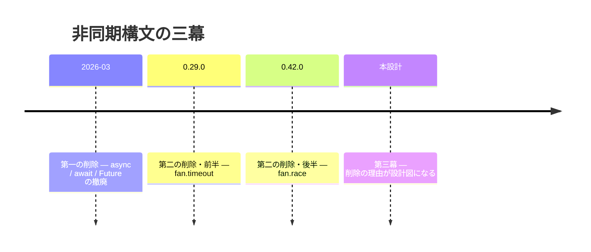
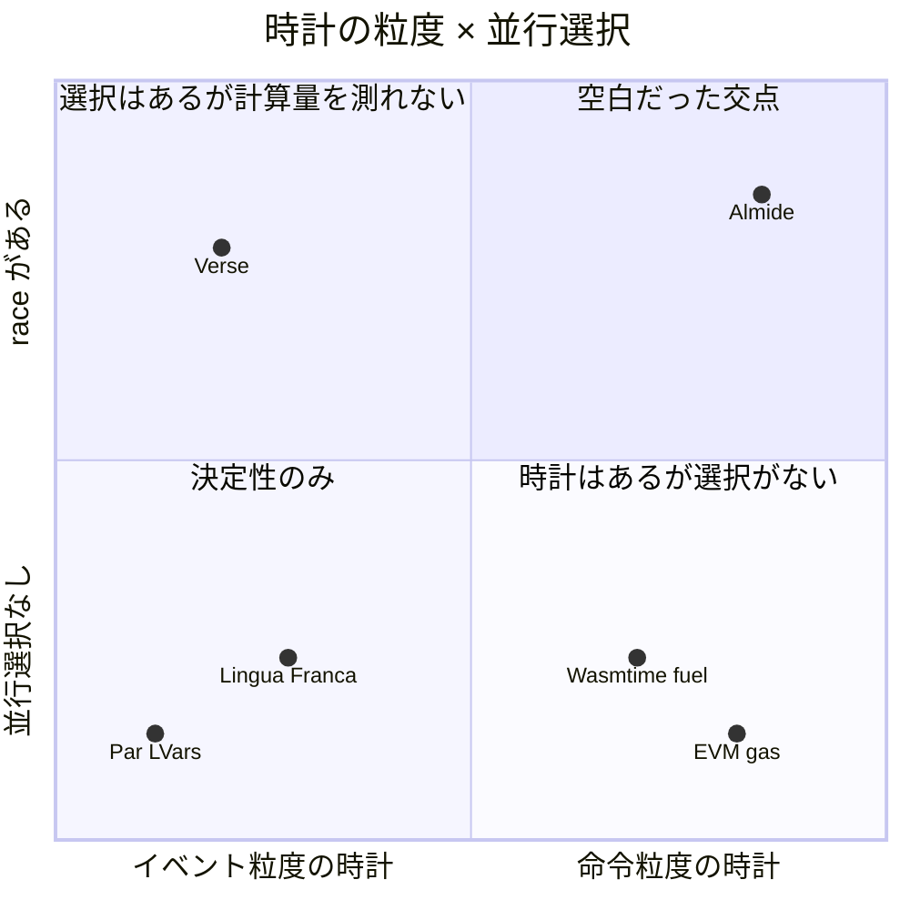
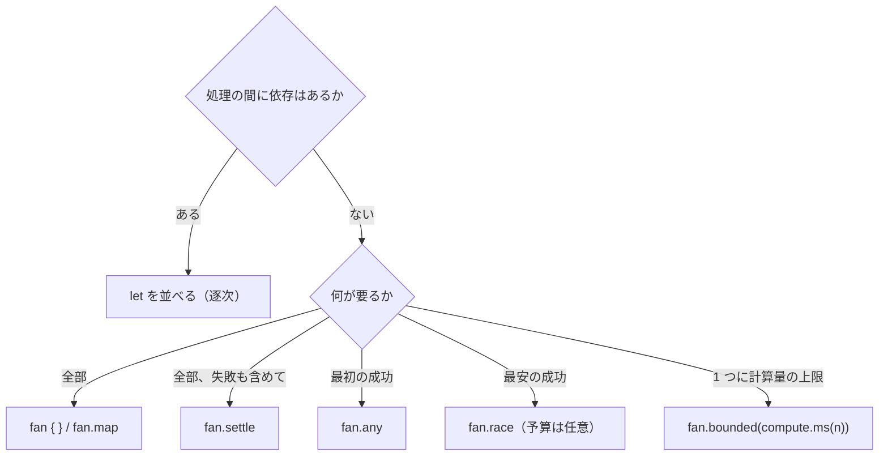
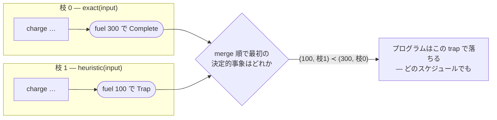
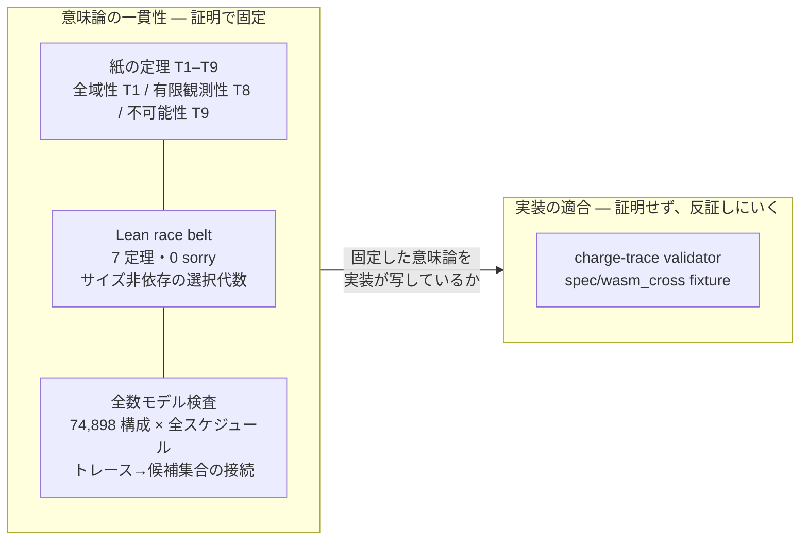
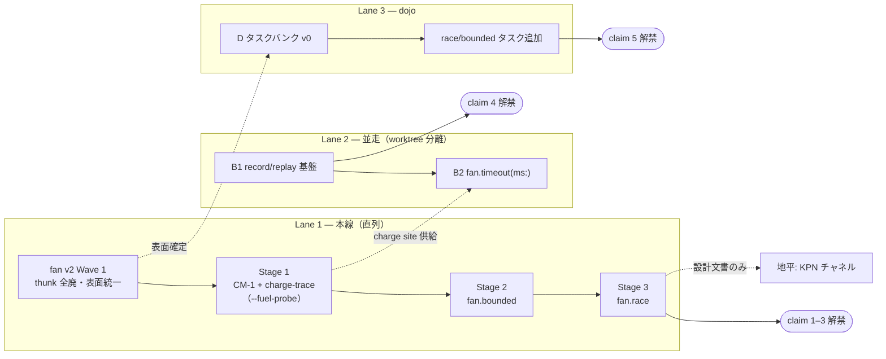

Historical description: The async inception: thesis, grammar, semantics, proofs, claim and plan in one charter.
<a id="async-inception--logical-time-as-the-languages-time-base"></a>

# Async Inception — logical time as the language's time base

[](async-inception.md) [](async-inception.ja.md) [](async-inception.zh-CN.md)

> Non-normative fixed-source historical design reader. The pinned original remains authoritative and unchanged; no automatic synchronization or independent execution, measurement or proof validation. The August 3 branch status, original pending stages and later narrowed claims coexist: claims 1–3 are reported as meeting release conditions, claim 4 covers timeout ω replay only with B1 effect-response tape unstarted, and claim 5 has Almide-only 7/7 MSR with cross-language comparison pending. Old optional-budget fan.race and thunk surfaces are historical, not current API advice. Optimization invariance, uniqueness, automatic replay and zero-overhead statements are original scoped design claims, not independent guarantees of the current implementation. Lean algebra, bounded exhaustive model checks, paper theorems and implementation conformance are different evidence layers. Verse pure-computation behavior is explicitly inferred, not runtime-verified. The original document’s authority and commands apply to its historical charter, not new instructions or current normative precedence. Section 7’s two-lane title and three-lane diagram are retained. [Source](https://github.com/almide/almide/blob/35297a612fb29e3f78f6587aba253aa91d51f466/docs/roadmap/active/async-inception.md)

> Charter of the asynchronous design. This one document gives the whole picture; use the document map at the end for depth.

> **Implementation status (2026-08-03, branch `worktree-stage1-charge-probe` — BURNDOWN/contract ledger is authoritative where accounts differ; the charter body remains as drafted)**: the §7 plan has completed **Lane 1 (Wave 1 → Stage 1 → 2 → 3), Lane 2 B2 (fan.timeout), and Lane 3 D (dojo async bank, Almide side 7/7)**. Every §3 matrix cell is fixed, including race's mapper form (T7-1), mechanically pinned by `tests/fan_surface_matrix_test.rs`. Of §6's five statements: **1–3 meet their release conditions** (seven Lean theorems + C-202..C-208 + 3-way gates); **4 is true if confined to timeout-ω record/replay** (the full effect-response tape, B1, has not started); **5 has Almide-only MSR measurements, but releasing the full statement still needs same-model lang-bench(async) comparison**. C (KPN) remains a horizon as designed.

<a id="0-一文"></a>

## 0. One sentence

**Wall time does not determine observations. The language's time basis is logical time; environmental time enters only as declared input.**

Before arriving here, Almide removed asynchronous syntax twice. Its history was made by subtraction, not addition; this third design also answers what those two removals had diagnosed.

<a id="1-物語--二度削除した言語だけが三度目に正しく作れる"></a>

## 1. The story — only a language that removed it twice can build it correctly the third time

SPEC.md once placed opposing promises about one feature side by side. §13.1 said “the result is identical on native and wasm”; §13.2 said “the fastest arm wins.” Each sounds plausible alone. But the former requires independence from timing, while the latter turns timing itself into the result. Two sections of one document were selling incompatible promises.

Which should go? There was actually no room for doubt. Native ⇄ wasm observational equivalence is the reason the contract ledger exists; every contract stacked there rests on it. Only “the faster arm wins” could be discarded (#1000, the deterministic data-parallel stance).

One removal was not enough.

**First removal (2026-03)** — `async` / `await` / `Future`. Almide decided not to make these three standard fixtures of other languages part of its grammar. `effect fn` became the async boundary; waiting became something the compiler inserts rather than something the programmer writes. Since then, **async and await never appear in Almide source** — the lexer has no such tokens even if one tries. Forgetting them, stacking them, or putting them in the wrong place ceased to be an error class to repair: the syntax itself ceased to exist. In the rest of this document, async names the field of asynchronous computation, not Almide syntax.

**Second removal (0.29.0 / 0.42.0)** — `fan.timeout` and `fan.race`. Wall-clock timeout was the only surface not a “function of program and input.” Race was a name without meaning under the deterministic model. The removal hint said “deadlines belong at the host boundary.” In other words, it was not meant to return to the language.

The asynchronous surface then contained only `fan {}` / `fan.map` / `fan.any` / `fan.settle` — four timing-independent forms.



**Act three (this design)** — what was meant to be a permanent removal turned out to be the blueprint for a return. Restating why race died: “the faster one wins” was not the bad idea. The language had no quantity with which to compare speed. Physical time gives different values on native and wasm. What race needs, then, is not retraction but a definition of “speed” taking the same value on both targets.

What must be measured so that “the faster one wins” has observations strictly identical to sequential evaluation?

<a id="2-鍵--時計を-fuel-に取り替える"></a>

## 2. The key — replace the clock with fuel

Discarding “the faster one wins” did not really discard competition. It discarded the wall clock. Nothing was wrong with the race shape; the problem was a winning clock that was a function of host speed. That leaves one question: can a quantity determined by the program itself stand in for time?

Yes. Industry has already named both sides. Wasmtime documents two interruption mechanisms: **fuel**, which stops the same program with the same initial state and allowance at the same point, and **epoch**, derived from wall time, which does not guarantee where execution stops. EVM **gas** has demonstrated the same claim at consensus scale. Unless every node applies the same cost table to the same state transitions and reaches the same out-of-gas decision, the chain forks. A deterministic bound is not a nice-to-have; it is the correctness argument itself.

Where, then, is a language running race on this fuel clock? Laying out the lineage reveals a curious gap.

Verse has race. Losers are cancelled; simultaneous completion favors the expression written earlier in source. It comes closest to the ideal. But Verse logical time has event granularity, and expressions without suspension finish within one tick. Pure-computation races should therefore always tie and collapse to the first source arm (an inference from documentation, not verified on an actual runtime). The clock lacks the resolution to measure which computation is cheaper. EVM has that resolution, yet no concurrency syntax. Lingua Franca and Esterel treat logical time most neatly, but their clocks derive from events, not computational cost. Haskell's Par and LVars buy determinism by restricting operations — without addressing fuel, selection, or cancellation.



Every component has been demonstrated somewhere. Only the combination exists nowhere.

Is distributing fuel to fan enough, then? This design's first draft said so. It was wrong — the correction remains rather than being erased. Share a budget of 1000 between arms A and B: a schedule advancing A by 900 before switching to B exhausts different arms from a schedule running B first. Same total, same program, different ending. Once again, the scheduler decides. Fuel is necessary, not sufficient.

The first missing piece is supplied by not sharing the budget. Give each arm its own n, and its fate — how many steps to completion, where it traps, whether n exhausts it — becomes a function only of that arm's trace, unchanged by its neighbors. The second is winner selection: put every arm's events in a single lexicographic sequence of (cumulative fuel, source position), leaving no opening for physical time. But that sequence still needs adjudication. Who wins a tie? What if a loser traps midway? With nested budgets, who pays for the inner consumption? Only after answering those does the ordering deserve to be called a clock.

There is only one place in the language able to decide all three of budget distribution, winner selection, and loser visibility. Fan is compiler-known syntax, not a library function. Thus the compiler can own the three. In a language whose concurrency is a library, those decisions scatter across user code and scheduler, and nobody can provide the guarantee. Fuel is only a component. Fan being syntax turns the component into a language property.

<a id="3-文法--書く側から見た-fan-v2"></a>

## 3. Grammar — fan v2 from the writer's perspective

With fuel available, one line shows the design's destination.

```almide
let plan = fan.bounded(compute.ms(100)) { optimal_plan(g) } ?? greedy_plan(g)
```

Use the exact solution if it emerges within 100 milliseconds' worth of computation; otherwise fall back to the greedy solution. A computation bound and fallback collapse into one line with no new keywords. Race is written in the same style.

```almide
let ans = fan.race {
  exact_solve(input)
  heuristic_solve(input)
} ?? default_answer
```

Run two arms and take the one succeeding with less computation. No budget is written — race selection needs no budget; a budget is an optional guard for arm configurations where divergence is a concern (the review, including where the numbers come from, is in [ticks-interface-audit.md](https://github.com/almide/almide/blob/35297a612fb29e3f78f6587aba253aa91d51f466/docs/roadmap/active/ticks-interface-audit.md)). There is no await anywhere, no Future, no task handle. All one writes is “what to place side by side” and “how to select.”

A single product of “how to select” = head and “how to arrange” = form is the whole fan v2 surface.

| head | Selection rule | block form (static arms) | mapper form (dynamic) | Arm effect ceiling |
|---|---|---|---|---|
| (unmarked) all | All; first Err in list order | `fan { a; b }` → `(A, B)` | `fan.map(xs, f)` → `List[B]` | Effects allowed |
| settle | Collect all | `fan.settle { a; b }` → `(Result[A], Result[B])` | `fan.settle(xs, f)` → `List[Result[B]]` | Effects allowed |
| any | Successful minimum index (sequential fallback) | `fan.any { a; b }` → `T` | `fan.any(xs, f)` → `T` | Effects allowed |
| race | Successful minimum (spend, index) | `fan.race { a; b }` → `T` (budget is optional guard) | `fan.race(xs, f)` → `T` | **pure** (Rung 0) |
| bounded | Meter a single body | `fan.bounded(compute.ms(100)) { body }` → `T` | — (compose with map) | **pure** |
| timeout | Environment cuts execution off | `fan.timeout(duration.s(5)) { body }` → `T` | — | Oracle allowed (Stage 4) |

The six heads expose only one axis. Any minimizes index, race minimizes fuel; all and settle do not select. “What to minimize” is the sole difference among heads. Adding a head means adding a row and filling every column as an acceptance condition (matrix gate).

v1 fan.any required this spelling:

```almide
fan.any([() => http_fetch(a), () => http_fetch(b)])
fan.any(mirrors |> list.map((m) => () => fetch(m)))
```

Wrapping in thunks (`() =>`) was necessary because fan.any was a function and arguments would evaluate first. All heads are syntax in v2, so the compiler controls evaluation timing. The reason to wrap disappears.

```almide
fan.any { http_fetch(a); http_fetch(b) }
fan.any(mirrors, (m) => fetch(m))
```

The dynamic case likewise goes from two stages, “build a thunk list, then pass it,” to one, “list + mapper”; code is strictly shorter. There is a bonus: dynamic thunk lists hit a wall because wasm could not represent `List[funcref]`, while mapper form has fan.map's “data + one closure” shape, so this wall class disappears by syntax change alone. Contracts align by form too: block arms use the same auto-unwrap as `fan {}`, mappers require Result like `fan.map`. Zero per-head auto-wrap exceptions.

Writing a budget as time, `compute.ms(100)`, is definition, not compromise. “Time” here is not wall time — just as CPU seconds in `ulimit -t` do not count waiting, the deterministic clock counts only computation (unlike CPU time, it stops measuring and computes from a frozen cost table, so **machine speed does not matter either**; the three-way comparison is in [ADR-0001's premise section](https://github.com/almide/almide/blob/35297a612fb29e3f78f6587aba253aa91d51f466/docs/adr/0001-deterministic-time-units.md#前提--時間は-1-つではない)). **The logical clock's unit is time itself**: CM-1 assigns each op “time required on the frozen Almide abstract machine”; total consumption is a duration. It is a function of (program, input), returning the same value on every host. The quantity counted is deterministic; its name is time. Separability of those two is machine-checked — neither the seven Lean theorems nor the confluence gate over 74,898 configurations depends on units at all.

Bare integers cannot be written (`expected Compute, found Int`). Examples abound of unitless `1000` being misread as milliseconds or seconds, a 1000-fold error: from Go `time.Sleep(10)` (10 nanoseconds) to Jenkins's “300 seconds became 3.5 days.” Put units in the type and type checking kills this class. No new literal syntax is added: `compute.ms(n)` is a module-function call in current syntax, requiring no lexer or parser changes. Its **type differs** from wall-clock `fan.timeout(duration.s(5))`: they share units, the head announces which clock is read, and typing stops contamination through variables. The full decision and evidence based on surveying 15 other language families are in [ADR-0001](https://github.com/almide/almide/blob/35297a612fb29e3f78f6587aba253aa91d51f466/docs/adr/0001-deterministic-time-units.md).

What stays out is also part of this grammar.

| Candidate | Decision | Reason |
|---|---|---|
| `fan.rush` (returns fastest while losers keep running) | **Permanently rejected** | Loser effects keep leaking after selection; no meaning under the deterministic model |
| `fan.spawn` / `fan.link` | Sent to the horizon | The foundation for deterministic channels (logical clock) comes first |
| trailing lambda / `fan.all` alias | Do not introduce | Two spellings for one meaning are coexistence debt |
| `fan.map(xs, limit: n, f)` | Do not include | Never implemented (status table stale). Wait for demonstrated need |

The writer's decision tree closes in two questions.



One more question decides form: block for statically arranged arms, mapper for arms produced from data. Misplacing await does not exist as an option, let alone an error class. The lexer has no async / await tokens; the dead AST variants (`ExprKind::Await`, the `r#async` field) are removed in Wave 1. “Cannot write it in the grammar” is upgraded to “cannot represent it.”

Still, the first one-line example hides unanswered questions. What if `optimal_plan(g)` divides by zero midway? If a race arm exhausts its budget midway, at precisely what point is “midway”? No column in the table answers. Grammar has no clock. Answering requires a device that can say exactly what happened at which point of a deterministic clock — the logical clock running one level below the grammar.

<a id="4-意味論--五本の柱"></a>

## 4. Semantics — five pillars

Suppose one writes `fan.race(compute.s(1)) { exact(input); heuristic(input) }`. If heuristic divides by zero midway, does the program abort? If exact exhausts its budget, who knows, and how? The grammar table does not answer. The answer lies in five semantic pillars.

<a id="柱-1--論理時計fuel-は機械のコストではなくソースのコストを数える"></a>

### Pillar 1 — logical clock: fuel counts source cost, not machine cost

Fuel may suggest counting executed machine instructions. That seems natural, but changing optimization level would then change which programs exhaust. “Adding `-O` breaks the test” — the nondeterminism we wanted to exclude flows back through the clock definition.

Thus charges attach to MIR **before** optimization, and every subsequent pass preserves their annotations. Even if renderer peepholes fuse ops, the summed charge remains. With this move, “`-O` invariance” is constructive rather than a test item, and RC, MakeUnique, and moves become automatically free — they are implementation conveniences, not source-semantic costs. This parallels EVM gas being defined independently of JIT speed.

The cost table enters the ledger as a versioned semantic object, `CM-1`. Change one constant and the winning arm may change; constant changes are therefore semantic changes. Only two conditions constrain implementation: W1, every cycle and recursion passes at least one charge site; W2, work between sites is finite. These underpin the later statement that budgeted execution always reaches an answer in finite time.

One more quiet decision matters later: **charge sites are the language's only interruption points**. Fuel syntax reads the counter there; oracle syntax reads the environment at the same place. Both tiers share the locations of interruption points themselves.

<a id="柱-2--決定的事象規則勝敗も死もmerge-順が決める"></a>

### Pillar 2 — decisive-event rule: merge order determines both victory and death

Return to the opening question. Each arm is a deterministic charge trace, whose terminal event (Complete or Trap) becomes `(累積 fuel, 枝 index)` (cumulative fuel, arm index). There is just one rule.

> Order Complete / Trap terminal events in merge order (lexicographic (cumulative fuel, arm index)); **the first decisive event is the sole arbiter**. Complete makes that arm the winner; Trap aborts the program with that trap; no decisive event yields `Err(exhausted)`.

Suppose exact (arm 0) completes at fuel 300 and heuristic (arm 1) divides by zero at fuel 100. Which thread physically runs first is unknown and irrelevant.



The trap precedes completion in logical time, so the program aborts. Reverse the arrangement — heuristic completes at 100, exact traps at 300 — and the decisive event is completion at (100, arm 1); arm 0's trap is **treated as never having occurred**. Speculative failure disappears quietly, while a bug before resolution always kills execution. Merge order, not wall time, decides which side of that boundary an event occupies. Exhaustion is answered by the same rule: no decisive event means `Err(exhausted)` — not an exception but an ordinary value handled by `??`.

The rule has another face. Draw lockstep, “every arm advances 1 fuel per tick, ties in source order,” and first completion exactly matches lexicographic minimum (spend, index). The picture offers Verse's UX; the equation removes the scheduler from the definition. Two readings of one thing.

<a id="柱-3--敗者の非観測性キャンセルは意味論ではなく最適化"></a>

### Pillar 3 — loser non-observation: cancellation is optimization, not semantics

A naive design shares one budget counter among arms. The scheduler decides which arm decrements it first, and therefore who exhausts. This was the trap that self-correction killed in the initial “adding fuel is enough for determinism” view. Per-branch budgeting removes the dependency at its root. It removes another too: adding an arm does not change existing arms' meanings. The editing failure in which an LLM adds a third candidate and the first suddenly exhausts becomes structurally impossible.

Only three things are observable: the selected value, the trap visibility window, and consumption under nesting. Everything else — when native stopped loser threads, how many steps fuel checking was delayed — is absent from observations. Pruning has a sufficient condition: for recorded candidate d, arm k need run only to `d.time − (k > d.idx ? 1 : 0)`. The fact that this cap cannot hide the decisive event or its visibility window is precisely what the machine proof below addresses.

<a id="柱-4--入れ子予算は-streaming-で流れ落ちる"></a>

### Pillar 4 — nesting: budgets flow downward as streams

Put race inside `fan.bounded`: how does the inner computation consume the outer budget? Effective budget is `min(自身の fuel, 外側の残量)` (minimum of own fuel and outer remaining allowance), the same shape as EIP-150's subcall gas bound. No region tags or propagation mechanism; everything becomes arithmetic.

Race's consumption visible to the outside is the **occurred stream**, the charge sequence preceding the decisive event in merge order. The outer region observes it streamed in merge order. If outer allowance expires midway, the outer becomes Exhausted there and abandons the race. What is debited is semantic consumption, not work the implementation physically performed. The same principle that made RC free operates once again.

<a id="柱-5--効果の三層と不可能性の定理"></a>

### Pillar 5 — three effect tiers and an impossibility theorem

Why must race arms be pure? If a losing arm's `print` remains on screen, “losers are unobservable” is false from the start. Conveniently, Almide's effect discipline (no `var` captures, mut-argument checking, single error channel) already splits effects into {pure | output | oracle}. v1 arms are pure (Rung 0). Output-only arms follow as a transactional Rung 1, flushing only the winner's output after resolution and discarding losers'.

Will oracle effects — http or fs — ever be writable in race arms? No. This is a theorem (T9), not implementation convenience. Syntax choosing a winner by the environment's wall clock contradicts the deterministic tier's definition that observations are a function of (program, input). I/O races and timeouts necessarily belong to the oracle tier, a contract class treating environmental response sequence ω as declared input. That is necessity, not preference. `fan.timeout` remaining a tombstone is a corollary.

The five pillars are not independent tricks; together they support one claim: observations do not change under sequential or parallel execution, pruning, or lazy fuel checks. But the designer believing “unchanged” and showing it are different matters.

<a id="5-証明--定理が通る前に定義が壊れた"></a>

## 5. Proof — before the theorems passed, the definitions broke

All five pillars are written as assertions. A design document may assert; assertions are not guarantees. A contradiction inside a declarative sentence need not make a document hard to read. This repository paid that tuition when §13.1 and §13.2 coexisted for months saying opposites.

So we wrote proofs. The first thing that happened was not a theorem passing, but **being unable to write the definition**.

Try to make trap visibility a theorem and there is a case where the subject vanishes. With a winner, one can say “traps before the winner's decisive tick are observed.” But what if no arm completes and only traps occur? The first window rule said nothing. The correction folded rules into one: order Complete and Trap terminal events in merge order; **the first decisive event is the sole arbiter**. The winner-present window rule became a corollary.

The second happened in consumption arithmetic. We wrote race's charge to the outer budget as Σ min(end_j, s\*), but trying to prove it exposed an off-by-one at the boundary. A time-s\* charge on an arm indexed after the winner follows the winner's completion in merge order, and does not occur. The formula was almost correct; almost-correct formulas do not belong in the ledger. We replaced it with the sum of the occurred stream — charge events preceding the decisive event in merge order.

The third was nesting. Treating race consumption as “an atomic charge at the site” gave no adjudication point for an outer budget expiring **inside** the race: atomic debits have no “inside.” We changed it to streaming, where the outer observes the occurred stream directly in merge order and abandons race at exhaustion.

All three were found before implementation. Found afterward, each would have surfaced through fuzzing or actual use as cross-target output divergence, forcing a backward excavation of the root cause.

The guarantee now stands in three layers.

- **Lean kernel-check** — `crates/almide-race-belt/`, seven theorems, zero sorry: decisive-event uniqueness (`decisive_unique`), subset stability (`decisive_subset`), pruning caps cannot hide the decisive event or visibility window (`cap_admits_decisive` / `cap_admits_window`), confluence (`decide_stable`). CI's `lean-proofs` job monitors these, including introduction of sorry.
- **Exhaustive model checking** — `research/spike/logical-time-race/`. Across 74,898 configurations × all physical schedules (including overrun from delayed fuel checks past caps), reference semantics, sequential scan, adversarial parallel execution, and nested streaming agreed not just on winner but spent fuel and occurred stream. Rerunnable with one `run-gate.sh`.
- **Paper theorems T1–T9** — from totality (T1), through finite observability (T8, closing conditions for 2-safety), to T9: syntax selecting winners by environmental wall time cannot inhabit the deterministic tier.

Lean handles size-independent selection algebra; the model exhaustively handles the trace-to-candidate-set connection within a small scope; paper handles the perimeter.



We have also decided what is not proved. Whether both renderers faithfully implement these semantics cannot be proved at the design stage. Charge-trace validators and `spec/wasm_cross` fixtures attempt to falsify that; it is explicit in the proven-vs-trusted boundary. Theorems fix semantic consistency; gates catch the moment implementation departs. Their roles do not overlap.

Yet all three layers fix **internal** consistency. Seven theorems and 74,898 configurations say nothing about whether this race is better than Verse or this clock better than Lingua Franca. Can this therefore be called the world's best?

<a id="6-当初の主張検討と現在の証拠で言える範囲"></a>

## 6. Original claim review and what current evidence supports

Seven Lean theorems, exhaustive checks of 74,898 configurations, a T1–T9 ledger. Stack that much and “the world's best async grammar” might sound justified.

We want to say it. But not today, for two reasons. First, race and bounded remain at design/proof stage; the shipped surface runs only from `fan {}` to `fan.settle`. Paper does not compete. Second, there are clear losses on operational axes.

| Counterpart | Where it wins | Almide's present state |
|---|---|---|
| Erlang/OTP | Fault tolerance (supervision, let-it-crash), 30 years of production | No structural recovery; traps simply kill deterministically |
| Go | Production async maturity, goroutine usability | Oracle tier unimplemented; cannot write genuine concurrent I/O races |
| Verse | Shipped transactional effects, production use in Fortnite | Effect isolation is only a Rung 0 (pure) design |
| Lingua Franca | Distributed (federated) determinism, academic foundation | Distribution outside scope |
| Temporal and similar durable execution | Replay-based persistent execution exists commercially | Not started on the language side; counterpart is a runtime, not a language |

These five losses differ in kind. Erlang is a loss we chose not to pursue: a fault-tolerant server is a different product from this language. Go and Verse seem a matter of time, since the oracle tier and Rung 1 map directly to them. Lingua Franca's loss (distributed determinism) belongs to the horizon, on the shelf with KPN channels. Deterministic coordination in distribution can only stand on logical clocks; if that day comes, LF is a source to borrow from, not a competitor. Borrowing in reverse does not happen: LF is a multilanguage coordination layer, does not own reaction bodies, and cannot meter computation portably. Metering requires ownership of codegen. The Temporal row differs: because it is a runtime, not a language, a language structurally offering the same ability can reclaim that loss.

The loss table also identifies the battlefield. We do not compete in human-operated fault-tolerant servers. Almide competes in **concurrency in an era where LLMs write most code**, where agent-written concurrent code returning the same result every run, and always being reproducible when broken, becomes an asset. This battlefield is still small today. But humans are no longer the only ones whose CI is burned by flaky tests.

The true opponent here is not any of the five, but “a runtime is enough.” Temporal commercially proved demand for replay, but workflow determinism is required by convention and violations surface at runtime. LLMs break conventions. They cannot break structure — the same logic underlying this language becomes the weapon here too.

The external wording below is confined to evidence, not the drafting-time slogans. Machine proofs, finite regression checks, and external comparison experiments are different kinds of evidence.

1. “The logical-time **selection algebra** has Lean-checked theorems” — not a conformance proof for the entire runtime or every concurrent construct.
2. “For the target fixtures, contract gates check native / wasm observational differences” — state finite measurement scope and distinguish it from observational equivalence for arbitrary programs.
3. “`fan.min` can select by logical cost using a Compute clock” — clock mandatory; cost contract bounded to meter version. No world-unique claim.
4. “Recorded oracle events have replay checks” — enumerate recording formats, target hosts, and fixtures; do not guarantee replay of every async bug.
5. “Measure async-edit success rates for specified models, tasks, and versions” — report only with Dojo comparison conditions and results; do not generalize to most correct among all languages.
The original Stage 3 / B1 / Dojo stage plan is retained below, but completing a stage does not enlarge evidence scope. In particular, selection-algebra theorems do not imply whole-implementation correctness, nor do finite replay tests imply reproducibility of arbitrary bugs.

The five statements organize design evaluation axes. The former assessments “1 already won” and “3 wins by default because nobody has built it” are unproven and are not carried forward as current competitive advantages. Recording/replay remains bounded to target events; MSR, demand, and competitor comparisons require separate external measurements with model, task, and version fixed.

Hide the loss table and list only these five claims, and we are the first to fail an audit. The remaining question is order: first fill reclaimable losses, or losses that are a matter of time?

<a id="7-計画--二レーン並列と一本の地平"></a>

## 7. Plan — two parallel lanes and one horizon

Of the five statements, only the machine-proof sentence can be signed today. In which order should the other four be released? A through E labels tempt a top-down reading, but dependency analysis shows this is not sequential. We initially thought record/replay (B1) had to wait for the deterministic tier. Wrong: today's language, deterministic except for oracle effects, already has a place to attach the tape. Only B2 waits for fuel.



Lane 1 is sequential, and order does work. Wave 1 goes first as a small change to welcome race in v2 form from the start (block/mapper forms for any/settle and thunk tombstones; only eight spec files to migrate). Stage 1 does not yet implement region specialization: the hidden `--fuel-probe` flag creates a globally metered build, running only three-part fixtures (result / consumed / trace) and validator first. The heavy specialization machinery waits until Stage 2 brings the surface. Stage 3 lands race with pruning, delayed trap adjudication, and nested streaming, revises E027, and releases claims 1–3.

Why Lane 2 is decisive is structural, not performance-related. Go's goroutine scheduling is itself nondeterministic, forcing rr to record all syscalls and scheduling. Temporal requires determinism by convention and detects violations at runtime. Almide nondeterminism passes through just one registered surface: fs / http / process / random / env. Thus record/replay is wiring for Almide and an architecture change for competitors. Recording on native and replaying on wasm holds by definition, becoming the executable form of the R_Ω contract.

Do not start C (KPN channels). Write only the design document after Stage 3. Until #1000's condition for revisiting structured concurrency — contracts per construct first — is met, there is no reason to touch implementation.

<a id="8-反証条件--殺せるものから先に走らせる"></a>

## 8. Falsifiers — run first what can kill the design

Order has another purpose. Stage 1 leads the heavy work because it alone can kill the whole. If a renderer peephole fails to combine one charge event correctly, traces diverge and everything from Stage 2 onward becomes invalid. Hence run it first.

| Falsifier | Detection surface | Response |
|---|---|---|
| Charge trace not preserved through lowering | Stage 1 three-part fixtures (renderer peephole is main suspect) | Stop Stage 2 onward |
| Required charge placement cannot meet W1/W2 | CM-1 implementation | Retract the claim together with T1 (totality) |
| Metering overhead unacceptable even when region-limited | Stage 2 benchmark | Coarsen charge granularity or advance AARA |
| Pure-only race has little real use | Usage after Stage 3 | Advance Rung 1 (transactional output); if still limited, reassess race's value |
| A precedent for instruction-granularity race is found | Search alongside D's comparative work | Retract claim 3 and correct competitor table |
| Dojo measurements show async MSR does not beat competitors | Lane 3 | Measurement wins: redesign fan v2 if grammar-related, otherwise send to diagnostic lane |

Every row names a retreat. Only claims with a predetermined sacrifice if falsified go outside.

<a id="9-文書地図"></a>

## 9. Document map

| Document | Role |
|---|---|
| async-inception.md (this document) | Charter — authoritative overall account |
| concurrency-stance.md | Premise decision: deterministic data parallelism (#1000) |
| deterministic-bounds.md | Problem framing and correctness argument (four questions) |
| logical-time-async.md | Detailed semantics (CM-1, decisive events, nesting, effect ladder) |
| fan-v2.md | Surface detail (head × form, migration, rejection table, Wave) |
| logical-time-proofs.md | Proof ledger (T1–T9, corrections) |
| logical-time-implementation.md | Implementation strategy (Op::Charge, fuel ABI, metered specialization, gate wiring) |
| fan-v2-examples.md + fan-v2-examples/*.almd | Reference examples (code originals in .almd; behavior annotations seed fixtures) |
| ticks-interface-audit.md | External ticks audit (why not time, optional race budget, supplier of numbers) |
| async-world-claim.md | Claim audit (source of competitor table, five moves, execution order) |
| `crates/almide-race-belt/` | Lean machine proof (zero sorry, always in CI) |
| `research/spike/logical-time-race/` | Exhaustive confluence gate (`run-gate.sh`) |

Where individual documents disagree with this one, this document is authoritative; the disagreement itself is a bug to fix.

<a id="10-結び--削除された二行のところへ"></a>

## 10. Closing — back to the two deleted lines

Ironically, the shortest description of the completed plan is the two SPEC.md lines deleted in 0.42.0: §13.1 “same result wherever it runs”; §13.2 “the faster one wins.” Their incompatibility forced deletion of the latter — this design's starting point. Almide after completion makes both true at once. The faster one wins, but speed is measured in logical time, not wall time.

Yet this circle remains unsigned. All seven Lean theorems and the confluence of 74,898 configurations rest on one floor: “charge traces are preserved through lowering.” Stage 1 fixtures are first to try to break through that floor. The next thing to move is not a proof, but a falsifier.


---

**Reader gloss for Japanese labels preserved in the original diagrams (the diagrams themselves are unchanged):**

- Timeline: “Three acts of asynchronous syntax”: March 2026, the first removal—async / await / Future; 0.29.0, the first half of the second removal—fan.timeout; 0.42.0, its second half—fan.race; this design, the third act—the reasons for removal become a blueprint.
- Quadrant chart: “Clock granularity × concurrent selection.” The horizontal axis runs from event-granularity clocks to instruction-granularity clocks; the vertical axis from no concurrent selection to having race. Its quadrants read “previously empty intersection,” “selection exists but cannot measure computation,” “determinism only,” and “a clock exists but no selection.” The plotted language/system positions are the source’s illustrative placement, not independently measured rankings.
- Decision tree: “Are there dependencies between operations?” If yes, arrange let bindings sequentially. If not, ask “What is needed?” All results → fan / fan.map; all results including failures → fan.settle; first success → fan.any; cheapest success → fan.race (budget optional in this historical design); a computation limit for one operation → fan.bounded(compute.ms(n)).
- Trap diagram: branch 0, exact(input), reaches Complete at fuel 300 after charges; branch 1, heuristic(input), reaches Trap at fuel 100. Ask which decisive event is first in merge order. Because (100, branch 1) precedes (300, branch 0), the program aborts with this trap under every schedule in the illustrated semantics.
- Evidence diagram: “Semantic consistency—fixed by proofs”: paper theorems T1–T9 (totality T1, finite observability T8, impossibility T9); Lean race belt (7 theorems, 0 sorry, size-independent selection algebra); exhaustive model checking (74,898 configurations × all schedules, connecting traces to candidate sets). A separate box says “Implementation conformance—not proved; attempt to falsify it,” using the charge-trace validator and spec/wasm_cross fixtures. The connecting question is whether the implementation maps the fixed semantics.
- Plan diagram: Lane 1 is the sequential main line: fan v2 Wave 1 removes all thunks and unifies the surface; Stage 1 adds CM-1 plus charge traces (--fuel-probe); Stage 2 adds fan.bounded; Stage 3 adds fan.race. Lane 2 proceeds in parallel in a separate worktree: B1 record/replay foundation → B2 fan.timeout(ms:). Lane 3 is dojo: D task bank v0 → add race/bounded tasks. Stage 1 supplies charge sites to B2; Wave 1 fixes the surface for the task bank. Stage 3 unlocks claims 1–3, B1 unlocks claim 4, and added tasks unlock claim 5. From Stage 3, a design-document-only arrow points to the horizon of KPN channels. These arrows describe the source plan, not new completion attestations.
