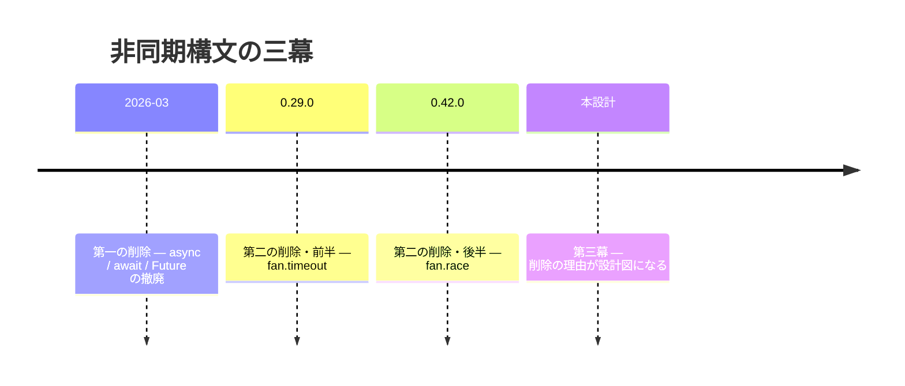
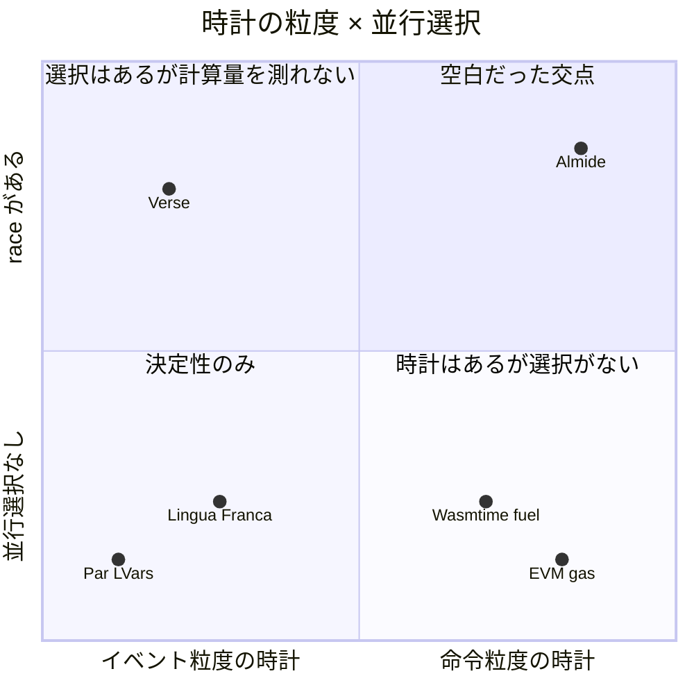
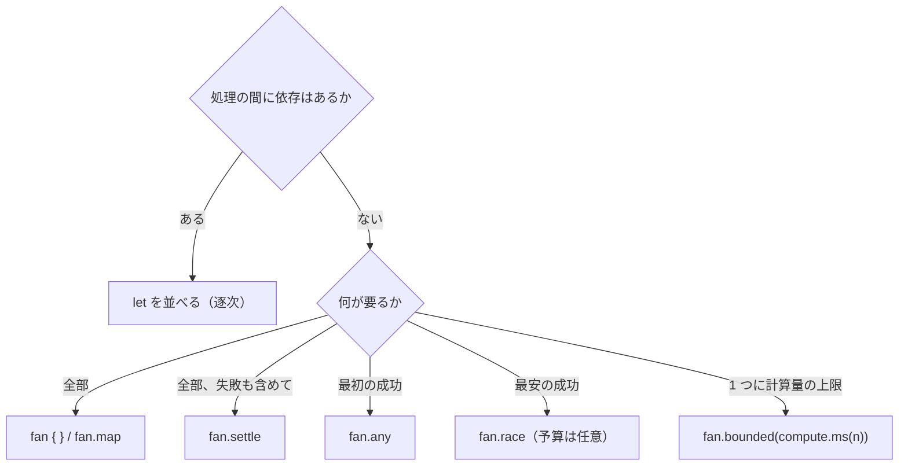
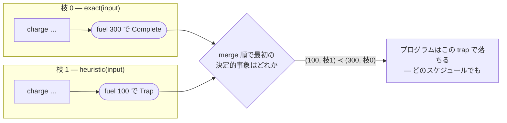
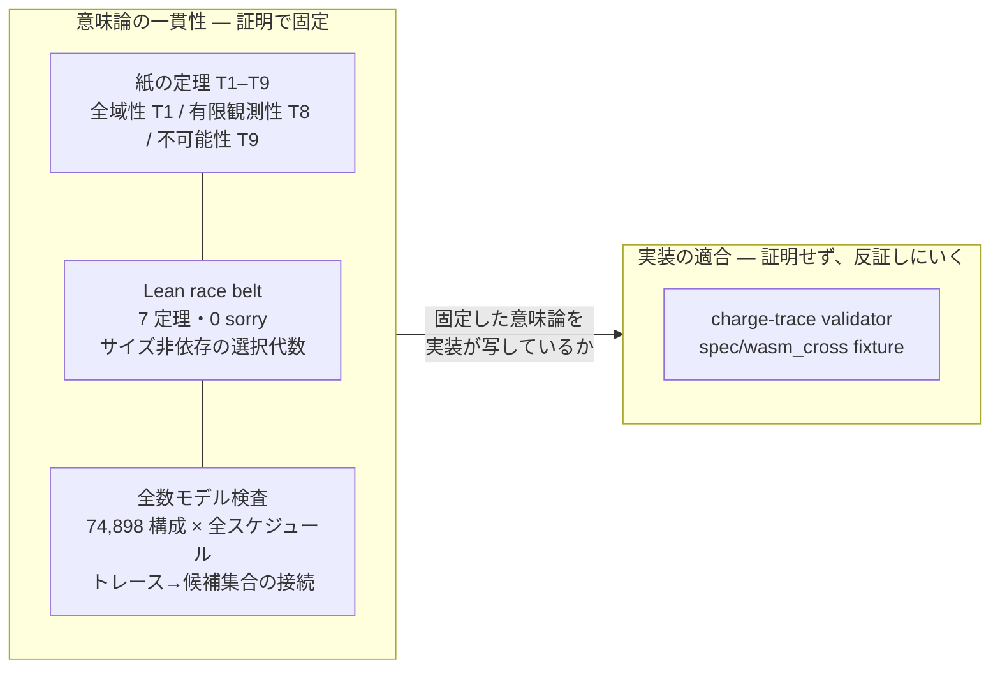
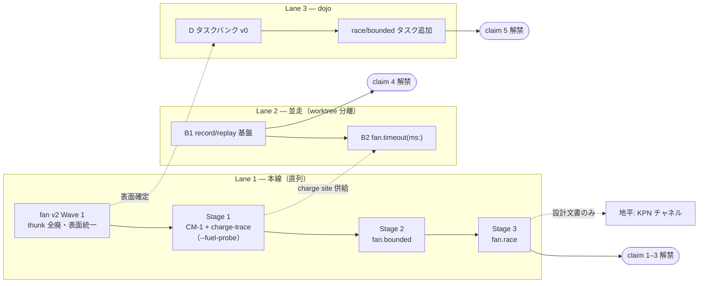

历史描述：async 起始章程，将论点、文法、语义、证明、主张与计划置于一份章程。
<a id="async-inception--logical-time-as-the-languages-time-base"></a>

# Async Inception — 逻辑时间作为语言时间基底

[](async-inception.md) [](async-inception.ja.md) [](async-inception.zh-CN.md)

> 非规范性固定原文历史设计读者版。保留固定正本，不自动同步，未独立运行、重新测量或验证证明。8月3日分支状态、最初待办阶段与后文收窄的主张并存：主张1–3被报告为满足发布条件；主张4仅覆盖timeout ω重放，B1效果响应磁带尚未着手；主张5只有Almide的MSR 7/7，跨语言比较仍待完成。旧的预算可选fan.race及thunk表面是历史记录，并非现行API建议。优化不变性、唯一性、自动重放及零开销是原文有限范围的设计主张，不是对当前实现的独立保证。Lean代数、有界穷举模型检查、纸面定理与实现符合性属于不同证据层。Verse纯计算行为明确属于推断，未经运行验证。原文的权威性与命令属于当时计划，不构成新指令或当前规范优先级。第7节两条路线标题和三条路线图按原文并存。 [Source](https://github.com/almide/almide/blob/35297a612fb29e3f78f6587aba253aa91d51f466/docs/roadmap/active/async-inception.md)

> 异步设计章程。这一篇可读全貌，深入资料见末尾文档地图。

> **实现状态（2026-08-03，branch `worktree-stage1-charge-probe` — 有分歧时以 BURNDOWN/契约台账为准；章程正文仍保留起草时内容）**：§7 计划中，**Lane 1（Wave 1 → Stage 1 → 2 → 3）、Lane 2 的 B2（fan.timeout）、Lane 3 的 D（dojo async bank，Almide 侧 7/7）已完成**。§3 matrix 所有单元均确定，包括 race mapper 形式（T7-1），由 `tests/fan_surface_matrix_test.rs` 机器固定。§6 五句话：**1–3 = 解禁条件已满足**（Lean 7 定理 + C-202..C-208 + 3-way gates）；**4 = 限于 timeout-ω record/replay 范围则成立**（效果响应 tape，即 B1 全域尚未启动）；**5 = 已取得 Almide 单独 MSR，全文解禁仍需同模型比较 lang-bench(async)**。C（KPN）按设计仍在远景。

<a id="0-一文"></a>

## 0. 一句话

**墙钟不决定观察。语言的时间基底是逻辑时间，环境时间仅以已声明输入进入。**

走到这里之前，Almide 两次删除异步语法。这是减法而非加法的历史；第三次的本设计也回答了“两次删除究竟诊断出什么”。

<a id="1-物語--二度削除した言語だけが三度目に正しく作れる"></a>

## 1. 故事 — 只有删过两次的语言，第三次才能正确构建

SPEC.md 曾对同一功能并列给出相反承诺。§13.1 说“native 和 wasm 结果相同”，§13.2 说“最快分支获胜”。单看各自都合理，但前者要求独立于时序，后者把时序本身变成结果。同一文档的两个章节在出售不兼容的承诺。

舍弃哪个？其实没有犹豫余地。native ⇄ wasm 观察等价就是契约台账存在的理由，所有契约都建立于此。只能舍弃“更快者获胜”一侧（#1000，确定性数据并行立场）。

删除不止一次。

**第一次删除（2026-03）** — `async` / `await` / `Future`。其他语言的这三件标配，Almide 决定不纳入文法。`effect fn` 成为异步边界，等待不再由人写，而由编译器插入。此后，**Almide 源码不会出现 async 或 await** — 想写也没有 lexer token。忘写、叠写、位置写错这一类错误，不再是待修复问题，而是连同语法一起不存在。下文 async 指异步领域，不是 Almide 语法。

**第二次删除（0.29.0 / 0.42.0）** — `fan.timeout` 和 `fan.race`。墙钟超时是唯一不属于“程序与输入的函数”的表面。race 是确定性模型下无法赋义的名字。移除提示写着“期限放在 host boundary”。也就是说，本不打算让它回到语言。

此时异步表面仅剩 `fan {}` / `fan.map` / `fan.any` / `fan.settle` — 四个不依赖时序的形式。



**第三幕（本设计）** — 后来才发现，本不打算恢复的删除，反而是复活蓝图。重述 race 死亡原因：“更快者获胜”的想法没有错，语言中缺少比较快慢的量。物理时间在 native 和 wasm 返回不同值。那么 race 所需不是撤回，而是在两目标取同值的“快慢”定义。

测量什么，才能让“更快者获胜”与顺序求值具有严格相同的观察？

<a id="2-鍵--時計を-fuel-に取り替える"></a>

## 2. 关键 — 用 fuel 替换时钟

舍弃“更快者获胜”时，真正舍弃的不是竞争，而是墙钟。race 形状本身没错，错在衡量胜负的时钟是 host 速度的函数。问题因此缩成一个：有没有由程序自身决定、能够替代时间的量？

有。产业界早已为两侧命名。Wasmtime 文档给出两种中断机制：**fuel** 对同程序、同初始状态、同额度，会在同一位置停止；**epoch** 源于墙钟，不保证停止位置。EVM **gas** 已在共识规模实证相同主张。若所有节点不能对同一状态转移应用同一成本表、得出同一 out-of-gas 判定，链就分裂。确定性上限不是锦上添花，而是正确性论证本身。

那么，哪里有以 fuel 为时钟运行 race 的语言？排列谱系后，出现奇怪空白。

Verse 有 race。未获胜者取消，同时完成时源码中靠前的表达式获胜，最接近理想。但 Verse 逻辑时间是 event 粒度，不含 suspension 的表达式在同一 tick 完成。因此纯计算之间的 race 应总是平局，总归约到源码第一个分支（由文档推断，未实机验证）。时钟没有衡量“哪项计算更便宜”的分辨率。EVM 有分辨率，却没有并发语法。Lingua Franca、Esterel 的逻辑时间处理最规整，但时钟源于事件，不承载计算量。Haskell Par 和 LVars 限制操作以换取确定性 — 不处理 fuel、选择或取消。



所有部件都已在某处实证，唯有组合哪里都没有。

那么只要把 fuel 分给 fan 就行了吗？本设计初稿曾如此主张。错了 — 更正保留，没有抹去。A、B 共享 1000 预算时，先让 A 前进 900 再切 B，与先运行 B 的调度会使不同分支耗尽。同总量、同程序、不同结局。又是调度器决定。fuel 是必要条件，不是充分条件。

第一个缺口由不共享预算补上。各分支有自己的 n，命运 — 几步完成、哪里 trap、是否在 n 耗尽 — 就只是自身 trace 的函数，不受邻居影响。第二个是胜者选择：将所有分支事件按（累计 fuel，源码位置）字典序排成一列，物理时间就无隙可入。但该序列仍需裁决：平局谁胜？未获胜分支中途 trap 会怎样？预算嵌套时，内层消耗算谁的账？回答完这些，排列才配叫时钟。

语言中只有一个地方能决定预算分配、胜者选择、未获胜者可见性三件事。fan 不是库函数，而是编译器已知语法，所以编译器可掌握三者。并发是库的语言中，同样决定散落到用户代码与调度器，没人能给出保证。fuel 只是部件；fan 是语法，才将部件变成语言性质。

<a id="3-文法--書く側から見た-fan-v2"></a>

## 3. 文法 — 从编写者看 fan v2

有了 fuel，设计终点可用一行展示。

```almide
let plan = fan.bounded(compute.ms(100)) { optimal_plan(g) } ?? greedy_plan(g)
```

100 毫秒计算量内有精确解就采用，否则退到贪心解。计算量上限与 fallback 在无新关键字下折叠为一行。race 也一样写。

```almide
let ans = fan.race {
  exact_solve(input)
  heuristic_solve(input)
} ?? default_answer
```

运行两个分支，取计算较少且成功的一个。没有写预算 — race 选择不需要预算，预算仅是担心分支发散时可加的守卫（包括数字来源问题的详细审查见 [ticks-interface-audit.md](https://github.com/almide/almide/blob/35297a612fb29e3f78f6587aba253aa91d51f466/docs/roadmap/active/ticks-interface-audit.md)）。没有 await、Future 或 task handle。只写“并列什么”“怎样选择”。

“怎样选择”=head 与“怎样排列”=form 的一张直积表，就是 fan v2 全部表面。

| head | 选择规则 | block form（静态 arm） | mapper form（动态） | arm 效果上限 |
|---|---|---|---|---|
| （无标记）all | 全部，列表顺序首个 Err | `fan { a; b }` → `(A, B)` | `fan.map(xs, f)` → `List[B]` | 可 effect |
| settle | 全收集 | `fan.settle { a; b }` → `(Result[A], Result[B])` | `fan.settle(xs, f)` → `List[Result[B]]` | 可 effect |
| any | index 最小成功（顺序 fallback） | `fan.any { a; b }` → `T` | `fan.any(xs, f)` → `T` | 可 effect |
| race | (spend, index) 最小成功 | `fan.race { a; b }` → `T`（预算为可选守卫） | `fan.race(xs, f)` → `T` | **pure**（Rung 0） |
| bounded | 单一 body 计量 | `fan.bounded(compute.ms(100)) { body }` → `T` | —（与 map 组合） | **pure** |
| timeout | 环境中断 | `fan.timeout(duration.s(5)) { body }` → `T` | — | 可 oracle（Stage 4） |

六个 head 只有一条轴。any 最小化 index，race 最小化 fuel，all、settle 不选择。“最小化什么”是 head 唯一区别；增加 head 的接受条件，就是在表中加一行并填满各列（matrix gate）。

v1 的 fan.any 要这样写：

```almide
fan.any([() => http_fetch(a), () => http_fetch(b)])
fan.any(mirrors |> list.map((m) => () => fetch(m)))
```

用 thunk（`() =>`）包裹，是因为 fan.any 是函数，参数会先求值。v2 全部 head 都是语法，编译器掌握求值时间，包裹理由消失。

```almide
fan.any { http_fetch(a); http_fetch(b) }
fan.any(mirrors, (m) => fetch(m))
```

动态情况也从“先构造 thunk 列表再传入”两步，变成“列表 + mapper”一步，代码严格更短。还有附带收益：动态 thunk 列表在 wasm 无法表示 `List[funcref]` 而碰壁；mapper form 与 fan.map 一样是“数据 + 一个闭包”，仅改语法就消除该 wall 类。契约也按 form 对齐 — block arm 与 `fan {}` 一样 auto-unwrap，mapper 与 `fan.map` 一样必须 Result，逐 head auto-wrap 例外归零。

预算能写成 `compute.ms(100)` 时间，不是妥协而是定义。此“时间”非墙钟 — 如 `ulimit -t` 的 CPU 秒不计等待，确定时钟仅数计算部分（与 CPU 时间不同在于不实测，而按冻结成本表计算，所以**也不依赖机器速度**；三者比较见 [ADR-0001 前提节](https://github.com/almide/almide/blob/35297a612fb29e3f78f6587aba253aa91d51f466/docs/adr/0001-deterministic-time-units.md#前提--時間は-1-つではない)）。**逻辑时钟单位就是时间本身** — CM-1 为每个 op 分配“冻结 Almide 抽象机上的耗时”，消耗总和成为一段持续时间。它是（程序，输入）的函数，每个 host 返回同值。所数的量是确定的，名称是时间。两者可分离，由机器检查支撑 — Lean 7 定理与 74,898 配置合流门槛均完全不依赖单位。

不能写裸整数（`expected Compute, found Int`）。无单位 `1000` 因“毫秒还是秒”错 1000 倍的案例很多，从 Go `time.Sleep(10)`（10 纳秒）到 Jenkins“300 秒变 3.5 天”。单位进类型，就由类型检查消灭。没有新增字面量语法 — `compute.ms(n)` 是现有语法模块函数调用，无需改 lexer/parser。它与墙钟 `fan.timeout(duration.s(5))` **类型不同** — 单位共享，head 表明读取哪种时钟，类型阻止经变量混入。完整决定及基于其他 15 系语言调查的依据见 [ADR-0001](https://github.com/almide/almide/blob/35297a612fb29e3f78f6587aba253aa91d51f466/docs/adr/0001-deterministic-time-units.md)。

不纳入什么也是文法一部分。

| 候选 | 判定 | 理由 |
|---|---|---|
| `fan.rush`（返回最快，未获胜者继续） | **永久否决** | 采用后未获胜者效果继续泄漏，无法在确定模型赋义 |
| `fan.spawn` / `fan.link` | 留待远景 | 先有确定性通道基础（逻辑时钟） |
| trailing lambda / `fan.all` 别名 | 不引入 | 同义双写法是共存债务 |
| `fan.map(xs, limit: n, f)` | 不纳入 | 从未实现（status 表过时）；待需求实证 |

编写者的决策树由两个问题闭合。



再问一个问题就决定 form — 静态并列分支用 block，从数据批量产生用 mapper。await 放错位置这类错误连选项都没有。lexer 无 async / await token，AST 中残余的死亡 variant（`ExprKind::Await`、`r#async` 字段）也将在 Wave 1 移除。“文法写不出”升级为“无法表示”。

但开头那行仍藏着未回答问题。`optimal_plan(g)` 中途除零会怎样？race 分支预算中途耗尽，“中途”精确是哪个时点？表中任何列都没有答案，因为文法没有时钟。回答需要能明确说出确定时钟哪个时点发生什么的装置 — 在文法下一层运行的逻辑时钟。

<a id="4-意味論--五本の柱"></a>

## 4. 语义 — 五根支柱

假设写 `fan.race(compute.s(1)) { exact(input); heuristic(input) }`。heuristic 中途除零，程序会终止吗？exact 预算耗尽，谁怎样得知？文法表没有回答，答案在五根语义支柱。

<a id="柱-1--論理時計fuel-は機械のコストではなくソースのコストを数える"></a>

### 支柱 1 — 逻辑时钟：fuel 数源码成本，而非机器成本

听到 fuel，可能会想到已执行机器指令数。看似自然，但仅改变优化等级就会改变耗尽的程序。“加 `-O` 后测试失败” — 想排除的非确定性从时钟定义倒流回来。

所以 charge 在优化**前**赋予 MIR，之后所有 pass 保留注解。renderer peephole 融合 op 时，charge 合计仍保留。这使“`-O` 不变”不是检查项，而是构造性成立；RC、MakeUnique、move 自动不计入成本，因为它们是实现需要，不是源码语义成本。与 EVM gas 不依赖 JIT 速度定义同构。

成本表作为带版本语义对象 `CM-1` 进入台账。改一个常数，就可能改变胜者，所以常数变化是 semantic change。实现只受两个条件约束：W1，所有循环和递归至少经过一个 charge site；W2，site 间工作有限。这两点构成后文“预算内执行必在有限时间得到答案”的基础。

还有一项不起眼但后面重要的决定：**charge site 是语言唯一中断点**。fuel 语法在那里读计数器，oracle 语法在同一处读环境。两层共享中断点位置。

<a id="柱-2--決定的事象規則勝敗も死もmerge-順が決める"></a>

### 支柱 2 — 决定性事件规则：胜负与终止都由 merge 顺序决定

回到开头。各分支是确定 charge trace，终端（Complete 或 Trap）成为事件 `(累積 fuel, 枝 index)`（所保留日文意为累计 fuel、分支 index）。规则只有一个。

> 将 Complete / Trap 终止事件按 merge 顺序（(累计 fuel, 分支 index) 字典序）排列，**第一个决定性事件是唯一裁决者**。Complete 则该分支获胜，Trap 则程序因该 trap 终止，无决定性事件则为 `Err(exhausted)`。

假设 exact（分支 0）在 fuel 300 完成，heuristic（分支 1）在 fuel 100 除零。物理上哪个线程先运行，不知道，也不重要。



trap 在逻辑时间更早，故程序终止。反过来，heuristic 在 100 完成、exact 在 300 trap，则决定性事件是（100，分支 1）完成，分支 0 的 trap **视为从未发生**。投机失败悄悄消失，决出胜负前的 bug 必定终止执行。边界哪一侧由 merge 顺序而非墙钟决定。预算耗尽也由此回答：无决定性事件即 `Err(exhausted)`，不是异常，只是可用 `??` 接住的值。

规则还有另一面。画出“所有分支每 tick 前进 1 fuel，同时则源码顺序”的 lockstep，首次完成与 (spend, index) 字典序最小精确一致。图景提供 Verse UX，公式将调度器从定义移除，是同一事物两种读法。

<a id="柱-3--敗者の非観測性キャンセルは意味論ではなく最適化"></a>

### 支柱 3 — 未获胜分支不可观察：取消是优化，不是语义

朴素设计让分支共享一个预算计数器。调度器决定谁先扣，也就决定谁耗尽 — “只要 fuel 就确定”的初始想法被自我更正推翻，陷阱正在此。per-branch 预算从根源移除依赖，也消除另一问题：加一个分支不改变已有分支意义。LLM 一加第三候选，第一个就开始耗尽的编辑破坏，在结构上不发生。

可观察只有三项：采用的值、trap 可见窗口、嵌套时消耗。其他事情 — native 何时停止未获胜线程、fuel 检查延迟几步 — 不映入观察。剪枝有充分条件：对已记录候选 d，分支 k 只需运行至 `d.time − (k > d.idx ? 1 : 0)`。该 cap 绝不会隐藏决定性事件或可见窗口，正是后述机器证明对象。

<a id="柱-4--入れ子予算は-streaming-で流れ落ちる"></a>

### 支柱 4 — 嵌套：预算以 stream 向下流动

`fan.bounded` 内放 race，内层怎样消耗外层预算？有效预算为 `min(自身の fuel, 外側の残量)`（所保留日文意为自身 fuel 与外层余量的最小值）。与 EIP-150 子调用 gas 上限同构，无需 region tag 或传播机制，全是算术。

race 对外消耗定义为 **occurred stream** — merge 顺序中早于决定性事件的 charge 序列。外层按 merge 顺序流式观察。stream 中途外层余量耗尽，则外层在该点 Exhausted，放弃 race。扣除的是语义消耗，不是实现实际付出的工作。RC 不计入成本的同一原则再次发挥作用。

<a id="柱-5--効果の三層と不可能性の定理"></a>

### 支柱 5 — 三层效果与不可能性定理

为何 race 分支必须 pure？未获胜分支的 `print` 若留在屏幕，“未获胜者不可观察”一开始就是假话。恰好 Almide 效果纪律（禁止 `var` 捕获、mut 参数检查、单一错误通道）一开始就把效果分成 {pure | 输出 | oracle}。v1 分支 pure（Rung 0）。只有输出的分支，作为 transactional Rung 1 后续引入：决出后只 flush 胜者，丢弃其他输出。

那么 oracle — http、fs — 有朝一日可写在 race 分支吗？不会。这不是实现便利，而是定理（T9）。通过环境墙钟选择胜者的语法，与确定层“观察是（程序，输入）的函数”这一定义矛盾。I/O race、timeout 属于 oracle 层 — 将环境响应序列 ω 当作声明输入的契约类 — 是必然，不是偏好。`fan.timeout` 一直保留 tombstone，是此定理推论。

五支柱不是独立技巧，而共同支撑一个主张：顺序、并行、剪枝，或懒惰 fuel 检查，观察都不变。但设计者相信不变，与已展示不变，是两回事。

<a id="5-証明--定理が通る前に定義が壊れた"></a>

## 5. 证明 — 定理通过前，定义先坏了

五支柱都写成断言。设计文档有权断言，但断言不是保证。即便某句内部矛盾，文档仍能顺畅阅读；§13.1 与 §13.2 说着相反事情共存数月，就是本 repo 交过的学费。

于是写证明。最先发生的不是定理通过，而是**定义写不出来**。

试图将 trap 可见窗口写成定理，有一种情况主语消失。有胜者时可说“胜者确定 tick 前的 trap 被观察”。没有分支完成、只有 trap 呢？初稿窗口规则没有说。修复是折叠为单一规则：Complete、Trap 终止事件按 merge 顺序，**第一个决定性事件是唯一裁决者**。有胜者时的窗口规则降为推论。

第二次发生在消耗公式。曾把 race 向外层收取量写作 Σ min(end_j, s\*)，证明时却在边界正好差 1。胜者后 index 的分支在时刻 s\* 踩到的 charge，merge 顺序晚于胜者完成，所以不发生。公式几乎正确，但台账不能写几乎正确。改为 occurred stream — merge 顺序早于决定性事件的 charge 列 — 的总和。

第三次是嵌套。把 race 消耗作为“site 原子 charge”从外层扣除，无法裁决外层在 race **中途**耗尽的情况：原子扣除没有“中途”。改为外层按 merge 顺序原样观察 occurred stream，在耗尽点放弃 race 的 streaming。

三项都在实现前发现。若实现后才发现，各自都会作为跨目标输出分歧在 fuzz 或实践出现，再倒挖根因。

现在保证立于三层。

- **Lean kernel-check** — `crates/almide-race-belt/`，7 定理、0 sorry。决定性事件唯一性（`decisive_unique`）、子集稳定性（`decisive_subset`）、剪枝 cap 不能隐藏决定性事件及可见窗口（`cap_admits_decisive` / `cap_admits_window`）、合流（`decide_stable`）。CI 的 `lean-proofs` job 连同 sorry 混入一起监视。
- **穷举模型检查** — `research/spike/logical-time-race/`。74,898 配置 × 全部物理调度（包括延迟 fuel 检查而越过 cap 的 overrun），参考语义、顺序 scan、对抗式并行、嵌套 streaming 不仅胜者一致，消耗 fuel 和 occurred stream 也一致。一次 `run-gate.sh` 可重跑。
- **纸面定理 T1–T9** — 从全域性 T1，到有限可观察性 T8（闭合 2-safety 成立条件），再到 T9：按环境墙钟选胜者的语法不能存在于确定层。

Lean 负责与规模无关的选择代数；模型以小范围穷举处理“trace 到候选集合”连接；纸面处理外围。



也明确不证明什么。两 renderer 是否正确映射该语义，在设计阶段不能证明。此处由 charge-trace validator 和 `spec/wasm_cross` fixture 尝试反证，已写入 proven-vs-trusted 边界。定理固定语义无矛盾，gate 捕获实现偏离瞬间，职责不交叉。

但三层固定的都是**内部**一致性。race 是否优于 Verse、clock 是否优于 Lingua Franca，7 定理与 74,898 配置没有说一个字。那么能称世界第一吗？

<a id="6-当初の主張検討と現在の証拠で言える範囲"></a>

## 6. 最初主张审查与当前证据可支持的范围

Lean 7 定理、74,898 配置穷举、T1–T9 台账。堆到这里，似乎可以叫“世界最好的异步文法”。

想这么说，但今天不行，有两个理由。一是 race、bounded 仍在设计/证明阶段，已交付表面只有 `fan {}` 到 `fan.settle`，纸面不能竞争。二是实际运营轴上明确落后。

| 对方 | 优势 | Almide 当时现状 |
|---|---|---|
| Erlang/OTP | 容错（supervision、let-it-crash）、30 年生产使用 | 无结构化恢复；trap 只会确定性终止 |
| Go | 生产 async 成熟度、goroutine 易用性 | oracle 层未实现，不能写真正并发 I/O race |
| Verse | transactional effects 已交付，Fortnite 生产使用 | 效果隔离仅 Rung 0（pure）设计 |
| Lingua Franca | 分布式（federated）确定性、学术积累 | 分布式不在视野 |
| Temporal 等 durable execution | 基于 replay 的持久执行已有商业产品 | 语言侧尚未开始；但对方是 runtime 而非语言 |

五项落后性质不同。Erlang 是决定不追赶的领域，容错服务器是与此语言不同的产品。Go、Verse 看似时间问题，oracle 层和 Rung 1 正好补上。Lingua Franca 的分布式确定性属于远景，与 KPN channel 同架；分布式确定协调只能建于逻辑时钟，到了那天 LF 不是竞争者而是借用来源。反向借用不会发生：LF 是多语言协调层，不拥有 reaction 内容，因此无法可移植地计量计算。计量要求拥有 codegen。Temporal 一行不同：对方是 runtime，不是语言，语言若结构上具有同能力，这项落后可夺回。

落后表也揭示战场。我们不在人工运营容错服务器的世界作战。Almide 要竞争的是**大多数代码由 LLM 编写时代的并发**：agent 写的并发代码每次返回同结果，出错一定能复现，这些性质成为资产。今天这个战场还小，但被 flaky 测试烧掉 CI 的早已不止人类。

真正对手不是表中五者，而是“runtime 就够了”的论点。Temporal 商业上实证了 replay 需求，但 workflow 确定性靠规范要求，违反在运行时才发现。LLM 会破坏规范，不能破坏结构 — 与此语言存在理由相同的逻辑在这里也是武器。

以下对外措辞限定于证据范围，而非起草时宣传语。机器证明、有限回归检查、外部比较实验不是同类证据。

1. “逻辑时间的**选择代数**有经 Lean 检查的定理” — 不是整个执行系统或全部并发语法的符合性证明。
2. “针对目标 fixture，用契约 gate 检查 native / wasm 观察差分” — 明示有限测量范围，区别于任意程序观察等价。
3. “`fan.min` 可用 Compute clock 按逻辑成本选择” — clock 必须，cost 契约限于 meter version，不声称世界唯一。
4. “记录对象 oracle 事件有 replay 检查” — 枚举记录格式、目标 host、fixture，不保证复现所有 async bug。
5. “对指定模型、任务、版本测量 async 编辑成功率” — 只有附带 Dojo 比较条件和结果才报告，不推广为所有语言中最准确。
原 Stage 3 / B1 / Dojo 阶段计划保留如下，但完成阶段不扩大证据射程。尤其选择代数定理不能推出实现整体正确，有限 replay 测试不能推出任意 bug 可复现。

五句话用于整理设计评价轴。原“1 已获胜”“3 无人做过所以默认获胜”未获证实，不作为当前竞争优势继承。记录/重放也限定目标事件范围；MSR、需求、竞争比较，另用固定模型、任务、版本的外部测量判断。

隐藏落后表只列这五句，我们自己就会最先审计失败。剩下问题是顺序：先补可夺回的落后，还是先补时间问题的落后？

<a id="7-計画--二レーン並列と一本の地平"></a>

## 7. 计划 — 双并行 lane 与一条远景

五句中今天能签字的仅机器证明一句。其余四句按什么顺序解禁？A 到 E 的编号诱人从上往下，但依赖分析显示计划不是串行。起初认为 record/replay（B1）要等确定层完成，错了。今天除 oracle 效果外全确定的语言，已有贴 tape 的位置。只有 B2 等 fuel。



Lane 1 串行，顺序本身有作用。Wave 1 先行，是为 race 一开始就用 v2 形式做小工程（any/settle block/mapper 化及 thunk tombstone，只迁移 8 个 spec 文件）。Stage 1 还不做 region 特化，用隐藏 `--fuel-probe` 标志构建全局计量版，先跑三项 fixture（result / consumed / trace）和 validator。特化重型机械留到 Stage 2 表面来时。Stage 3 让 race 连同剪枝、延迟 trap 判定、嵌套 streaming 落地，修订 E027，在此解禁 claim 1–3。

Lane 2 的决定性不是性能，而是结构。Go 的 goroutine 调度本身非确定，rr 被迫记录全部 syscall 和调度。Temporal 用规范要求确定性，违反在运行时发现。Almide 非确定性只有一个注册表面 — fs / http / process / random / env。因此 record/replay 对 Almide 是接线，对竞争者是架构改变。native 记录、wasm replay 由定义成立，本身成为 R_Ω 契约的可执行形式。

C（KPN channel）不启动。Stage 3 后仅起草设计文档。满足 #1000 对重访 structured concurrency 的条件 — 逐语法契约先行 — 之前，没有理由动实现。

<a id="8-反証条件--殺せるものから先に走らせる"></a>

## 8. 反证条件 — 先跑能杀死设计的部分

顺序还有意图。Stage 1 放在重工作前，是因为它是唯一能杀死整个设计的项目。renderer peephole 一个 charge 事件融合不正确，trace 就乖离，Stage 2 以后全无效，所以先跑。

| 反证 | 检测面 | 发生后 |
|---|---|---|
| charge trace 无法通过 lowering 保留 | Stage 1 三项 fixture（主要嫌疑 renderer peephole） | 停止 Stage 2 及以后 |
| 必须采用不满足 W1/W2 的 charge 放置 | CM-1 实现 | 连同 T1（全域性）撤回主张 |
| 即使 region 限定，计量开销仍不可接受 | Stage 2 benchmark | 粗化 charge 粒度，或提前 AARA |
| pure 限定 race 缺少真实用途 | Stage 3 后使用情况 | 提前 Rung 1（输出 transactional），仍不足则重估 race 价值 |
| 找到指令粒度 race 先例 | 与 D 比较工作同时搜索 | 撤回 claim 3，纠正竞争表 |
| dojo 实测 async MSR 不胜竞争者 | Lane 3 | measurement wins — 文法问题重设计 fan v2，诊断问题转诊断 lane |

每行都写明退路。只有先决定被反证时舍弃什么，才将其作为主张对外发表。

<a id="9-文書地図"></a>

## 9. 文档地图

| 文档 | 作用 |
|---|---|
| async-inception.md（本文） | 章程 — 全局正本 |
| concurrency-stance.md | 前提决定：确定性数据并行（#1000） |
| deterministic-bounds.md | 问题设定及正确性论证（四问） |
| logical-time-async.md | 语义细节（CM-1、决定性事件、嵌套、效果阶梯） |
| fan-v2.md | 表面细节（head × form、迁移、否决表、Wave） |
| logical-time-proofs.md | 证明台账（T1–T9、更正记录） |
| logical-time-implementation.md | 实现方式（Op::Charge、fuel ABI、metered 特化、gate 接线） |
| fan-v2-examples.md + fan-v2-examples/*.almd | 参考例（代码原本为 .almd，行为注记作为 fixture 种子） |
| ticks-interface-audit.md | ticks 对外审计（不用时间的理由、race 可选化、数字供给者） |
| async-world-claim.md | 主张审计（竞争表、五步、执行顺序原本） |
| `crates/almide-race-belt/` | Lean 机器证明（0 sorry，常驻 CI） |
| `research/spike/logical-time-race/` | 穷举合流 gate（`run-gate.sh`） |

各文档与本文不同，以本文为准；分歧本身就是待修复 bug。

<a id="10-結び--削除された二行のところへ"></a>

## 10. 结语 — 回到被删的两行

计划全部完成后的最短说明，讽刺地正是 0.42.0 删除的 SPEC.md 两行。§13.1“在哪里运行结果都相同”，§13.2“更快者获胜”。因不兼容而舍弃后者，这是起点。完成后的 Almide 同时让两者成立。更快者获胜，但快慢按逻辑时间，而非墙钟衡量。

不过这个圆环尚未签字。Lean 七定理与 74,898 配置合流，都站在“charge trace 通过 lowering 保留”这块地板上。Stage 1 fixture 最先尝试踩穿它；下一步动的不是证明，而是反证器。


---

**原图保留的日语标签释义（图本身不变）：**

- 时间线：“异步语法的三幕”：2026年3月第一次删除——移除async / await / Future；0.29.0第二次删除的前半——fan.timeout；0.42.0后半——fan.race；本设计为第三幕——删除的理由成为蓝图。
- 象限图：“时钟粒度 × 并发选择”。横轴从事件粒度时钟到指令粒度时钟；纵轴从没有并发选择到具有race。四象限分别是“此前空缺的交点”“有选择但不能测量计算量”“仅有确定性”“有时钟但没有选择”。各语言/系统的位置是原文的示意定位，并非独立测量的排名。
- 决策树：“操作之间是否有依赖？”有则按顺序排列let。没有则问“需要什么？”全部结果→fan / fan.map；全部结果含失败→fan.settle；首个成功→fan.any；成本最低的成功→fan.race（此历史设计中预算可选）；单个操作的计算量上限→fan.bounded(compute.ms(n))。
- trap图：分支0为exact(input)，经过charge后在fuel 300达到Complete；分支1为heuristic(input)，在fuel 100达到Trap。询问merge顺序中哪个决定性事件在先。由于(100, 分支1)先于(300, 分支0)，在图示语义下，无论何种调度，程序都因这个trap中止。
- 证据图：“语义一致性——由证明固定”：纸面定理T1–T9（全域性T1、有限可观测性T8、不可能性T9）；Lean race belt（7个定理、0 sorry、与规模无关的选择代数）；穷举模型检查（74,898种配置×所有调度，将轨迹连接到候选集合）。另一区域写明“实现符合性——不证明，而尝试证伪”，使用charge-trace validator与spec/wasm_cross fixture。连接问题是实现是否映射了固定语义。
- 计划图：路线1为串行主线：fan v2 Wave 1彻底移除thunk并统一表面；Stage 1加入CM-1与charge-trace（--fuel-probe）；Stage 2加入fan.bounded；Stage 3加入fan.race。路线2在独立worktree并行：B1 record/replay基础→B2 fan.timeout(ms:)。路线3为dojo：D任务库v0→加入race/bounded任务。Stage 1向B2提供charge site，Wave 1为任务库确定表面。Stage 3解禁主张1–3，B1解禁主张4，新增任务解禁主张5。Stage 3另有一条“仅设计文档”的箭头指向远期KPN通道。这些箭头描述原计划，不是新的完成证明。
