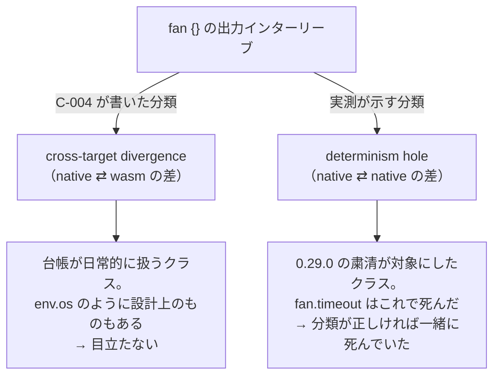
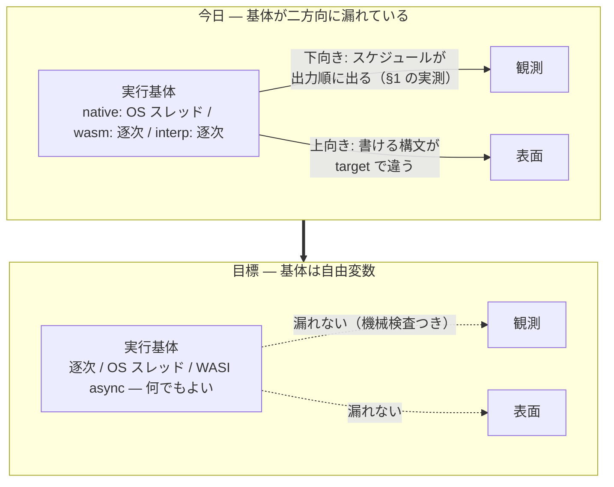
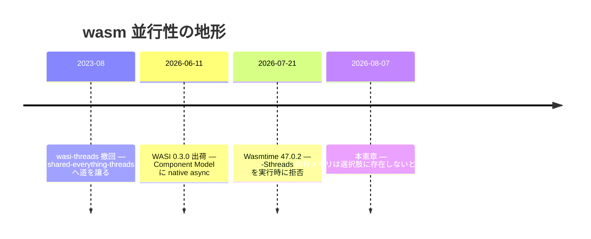
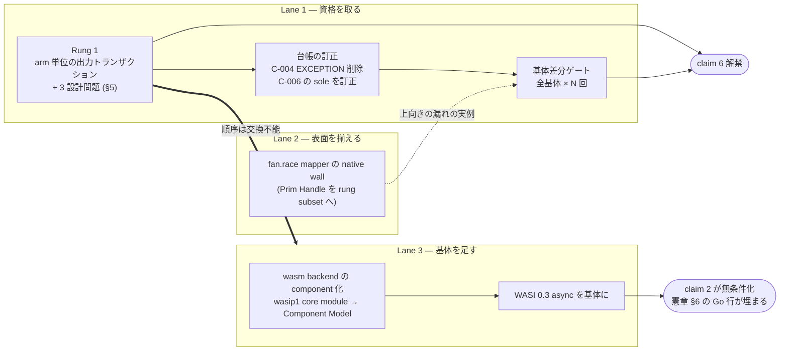

Description: August execution-substrate investigation and original plan, with current ADR and component-host pointers.
<a id="execution-inception--as-if-規則を並行と-target-の向こうまで完成させる"></a>

# Execution Inception — completing the as-if rule across concurrency and targets

[](execution-inception.md) [](execution-inception.ja.md) [](execution-inception.zh-CN.md)

> Non-normative reader snapshot pinned to the original commit; the original remains authoritative. No automatic synchronization or independent execution, implementation verification, proof checking or measurement. Historical commands and design instructions are documentation, not executed instructions.
> [Original source / 原文](https://github.com/almide/almide/blob/35297a612fb29e3f78f6587aba253aa91d51f466/docs/roadmap/active/execution-inception.md)

> Source caveat: this is a historical 2026-08-07 investigation and advocacy document, not a current world ranking, independently remeasured benchmark or proof for all substrates/programs. Its original Rung 1 transactional output-buffering ladder is preserved as a superseded proposal; the introductory ADR-0024/0028 pointers and partial implementation status distinguish current decisions from that plan. Old C-004/C-006 quotations, 10-run/3-run results and the 22/23 comparison are time-scoped evidence, not a universal determinism guarantee. The source says a sixth claim is among five, and describes all substrate combinations before later saying Lane 1's two substrates suffice; retain both formulations without asserting unimplemented combinations were checked. Claims about WASI releases, host thread availability, as-if rules and rival languages remain the source's historical assessment, not independently verified standards or impossibility results. The old trap-flush/buffering design is not evidence that those transactions are shipped; a shared mechanism or finite gate alone is not full semantic proof. No quoted command, benchmark, repair, build or network experiment was run.

> Execution-substrate design record originating in measurements on 2026-08-07. Measurements, old C-004 quotations and the initial plan are preserved as evidence from that time. [ADR-0024](https://github.com/almide/almide/blob/35297a612fb29e3f78f6587aba253aa91d51f466/docs/adr/0024-fan-effect-callbacks-run-concurrently-as-if-sequential.md) is authoritative for the current as-if-sequential contract and implementation stages; [ADR-0028](https://github.com/almide/almide/blob/35297a612fb29e3f78f6587aba253aa91d51f466/docs/adr/0028-fan-selection-names-and-cost-contract.md) for selection names and clocks. ADR-0024 D1/D5/D6 and block D3 are implemented, but work such as parallel execution of effect mappers remains, so do not mark this whole ladder complete. An embedded host for WASI 0.3 HTTP components exists in `crates/almide-wasm-run/src/component_host.rs`. This does not mean the whole fan/async vision is complete.

<a id="0-一文"></a>

## 0. In one sentence

**Optimizations do not change observations. The compiler that fully extends this 50-year promise across concurrent execution and target differences is the best compiler of 2026.**

<a id="1-2026-08-07-の実測--当時の憲章への反例"></a>

## 1. Measurements on 2026-08-07—a counterexample to the charter at the time

async-inception fixed async **observations**. Logical time decides winners and losers; environmental time enters only as declared input. Seven Lean theorems, exhaustive confluence over 74,898 configurations, and the T1–T9 ledger. Inside the semantics, things could hardly be tighter.

A four-line program reproduces a counterexample to those tight semantics.

```almide
effect fn main() -> Unit = {
  let n = list.len(env.args()!)                  // 定数畳み込みを防ぐ runtime 値
  let (a, b, c, d) = fan { arm("A", n)  arm("B", n)  arm("C", n)  arm("D", n) }
  println("sum=${a + b + c + d}")
}
// arm(tag, extra) = 600 万回まわして println(tag)
```

Original code comments: use a runtime value to prevent constant folding; arm(tag, extra) loops 6 million times and prints tag.

Measured on 2026-08-07 with almide 0.56.0 / wasmtime 47.0.2 / 14-core arm64 macOS.

```
native × 10 回:  ACDB ×2, DCAB, DBCA, CBAD, BDCA, BCAD, BACD, ADCB, ACBD
                 ── 10 回で 9 通り
wasm   ×  3 回:  ABCD, ABCD, ABCD
                 ── 常に arm 順
```

The measurement annotation says: native ran 10 times, yielding 9 different orders; wasm ran 3 times and always followed arm order. The exact output sequences remain above.

The EXCEPTION section of C-004 in the contract ledger at the time foretold this (the following quotes the old wording).

> EXCEPTION: side-effect INTERLEAVING inside `fan { }` block arms and `fan.settle`
> thunks is wall-clock on native (both run on real threads) and sequential on wasm

native ⇄ wasm diverged as the clause said. Simultaneously a **fact absent from the clause** emerged—**native also disagrees with itself.** Same binary, same input, 9 orders in 10 runs.

<a id="2-分類が間違っていた"></a>

## 2. The classification was wrong

The ledger has a name for this property. C-006—the reason `fan.timeout` was removed in 0.29.0:

> Worse than the cross-target divergence: whether the deadline fired depended on
> machine load, so the result was not a function of the program + its inputs
> **even between two native runs** — **the sole stdlib surface violating that property.**

`fan.timeout` was killed for this property. C-006 says it was the **only** such surface. The §1 measurements show that statement is inaccurate today.

The oversight is not “an exception exists.” It is the **classification of the exception**.



Diagram translation: fan{} output interleaving branches into C-004's classification, cross-target divergence (native ⇄ wasm difference), and the measured classification, a determinism hole (native ⇄ native difference). The former is a routine ledger class, sometimes by design as with env.os, so it attracts little notice. The latter is the class targeted by the 0.29.0 purge, which killed fan.timeout; classified correctly, this would have been killed alongside it.

Cross-target divergence is a class this repo handles daily. Some cases, such as `env.os`, are **by design** (C-189's carve-out). Hence the clause went unnoticed. In substance it was a determinism hole, shipped unclassified for two years since 0.24.0.

This is also the second time C-004's EXCEPTION section was underestimated. Its closing words:

> The block was an undercount here until #915's audit: it spawns per-arm scoped
> threads on native, the same interleaving class as settle.

#915 corrected underestimation of **scope** (not just `settle`, but `fan {}` too). Underestimation of the **class** remained.

The third oracle is not on native's side. `crates/almide-interp/src/eval.rs:148`—fan in the reference interpreter is “SEQUENTIALLY in source order.” wasm and interp agree sequentially; **only native deviates**. Nor is a debate over “which is correct?” necessary. The sequential side is exactly the observation #1000 defined: “execution may be parallel, but observable behavior is strictly identical to evaluating sequentially in list order.”

<a id="3-当時の原因分析--基体の決定が不足していた"></a>

## 3. Cause analysis at the time—the substrate decision was missing

Why did this happen? **The execution substrate was a leftover of implementation convenience, not a design product.**

| Target at the time | Substrate at the time | Origin at the time |
|---|---|---|
| native | OS threads (`std::thread::scope`) | `crates/almide-codegen/templates/rust.toml` `[fan_expr]` |
| wasm | Fully sequential (inline arm expansion) | `crates/almide-mir/src/lower/desugar_fan.rs` |
| interp | Fully sequential | `crates/almide-interp/src/eval.rs` |

Nowhere does the charter say “native uses OS threads; wasm is sequential.” native uses `std::thread::scope` because Rust had it; wasm is sequential because wasip1 had no threads. Semantics were chosen. **The substrate was what was left over.**

That leftover leaks in two directions.



Diagram translation: today the substrate leaks in two directions. The substrate is native OS threads / sequential wasm / sequential interp. Downward, scheduling appears in output order (§1 measurements), reaching observation; upward, which syntax can be written differs by target, reaching the surface. The goal makes the substrate a free variable: sequential / OS threads / WASI async—anything is acceptable. It leaks neither to observation (with machine checking) nor to the surface. Today transitions to that goal.

The upward leak is measured too. `spec/wasm_cross/fan_race_mapper.almd` exits normally on wasm but **walls on native** (`op "Prim Handle" in main — outside the rung
subset`, exit 1). Charter §3 declares every head × form matrix cell settled, yet a cell is empty from native's perspective. The substrate determines even **which syntax exists**.

(Comparing both targets across all 23 `spec/wasm_cross/{fan_*,fuel_*}.almd` files, 22 are byte-identical except this one. There are 0 downward-leak fixtures—because they avoid configurations with two printing arms; that avoidance itself admits the clause.)

<a id="4-2026-の地形--倒す相手はいなかった"></a>

## 4. The 2026 landscape—there was no opponent to defeat

We thought truly parallel wasm would require shared memory and atomics, overturning C-210 (Wasm 3.0 deterministic-profile conformance, machine-checked `FORBIDDEN = ["relaxed", "atomic", "shared"]`)—a determinism/parallelism tradeoff.

**That either/or did not exist.**

```
$ wasmtime --version
wasmtime 47.0.2 (90fed3c6a 2026-07-21)

$ wasmtime run -S threads=y t.wasm
Error: the `-Sthreads` flag is no longer supported
```

Help still shows `threads[=y|n] -- Enable support for WASI threading imports (experimental)`. Reading it alone yields “experimental but usable.” Running it gets rejected. wasi-threads was a legacy proposal withdrawn in 2023-08, left only for engines that can support preview1 alone. No WASI host runtime implements its successor, shared-everything-threads.

Instead, what we were waiting for had arrived two months earlier. **WASI 0.3.0—shipped 2026-06-11, native async for the Component Model.** `async func` / `stream<T>` / `future<T>` entered the Canonical ABI, and `wasi:io` was removed. The 0.2 three-step dance of `start-foo` / `finish-foo` / `subscribe` disappeared. Support is Wasmtime 43+; the local version is 47.0.2—**it runs today.**

Crucially, this is not about the instruction set. Concurrency lives in the component-boundary ABI, without sharing linear memory. No atomics or shared memory is emitted. **Not one character of C-210 needs changing.**



Timeline translation—wasm concurrency landscape: 2023-08, wasi-threads withdrawn, giving way to shared-everything-threads; 2026-06-11, WASI 0.3.0 shipped, native async in the Component Model; 2026-07-21, Wasmtime 47.0.2 rejects -Sthreads at runtime; 2026-08-07, this charter measures and confirms shared memory is not an available option.

“Sell determinism to buy parallelism” has no corresponding trade in the 2026 landscape. It can be bought without selling.

<a id="5-決定--基体は自由変数である"></a>

## 5. Decision—the substrate is a free variable

The formal decision is [ADR-0011](https://github.com/almide/almide/blob/35297a612fb29e3f78f6587aba253aa91d51f466/docs/adr/0011-execution-substrate-is-a-free-variable.md).

> **The execution substrate is a free variable separated from observation. It is a performance-only knob and must not change a single observed bit. wasm concurrency comes from WASI 0.3 native async, not shared memory or atomics.**

The ladder has three steps, and their order does work.

| Step | Contents | What it completes |
|---|---|---|
| **Rung 1** | Arm-level output transactions—buffer each arm's stdout/stderr and flush in arm order at join | **Closes the determinism hole.** C-004 EXCEPTION disappears. The substrate becomes a free variable |
| **Gate** | Substrate differential gate—machine-check equal observations across all substrates × N runs | “The substrate does not alter observations” moves from claim to gate |
| **Async** | Turn the wasm backend into components → use WASI 0.3 async as substrate | Fills charter §6's Go loss row (real concurrent I/O) |

The order cannot be swapped. Parallelizing the substrate without Rung 1 worsens today's “only native is nondeterministic” divergence into “all targets nondeterministic.” **Rung 1 is not an improvement; it is qualification to discuss the substrate at all.**

Rung 1 must answer three design questions, all determined by “match sequential execution.”

- **Relative stdout / stderr order within an arm**—independent buffering loses the `println` → `eprintln` order. Record one timeline per arm, then dispatch to file descriptors when flushing.
- **Flush on trap**—align with C-200 (trapping siblings cause unified abort, without waiting for in-flight work). In sequential execution, output from arms preceding the trap is already visible; flush completed arms in arm order, then abort.
- **Buffer limit**—the first arm has nobody ahead of it, so can flush immediately. The worst case reduces to “total output of all non-first arms.”

<a id="6-主張--なぜこれが2026-年最高のコンパイラなのか"></a>

## 6. Claim—why this is “the best compiler of 2026”

“Best compiler” is meaningless unless made measurable. First, name the axis.

Compiler-quality axes have shifted in recent years. Generated-code speed, clever type inference, helpful diagnostics—all matter, but **in a world where LLMs write most code, a different question comes first.** Does the same source return the same observation each run? If not, the very means of verifying generated code breaks. Humans are no longer the only ones burned by flaky tests.

The compiler industry has had a name for this axis for 50 years: the **as-if rule**. Optimizations may do anything as long as they preserve the abstract machine's observable behavior. C, C++ and Rust all stand on this rule.

The as-if rule has a well-known boundary: **it is defined against a sequential abstract machine**. Once concurrency begins, it does not say “a concurrent program's observations match some sequential execution.” C++ handled the boundary by declaring “data races are undefined behavior”—one could say it gave up closing it. OpenMP's `parallel for` puts proof of no dependencies on the user; failure means UB. Rayon's `par_iter` is safe but does not guarantee arm output order.

**Almide places concurrency syntax inside that boundary.** When #1000 decided “`fan` is scheduling syntax, not semantic syntax,” it declared **`fan` under the as-if rule's jurisdiction**. `fan` is an optimization directive; it does not alter semantics.

In retrospect, the past two years' work expanded this boundary. Fixing observations to logical time excluded scheduling from observation. Continuing to track native ⇄ wasm byte equality in the ledger excluded target differences. **The last remaining hole was the execution substrate—the 9 orders in 10 runs in §1.**

> Complete the as-if rule across concurrent execution and target differences.
> Sequential, OS threads or WASI async; native or wasm—observations identical.
> Show it by machine checking, not assertion.

A sixth sentence joins charter §6's five.

6. “**Switching execution substrates does not change observations**—machine-checked over every combination of sequential / OS threads / WASI async and native / wasm / interp.”
   — **Enabling condition: Rung 1 + substrate differential gate**

It cannot be said today: §1 is a counterexample. Rung 1 is the work that buys this sentence, **the cheapest and hardest for competitors to imitate among the five sentences**. Go, Rust and TypeScript all change output interleaving when parallelism changes. That is not a defect but the result of defining observation as a function of scheduling. **Only a language that changes the definition can write this sentence.**

<a id="7-当初の計画現在の未完了一覧ではない"></a>

## 7. Original plan (not today's list of unfinished work)



Diagram translation: Lane 1—earn qualification. Rung 1 arm-level output transactions + the three §5 design questions → ledger correction (remove C-004 EXCEPTION, correct C-006's “sole”) → substrate differential gate (all substrates × N runs). Lane 2—align surfaces: native wall for fan.race mapper (Prim Handle into the rung subset). Lane 3—add a substrate: componentize wasm backend (wasip1 core module → Component Model) → WASI 0.3 async substrate. Rung 1 and the gate enable claim 6. The mapper wall, an example of upward leakage, feeds the gate. Async makes claim 2 unconditional and fills charter §6's Go row. Rung 1 must precede Lane 3; this order cannot be swapped.

**Lane 1 is the main route.** Rung 1 is the mechanism designed by charter §4 pillar 5; implementation amounts to passing runtime print paths through per-arm buffers. The decisions needed are the three in §5. Updating the ledger in the same PR follows CLAUDE.md: “change observable behavior = update the contract ledger in the same PR.”

**Lane 2 is independent.** The `fan_race_mapper` native wall does not wait for Lane 1. But the point is less to plug it individually than to **make the substrate differential gate structurally detect this condition**, so it converges on Lane 1's gate.

**Original Lane 3 assessment.** At investigation time, output was a `wasi_snapshot_preview1` core module (`render_wasm_p3.rs` imports), while WASI 0.3 async sits on the Component Model. ADR-0011 adopted D2 as a **direction decision**, leaving timing here. Do not start until Rung 1 and the gate stand—qualification to add a substrate comes first.

<a id="8-反証条件"></a>

## 8. Falsification conditions

| Falsifier | Detection surface | If it happens |
|---|---|---|
| Switching substrate changes observation and Rung 1 cannot close it | Substrate differential gate | Remove that substrate. If the rule cannot be upheld, make all targets sequential (sacrifice substrate freedom to preserve observations, not the reverse) |
| WASI 0.3 async overhead exceeds sequential | Lane 3 benchmark | Withdraw D2 only; keep wasm sequential. Rung 1 and the gate stay |
| Per-arm buffering breaks progress displays for long-running arms | Real use | Redesign flush-boundary granularity. **No opt-out** (it makes observation substrate-dependent again, invalidating this charter) |
| Gate cannot reproduce after N repeats (e.g. 1-core CI) | Lane 1 | Redesign to test by **direct substrate selection** (a flag forcing sequential substrate), not repetition |
| shared-everything-threads gets implemented in a host runtime | External | Reassess D3 if usable without overturning C-210; otherwise keep the decision |
| Componentization cost consumes Lane 1's benefit | Estimate when starting Lane 3 | Put Lane 3 on hold. **Lane 1 alone can enable claim 6** |

The last row matters. **Claim 6 does not wait for Lane 3.** With just two substrates—sequential and OS threads—“switching substrate does not change observations” can become true. Lane 3 strengthens the sentence, but is not a condition for its truth. The arrangement prevents heavy construction from holding the claim hostage.

<a id="9-文書地図"></a>

## 9. Document map

| Document | Role |
|---|---|
| [async-inception.md](https://github.com/almide/almide/blob/35297a612fb29e3f78f6587aba253aa91d51f466/docs/roadmap/active/async-inception.md) | Charter of **observation**—authoritative if they disagree |
| execution-inception.md (this document) | Charter of the **substrate** |
| [ADR-0011](https://github.com/almide/almide/blob/35297a612fb29e3f78f6587aba253aa91d51f466/docs/adr/0011-execution-substrate-is-a-free-variable.md) | Original decision (D1–D6, 6 rejected options, falsifiers F1–F5) |
| [ADR-0001](https://github.com/almide/almide/blob/35297a612fb29e3f78f6587aba253aa91d51f466/docs/adr/0001-deterministic-time-units.md) | Deterministic-clock units (a clock the substrate does not read) |
| [concurrency-stance.md](https://github.com/almide/almide/blob/35297a612fb29e3f78f6587aba253aa91d51f466/docs/roadmap/active/concurrency-stance.md) | #1000. ADR-0011 R2 updates the premise “wasm32 has no threads” |
| [contracts.toml](https://github.com/almide/almide/blob/35297a612fb29e3f78f6587aba253aa91d51f466/docs/contracts/contracts.toml) | C-004 (original EXCEPTION), C-006 (“sole”), C-200 (abort on trap), C-210 (deterministic profile) |
| `crates/almide-mir/tests/deterministic_profile_test.rs` | C-210 machine checking—**unchanged** by this decision |

<a id="10-結び--余りものだったものを決定にする"></a>

## 10. Closing—turning leftovers into decisions

This charter deals with just one thing that took its current shape because nobody decided it. Native uses OS threads because Rust had them; wasm is sequential because wasip1 had no threads. Two accidents left one misclassification in the contract ledger.

Turning accident into decision does more than remove an exception clause. **The substrate becomes a performance-only knob.** To go faster, change the substrate; nobody can observe the change. Optimizations do not change observation—the promise compilers have sold for 50 years holds across concurrency and targets too.

The first step toward that is neither WASI nor the Component Model. It is deciding which output appears first when two arms both call `println`.
