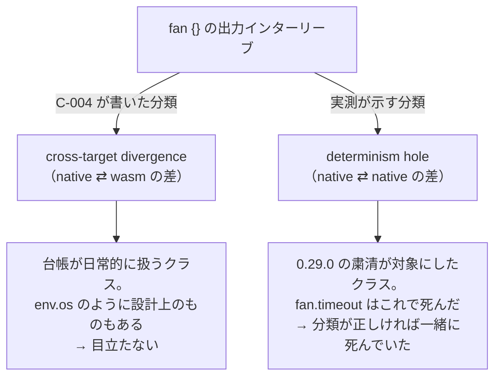
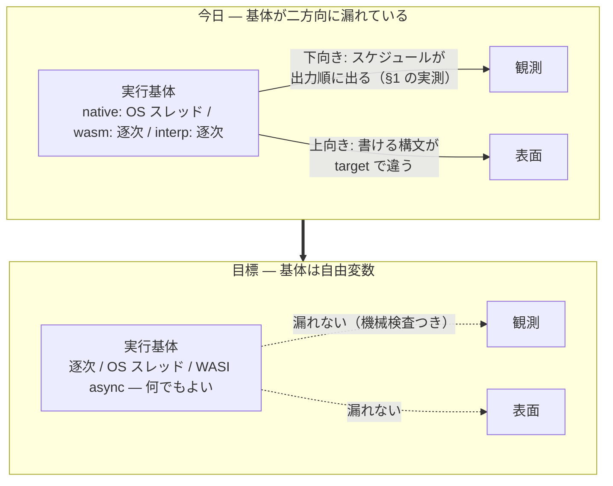
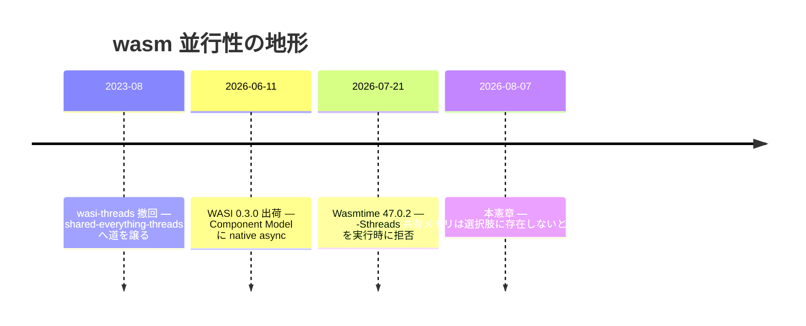
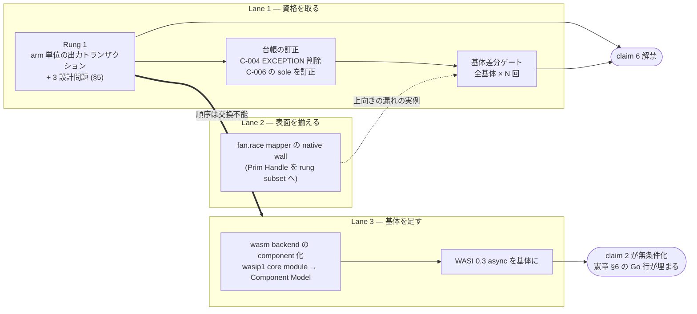

说明：8 月执行基体调查及原计划，附当前 ADR 与 component host 指引。
<a id="execution-inception--as-if-規則を並行と-target-の向こうまで完成させる"></a>

# Execution Inception — 将 as-if 规则完善至并发与 target 之外

[](execution-inception.md) [](execution-inception.ja.md) [](execution-inception.zh-CN.md)

> 固定原文提交的非规范阅读快照；以原文为准，不自动同步。未独立执行、验证实现、检查证明或测量。历史命令与设计指令是资料，不是已执行的指令。
> [Original source / 原文](https://github.com/almide/almide/blob/35297a612fb29e3f78f6587aba253aa91d51f466/docs/roadmap/active/execution-inception.md)

> 原文注记：这是 2026-08-07 历史调查与宣传资料，不是当前世界排名、独立重测 benchmark 或所有基体/程序的证明。原 Rung 1 输出事务 buffering 阶梯保留为已被替代提案；开头 ADR-0024/0028 指引与部分实现状态区分当前决定和旧计划。旧 C-004/C-006 引文、10次/3次结果和22/23比较为时点限定证据，不是普遍确定性保证。原文称第六主张在五句之中，并先说全部基体组合、后说 Lane 1 两基体足够；保留两种说法，不推断未实现组合已检查。WASI 发布、host thread 可用性、as-if 规则、竞争语言论述为历史原评估，不是独立核验标准或不可能性结论。旧 trap flush/buffering 设计不证明事务已交付；共同机制或有限 gate 单独不是完整语义证明。未执行引用命令、benchmark、修复、build 或网络实验。

> 由 2026-08-07 实测起草的执行基体设计记录。测量、旧 C-004 引文、初始计划保留为当时证据。当前 as-if-sequential 契约及实现阶段以 [ADR-0024](https://github.com/almide/almide/blob/35297a612fb29e3f78f6587aba253aa91d51f466/docs/adr/0024-fan-effect-callbacks-run-concurrently-as-if-sequential.md) 为准，选择名称与 clock 以 [ADR-0028](https://github.com/almide/almide/blob/35297a612fb29e3f78f6587aba253aa91d51f466/docs/adr/0028-fan-selection-names-and-cost-contract.md) 为准。ADR-0024 D1/D5/D6 及 block D3 已实现，但 effect mapper 并行执行等仍有剩余，不能将整条阶梯标为完成。WASI 0.3 HTTP component 的 embedded host 已在 `crates/almide-wasm-run/src/component_host.rs` 存在。这不意味着全部 fan/async 构想完成。

<a id="0-一文"></a>

## 0. 一句话

**优化不改变观察。将这 50 年的承诺完整延伸到并发执行与 target 差异之外的编译器，就是 2026 年最好的编译器。**

<a id="1-2026-08-07-の実測--当時の憲章への反例"></a>

## 1. 2026-08-07 实测——对当时宪章的反例

async-inception 固定异步的**观察**。逻辑时间决定胜负，环境时间仅作为声明输入进入。Lean 7 定理、74,898 配置的全数合流、T1 至 T9 台账。语义内部已无比严密。

四行程序可复现对该严密语义的反例。

```almide
effect fn main() -> Unit = {
  let n = list.len(env.args()!)                  // 定数畳み込みを防ぐ runtime 値
  let (a, b, c, d) = fan { arm("A", n)  arm("B", n)  arm("C", n)  arm("D", n) }
  println("sum=${a + b + c + d}")
}
// arm(tag, extra) = 600 万回まわして println(tag)
```

原代码注释译文：用 runtime 值阻止常量折叠；arm(tag, extra) 循环 600 万次后 println(tag)。

于 2026-08-07、almide 0.56.0 / wasmtime 47.0.2 / 14 核 arm64 macOS 实测。

```
native × 10 回:  ACDB ×2, DCAB, DBCA, CBAD, BDCA, BCAD, BACD, ADCB, ACBD
                 ── 10 回で 9 通り
wasm   ×  3 回:  ABCD, ABCD, ABCD
                 ── 常に arm 順
```

测量注释译文：native 运行 10 次，出现 9 种顺序；wasm 运行 3 次，始终按 arm 顺序。精确输出序列保留如上。

当时契约台账 C-004 EXCEPTION 节已预告此事（以下引用旧文）。

> 例外：`fan { }` block arm 和 `fan.settle` thunk 内副作用交错在 native 上依赖 wall-clock（两者均在真实 thread 运行），在 wasm 上逐次执行。

native ⇄ wasm 如条款所述出现差异。同时出现**条款未写的事实**——**native 与自身也不一致**。同二进制、同输入，10 次有 9 种。

<a id="2-分類が間違っていた"></a>

## 2. 分类错了

台账已为此性质命名。C-006——0.29.0 移除 `fan.timeout` 的原因：

> 比跨 target 分歧更糟：deadline 是否触发取决于机器负载，所以结果**即使在两次 native 运行间**也不是程序+输入的函数——**唯一违反该性质的 stdlib surface。**

`fan.timeout` 因此被移除。C-006 写明它是**唯一**此类 surface。§1 实测说明该表述今天不准确。

遗漏不是“存在例外”，而是**例外的分类**。



图译文：fan{} 输出交错分成两种分类。C-004 写的是 cross-target divergence（native ⇄ wasm 差异）；实测显示的是 determinism hole（native ⇄ native 差异）。前者是台账日常处理类别，部分如 env.os 属设计使然，故不显眼。后者是 0.29.0 清理针对类别，fan.timeout 因此被移除；若分类正确，此项本应一同移除。

cross-target 差异是本 repo 每天处理的类别。也有像 `env.os` 这样**按设计如此**的情况（C-189 carve-out），故条款未引起注意。实际是 determinism hole，自 0.24.0 起两年一直未分类而发布。

这也是 C-004 EXCEPTION 第二次被低估。条款末尾：

> block 在 #915 审计前在此被少计：native 上按 arm 启动 scoped thread，与 settle 属相同交错类别。

#915 修正了**范围**低估（不仅 `settle`，`fan {}` 也属于）。剩下的是**类别**低估。

第三 oracle 不站 native 一边。`crates/almide-interp/src/eval.rs:148`——参考解释器 fan“按源顺序逐次执行”。wasm 与 interp 逐次一致，**仅 native 偏离**。且无需争论“谁正确”：逐次侧就是 #1000 定义的观察——“执行可并行，但可观测行为必须与按列表顺序逐次求值严格相同”。

<a id="3-当時の原因分析--基体の決定が不足していた"></a>

## 3. 当时原因分析——缺少基体决策

为何如此？**执行基体不是设计产物，而是实现便利的剩余物**。

| 当时 target | 当时基体 | 当时来源 |
|---|---|---|
| native | OS thread（`std::thread::scope`） | `crates/almide-codegen/templates/rust.toml` `[fan_expr]` |
| wasm | 完全逐次（inline 展开 arm） | `crates/almide-mir/src/lower/desugar_fan.rs` |
| interp | 完全逐次 | `crates/almide-interp/src/eval.rs` |

宪章从未写“native 用 OS thread，wasm 逐次”。native 用 `std::thread::scope` 因为 Rust 有它，wasm 逐次因为 wasip1 没 thread。语义经过选择。**基体则是剩余物。**

剩余物向两个方向泄露。



图译文：今天基体向两方向泄露。执行基体为 native OS thread / wasm 逐次 / interp 逐次。向下，调度出现在输出顺序（§1 实测），影响观察；向上，可写语法随 target 不同，影响 surface。目标是基体成为自由变量：逐次 / OS thread / WASI async 均可，不泄露到观察（有机器检查），也不泄露到 surface。由今天转向目标。

向上泄露也有实测。`spec/wasm_cross/fan_race_mapper.almd` 在 wasm 正常退出，**native 却 wall**（`op "Prim Handle" in main — outside the rung
subset`，exit 1）。宪章 §3 的 head × form matrix 宣称所有单元确定，但 native 视角有空格。基体连**哪些语法存在**都决定了。

（`spec/wasm_cross/{fan_*,fuel_*}.almd` 全 23 个的两 target 比较中，除此 1 个外 22 个字节一致。向下泄露 fixture 为 0——因为避免了两个打印 arm 的配置；避免本身就是对条款的承认。）

<a id="4-2026-の地形--倒す相手はいなかった"></a>

## 4. 2026 地形——没有需要击败的对手

若使 wasm 真并行，就需共享内存和 atomics，这意味着推翻 C-210（Wasm 3.0 deterministic profile 符合性，机器检查 `FORBIDDEN = ["relaxed", "atomic", "shared"]`）——此前将其看作确定性与并行性的取舍。

**这个二选一并不存在。**

```
$ wasmtime --version
wasmtime 47.0.2 (90fed3c6a 2026-07-21)

$ wasmtime run -S threads=y t.wasm
Error: the `-Sthreads` flag is no longer supported
```

原错误译文：已不再支持 -Sthreads 标志。

help 仍显示 `threads[=y|n] -- Enable support for WASI threading imports (experimental)`。单看会得出“实验性但可用”。实际执行会拒绝。wasi-threads 是 2023-08 撤回的 legacy proposal，只为仅支持 preview1 的引擎留下。后继 shared-everything-threads 尚无任何 WASI host runtime 实现。

反而，等待的东西两个月前已到：**WASI 0.3.0——2026-06-11 发布，Component Model 原生 async。** `async func` / `stream<T>` / `future<T>` 纳入 Canonical ABI，`wasi:io` 废除。0.2 的 `start-foo` / `finish-foo` / `subscribe` 三步舞消失。Wasmtime 43+ 支持，手头 47.0.2——**今天就能运行**。

关键是这不是指令集问题。并发在 component 边界 ABI，不共享线性内存。不 emit atomics 或 shared memory。**C-210 一字无需改。**



时间线译文——wasm 并发地形：2023-08，撤回 wasi-threads，给 shared-everything-threads 让路；2026-06-11，WASI 0.3.0 发布，Component Model 加入原生 async；2026-07-21，Wasmtime 47.0.2 运行时拒绝 -Sthreads；2026-08-07，本宪章实测确认共享内存不在选项中。

“卖确定性换并行性”在 2026 地形没有对应交易。不卖也能买。

<a id="5-決定--基体は自由変数である"></a>

## 5. 决定——基体是自由变量

正式决定见 [ADR-0011](https://github.com/almide/almide/blob/35297a612fb29e3f78f6587aba253aa91d51f466/docs/adr/0011-execution-substrate-is-a-free-variable.md)。

> **执行基体是与观察分离的自由变量。基体只调性能，不得改变任何一 bit 观察。wasm 并发来自 WASI 0.3 原生 async，不采用共享内存和 atomics。**

阶梯三段，顺序发挥作用。

| 段 | 内容 | 完成什么 |
|---|---|---|
| **Rung 1** | arm 级输出事务——buffer 各 arm stdout/stderr，join 时按 arm 顺序 flush | **关闭 determinism hole。** C-004 EXCEPTION 消失，基体成为自由变量 |
| **Gate** | 基体差分 gate——全基体 × N 次机器检查观察一致 | “基体不改变观察”从主张变 gate |
| **Async** | wasm backend component 化 → 以 WASI 0.3 async 为基体 | 填补宪章 §6 Go 失利行（真正并发 I/O） |

顺序不能交换。没有 Rung 1 就并行化基体，会把今天“仅 native 非确定”的差异恶化为“所有 target 非确定”。**Rung 1 不是改进，而是谈论基体的资格本身。**

Rung 1 须回答三个设计问题，全部由“与逐次执行一致”决定。

- **arm 内 stdout / stderr 相对顺序**——独立 buffer 两者会丢失 `println` → `eprintln` 顺序。arm 内记录为一条时间线，flush 时分到 fd。
- **trap 时 flush**——与 C-200（trap sibling 统一 abort、不等 in-flight）一致。逐次执行时 trap 前 arm 输出已出现，因此先按 arm 顺序 flush 已完成 arm，再 abort。
- **buffer 上限**——首 arm 前面无人，可立即 flush。最坏情况降为“非首 arm 输出总量”。

<a id="6-主張--なぜこれが2026-年最高のコンパイラなのか"></a>

## 6. 主张——为何是“2026 年最佳编译器”

“最佳编译器”不变成可测句子就无意义。先说明方向。

近年编译器质量方向变了。生成代码速度、类型推导聪明度、诊断友好度都重要，但**大部分代码由 LLM 编写时，优先问题不同**。同一源码每次是否返回同一观察？否则验证生成代码的手段本身就坏了。被 flaky 测试折磨的已不止人类。

业界 50 年前已为这个方向命名：**as-if 规则**。只要保持抽象机可观察行为，优化可做任何事。C、C++、Rust 都立于此规则。

as-if 规则有熟知边界：**它针对逐次抽象机定义**。并发开始后，不会说“并发程序观察与某个逐次执行一致”。C++ 用“数据竞争是未定义行为”处理边界——也可说放弃堵住它。OpenMP `parallel for` 将无依赖证明交给用户，出错则 UB。Rayon `par_iter` 安全，却不保证 arm 输出顺序。

**Almide 将并发语法置于边界内部。** #1000 决定“`fan` 是调度语法，不是语义语法”时，就是宣布将 **`fan` 纳入 as-if 规则管辖**。`fan` 是优化指令，不改语义。

事后可以说，两年工作是在拓宽边界。观察固定于逻辑时间，调度不进入观察；台账持续追踪 native ⇄ wasm 字节一致，target 差异也不进入。**最后剩下执行基体这个洞，就是 §1 的 10 次 9 种。**

> 将 as-if 规则完善到并发执行与 target 差异之外。
> 无论逐次、OS thread、WASI async，native 或 wasm，观察相同。
> 且以机器检查展示，而非主张。

宪章 §6 五句话加上第六句。

6. “**切换执行基体也不改变观察**——逐次 / OS thread / WASI async、native / wasm / interp 所有组合均机器检查。”
   ——**启用条件：Rung 1 + 基体差分 gate**

今天不能说，§1 就是反例。Rung 1 是买来此句的工程，也是**五句话中最便宜、最难被他家模仿的一句**。Go、Rust、TypeScript 改并行度就改输出混杂方式。不是缺陷，而是把观察定义为调度函数的结果。**只有改变定义的语言能写此句。**

<a id="7-当初の計画現在の未完了一覧ではない"></a>

## 7. 原计划（不是当前未完成列表）



图译文：Lane 1——取得资格：Rung 1 arm 级输出事务 + §5 三设计问题 → 台账订正（删除 C-004 EXCEPTION，订正 C-006 sole）→ 基体差分 gate（全部基体 × N 次）。Lane 2——统一 surface：fan.race mapper 的 native wall（Prim Handle 纳入 rung subset）。Lane 3——增加基体：wasm backend component 化（wasip1 core module → Component Model）→ WASI 0.3 async 基体。Rung 1 和 gate 启用 claim 6；mapper wall 是向上泄露实例，连向 gate；async 使 claim 2 无条件化并填补宪章 §6 Go 行；Rung 1 必须先于 Lane 3，顺序不可交换。

**Lane 1 是主线。** Rung 1 是宪章 §4 支柱 5 已设计机制，实现归结为 runtime print 路径通过 arm 级 buffer。需判断的是 §5 三点。按 CLAUDE.md“改变可观察行为 = 同一 PR 更新契约台账”，将台账订正放同一 PR。

**Lane 2 独立。** `fan_race_mapper` native wall 不等 Lane 1。但重点不在逐项堵洞，而在**基体差分 gate 能结构性检测此病**，因此汇入 Lane 1 gate。

**原 Lane 3 评价。** 调查时输出 `wasi_snapshot_preview1` core module（`render_wasm_p3.rs` imports），WASI 0.3 async 位于 Component Model。ADR-0011 将 D2 作为**方向决定**，把开工时间留给此处。Rung 1 和 gate 成立前不开始——先有增加基体的资格。

<a id="8-反証条件"></a>

## 8. 反证条件

| 反证 | 检测面 | 发生后 |
|---|---|---|
| 切换基体改变观察，Rung 1 无法封堵 | 基体差分 gate | 撤下该基体。守不住则全 target 逐次（为守观察放弃基体自由，而非反过来） |
| WASI 0.3 async overhead 超过逐次 | Lane 3 benchmark | 仅撤 D2，wasm 保持逐次；Rung 1 和 gate 留下 |
| arm 级 buffer 破坏长时间 arm 进度显示 | 实际使用 | 重设 flush 边界粒度。**不采用 opt-out**（会让观察重新依赖基体，使宪章失效） |
| gate 重复 N 次仍不复现（如 CI 1 核） | Lane 1 | 改为**直接指定基体**（强制逐次基体的标志）来检查，而非重复 |
| shared-everything-threads 在 host runtime 实现 | 外部 | 若无需推翻 C-210 可用则重审 D3，否则保持 |
| component 化成本吞没 Lane 1 收益 | Lane 3 开始时估算 | 将 Lane 3 on-hold。**claim 6 可仅由 Lane 1 启用** |

最后一行很重要。**claim 6 不等 Lane 3**。即便仅逐次和 OS thread 两基体，“切换基体观察不变”也能为真。Lane 3 增强句子，不是成立条件。如此安排，不让重工程绑架主张。

<a id="9-文書地図"></a>

## 9. 文档地图

| 文档 | 作用 |
|---|---|
| [async-inception.md](https://github.com/almide/almide/blob/35297a612fb29e3f78f6587aba253aa91d51f466/docs/roadmap/active/async-inception.md) | **观察**宪章——有差异以其为准 |
| execution-inception.md（本文） | **基体**宪章 |
| [ADR-0011](https://github.com/almide/almide/blob/35297a612fb29e3f78f6587aba253aa91d51f466/docs/adr/0011-execution-substrate-is-a-free-variable.md) | 决定原本（D1–D6、6 个否决案、反证 F1–F5） |
| [ADR-0001](https://github.com/almide/almide/blob/35297a612fb29e3f78f6587aba253aa91d51f466/docs/adr/0001-deterministic-time-units.md) | 确定性时钟单位（基体不读取的时钟） |
| [concurrency-stance.md](https://github.com/almide/almide/blob/35297a612fb29e3f78f6587aba253aa91d51f466/docs/roadmap/active/concurrency-stance.md) | #1000。“wasm32 无 thread”前提由 ADR-0011 R2 更新 |
| [contracts.toml](https://github.com/almide/almide/blob/35297a612fb29e3f78f6587aba253aa91d51f466/docs/contracts/contracts.toml) | C-004（EXCEPTION 原本）、C-006（sole 记载）、C-200（trap abort）、C-210（deterministic profile） |
| `crates/almide-mir/tests/deterministic_profile_test.rs` | C-210 机器检查——本决定**不改** |

<a id="10-結び--余りものだったものを決定にする"></a>

## 10. 结语——把剩余物变成决定

本宪章只处理一件因无人决定而形成现状的事：native 用 OS thread 因 Rust 有它，wasm 逐次因 wasip1 无 thread。两次偶然在契约台账留下一个误分类。

偶然变决定，不仅消失一个例外条款。**基体变成纯性能旋钮。** 想快则换基体，换了无人能观察到。优化不改观察——编译器卖了 50 年的承诺，在并发与 target 之外也成立。

第一步不是 WASI 或 Component Model，而是决定两个 arm 都 `println` 时谁先输出。
