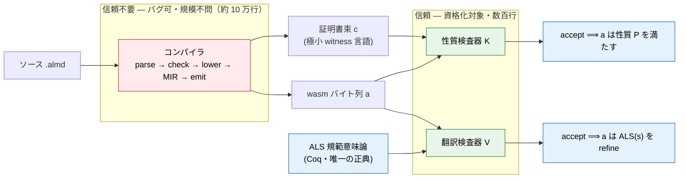
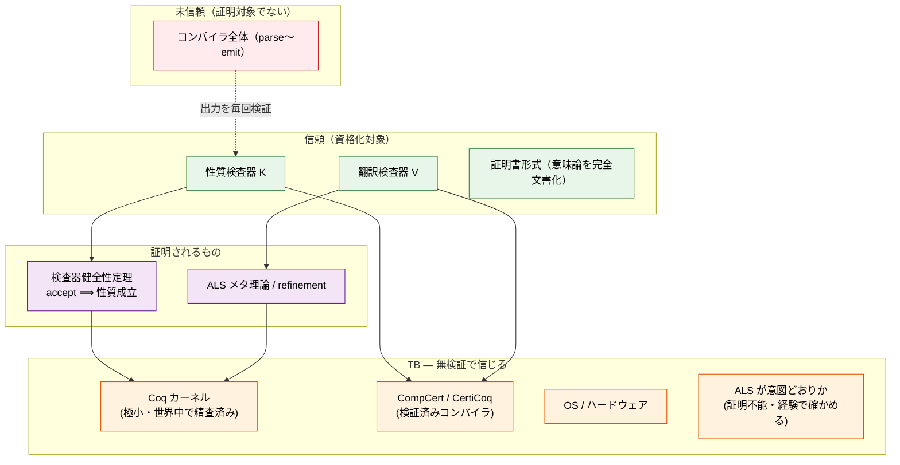
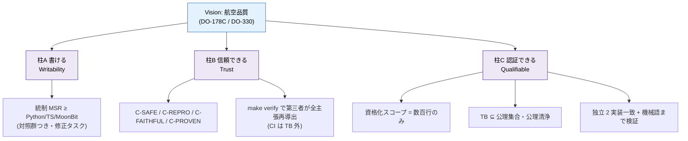
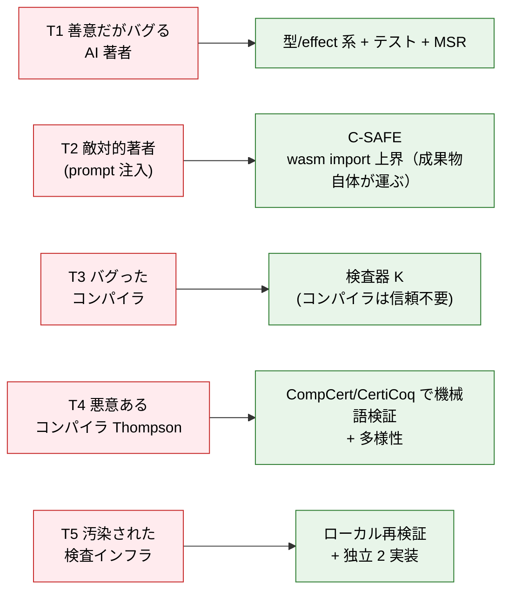
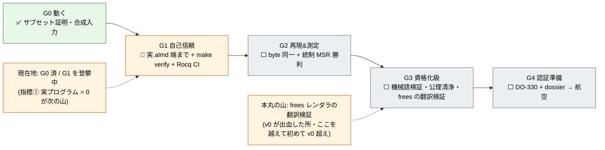
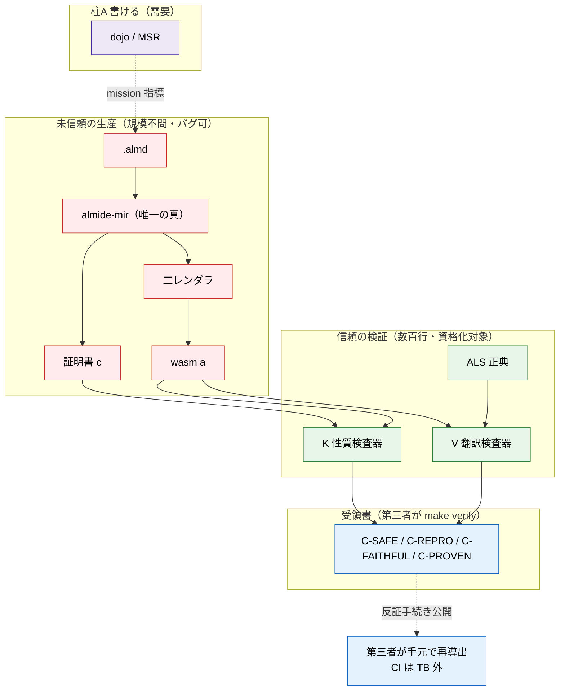

<!-- description: Intended v1 assurance architecture and historical maturity diagrams, not a completed trust-chain certificate -->

# v1 System Map — The Overall Picture (Mermaid)

  

> Non-normative source-pinned historical design map, not a completed security, certification or performance guarantee. The opening scope disclaimer governs every absolute assurance claim and diagram below. Original Mermaid code remains byte-identical; translated diagram labels are supplied outside the code. No new proof, benchmark, deployment or certification verification was run. No automatic synchronization; the pinned original remains authoritative. [Source](https://github.com/almide/almide/blob/35297a612fb29e3f78f6587aba253aa91d51f466/docs/roadmap/active/v1-system-map.md)

## Design map, not a completed trust-chain certificate

These diagrams combine the intended assurance architecture with the early
v1 maturity snapshot. The labels “current”, zero real programs and completed
trust arrows are not current measurements. In particular, proving a witness
checker does not by itself remove trust in event recording, lowering, runtime
bodies, host behavior or source semantics.

Current scoped claims are in [proven versus trusted](https://github.com/almide/almide/blob/35297a612fb29e3f78f6587aba253aa91d51f466/docs/contracts/proven-vs-trusted.md)
and the [receipt generator](https://github.com/almide/almide/blob/35297a612fb29e3f78f6587aba253aa91d51f466/proofs/receipt.sh). The full K/V/ALS
refinement chain and qualification ladder below are objectives; the diagrams
must not be read as evidence that every shipped artifact has attained them.
The early scoreboard and intended topology are preserved rather than filled
with unmeasured new values.

> **What this is**: a map of Almide v1's trust architecture, **one diagram at a time**.
> For each part: **what it is / why use it / which area of Almide it assures**.
> Detailed rationale is in sibling documents:
> [v1-proof-architecture](https://github.com/almide/almide/blob/35297a612fb29e3f78f6587aba253aa91d51f466/docs/roadmap/active/v1-proof-architecture.md) (destination),
> [receipt-logic](https://github.com/almide/almide/blob/35297a612fb29e3f78f6587aba253aa91d51f466/docs/roadmap/active/receipt-logic.md) (receipt format),
> [trust-layer](https://github.com/almide/almide/blob/35297a612fb29e3f78f6587aba253aa91d51f466/docs/roadmap/active/trust-layer.md) (L0–L4 category strategy),
> [completeness-by-construction](https://github.com/almide/almide/blob/35297a612fb29e3f78f6587aba253aa91d51f466/docs/roadmap/active/completeness-by-construction.md) (semantic ledger).

---

## 0. Backbone (One Sentence Shared by Every Diagram)

> **Do not prove the compiler correct. Prove only a small checker's soundness,
> have the compiler emit a “certificate” on every build, and have the checker verify it each time.**
> Checking is orders of magnitude cheaper than constructing: trust shrinks from “100,000 lines” to “a few hundred lines.”

---

## 1. Flow of Trust (PCC Chain)

An untrusted compiler emits the artifact and certificate; **only the small checker that must be trusted** revalidates them. Read the trust boundary: red = no trust needed; green = trusted.

Diagram labels: source .almd → compiler (parse → check → lower → MIR → emit), in the untrusted approximately-100,000-line area → wasm bytes a and certificate bundle c (tiny witness language). ALS is the normative Coq semantics, the sole canon. The trusted qualification scope contains property checker K and translation checker V. K acceptance implies property P for a; V acceptance implies that a refines ALS(s).

**Assured area**: whatever the compiler emits, the checker rejects it if the certificate does not hold; **compiler bugs cannot destroy trust in the artifact**.

---

## 2. Foundation of Trust (Trusted-Base Stack)

Lower layers are what is trusted without verification (TB); higher layers are proved or checked. The stack's claim is to narrow **what must be believed to the bottom layer alone**.

Diagram labels, top to bottom: untrusted whole compiler, not itself the proof subject; trusted qualification scope K/V and fully specified certificate format; checker soundness theorem and ALS metatheory/refinement; unverified trusted base of the Coq kernel (tiny and extensively scrutinized), CompCert/CertiCoq verified compilers, OS/hardware, and whether ALS expresses the intention (not provable, checked through experience). Compiler output is checked each time; soundness and metatheory rely on the kernel, while K/V rely on the verified compilers.

**Assured area**: keeping “Coq-proved” truthful. `Print Assumptions` ⊆ standard assumptions plus independent coqchk rechecking mechanically verify each time that nothing extra has entered the TB.

---

## 3. Component Quick Reference (What / Why / Assurance)

| Component | What it is | Why use it | Area of Almide assured |
|---|---|---|---|
| **ALS** (normative semantics) | Sole canon of language meaning, in Coq | Reference for every backend; prevents duplicate semantic definitions | Semantic consistency (**C-FAITHFUL**) |
| **almide-mir** | Single source of truth with explicit ownership and layout | One decision point, not re-decided by renderers | Consistent ownership decisions (`is_heap`/last-use/Repr, #643 class) |
| **Two renderers** (wasm sovereignty / Rust=Ferrocene) | **Translate only** from MIR; no re-decisions | wasm = canonical artifact with minimum TCB; Rust = stepping stone to Ferrocene | Byte reproducibility (**C-REPRO**) and equivalence of both routes |
| **Certificate format** | Tiny witness language, Metamath-scale | **Only seam** between untrusted compiler and trusted checker | Independent verification and unambiguous meaning |
| **Property checker K** | Small certificate-checking program, Coq-proved | `accept ⟹ P`; narrows trust to hundreds of lines | Memory safety, total names, capability upper bound, type concretization, stack balance, termination (**C-SAFE/C-PROVEN**) |
| **Translation checker V** | Checks each build that emitted wasm refines ALS | Answers the review question “Did you prove only the model?” | Model-to-artifact correspondence (**C-FAITHFUL**) |
| **Coq/Rocq** | Write proofs and have the kernel recheck them | Narrows trust to a tiny kernel plus accumulated scrutiny | Soundness of all proofs (**C-PROVEN**) |
| **CompCert/CertiCoq** | Verified compilers | Carry checkers to machine code, closing extraction and Thompson gaps | Correctness of the checker **itself**, threat T4 |
| **Differential oracle** (v0 corpus/contracts/interp) | Higher-level independent oracle retained until parity | Reject blind rewrites; do not delete before retirement | Regression detection and **preservation of v0 knowledge** |
| **dojo** (MSR) | Daily measurement of LLM writability | Mission metric, the sole metric | “Writable”: demand side of pillar A |
| **make verify-trust** | One entry for a third party to rederive all claims | Keeps CI outside the TB | Receipt **reproducibility** |

---

## 4. Three Pillars and Metrics (All Metrics Lead Here)

Diagram labels: the vision is aviation quality (DO-178C / DO-330). Pillar A, writability, targets controlled modification-task MSR ≥ Python/TS/MoonBit with controls. Pillar B, trust, comprises C-SAFE/C-REPRO/C-FAITHFUL/C-PROVEN and third-party rederivation via make verify, with CI outside the TB. Pillar C, qualifiability, targets a scope of only hundreds of lines, TB within the axiom set with clean axioms, agreement of two independent implementations, and verification through machine code.

**Assured area**: A = demand (can a machine write correctly?), B = artifacts (can trust be handed over?), C = certification (can it enter assessment?). Only with all three can it call itself a “trust layer.”

---

## 5. Threat Model (Which Part Stops Which Threat)

Diagram labels: T1, a well-intentioned but buggy AI author → type/effect system + tests + MSR. T2, an adversarial author/prompt injection → C-SAFE and the wasm-import upper bound carried by the artifact. T3, a buggy compiler → checker K, with no compiler trust required. T4, a malicious compiler/Thompson → CompCert/CertiCoq verification to machine code plus diversity. T5, contaminated checking infrastructure → local rechecking plus two independent implementations.

**Reading T2**: capability soundness comes not from “compile-time checking” but from the **wasm import section, a structural upper bound carried by the artifact itself**. Thus **tricking the checker does not help the author**: an import absent from it cannot be called, as guaranteed by the wasm specification.

---

## 6. Maturity Ladder (Climbing Toward Aviation Quality, with Position)

Diagram labels: G0, works, subset proofs and synthetic inputs complete; G1, self-trust, real .almd end-to-end + make verify + Rocq CI underway; G2, reproduction/measurement, byte identity + controlled MSR victory pending; G3, qualification grade, machine-code verification, axiom cleanliness and frees translation validation pending; G4, certification readiness, DO-330 + dossier → aviation pending. Historical position: G0 complete / climbing G1, with metric 1, real programs = 0, the next climb. The central mountain is translation validation of the frees renderer, where v0 struggled; only crossing it surpasses v0.

**Route reality**: G4 aviation is hardest and last. **Monetization and qualification go through adjacent markets first**: CRA / cryptography / AI-agent infrastructure (1–3 years) → automotive/industrial ISO 26262 / IEC 61508 (requires incorporation) → **aviation last**. Aviation is not a near-term product goal but a north star that supplies discipline.

---

## 7. Putting It in One Diagram

Diagram labels: demand-side pillar A contains dojo/MSR. Untrusted production, with arbitrary scale and possible bugs, runs .almd → almide-mir (sole truth) → two renderers → wasm a, while MIR also emits certificate c. Trusted verification, hundreds of lines in qualification scope, contains K, V and canonical ALS. Certificates and wasm go to K; wasm and ALS go to V; both yield the C-SAFE/C-REPRO/C-FAITHFUL/C-PROVEN receipt. Third parties rederive it locally via make verify, with public falsification procedures and CI outside the TB. Dojo supplies the mission metric to source production.

**Overall assurance, in one sentence**: produce at scale in red (untrusted), verify every build in green (hundreds of lines, qualification scope), and let third parties locally rederive blue receipts: **narrow trust to hundreds of lines, so nobody needs to trust anything else**. This is the overall assurance architecture for Almide v1.
