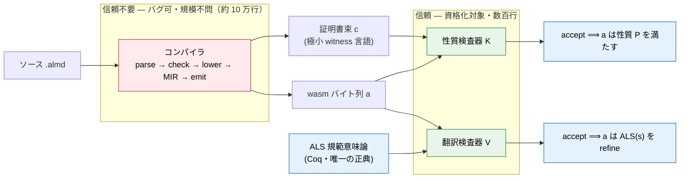
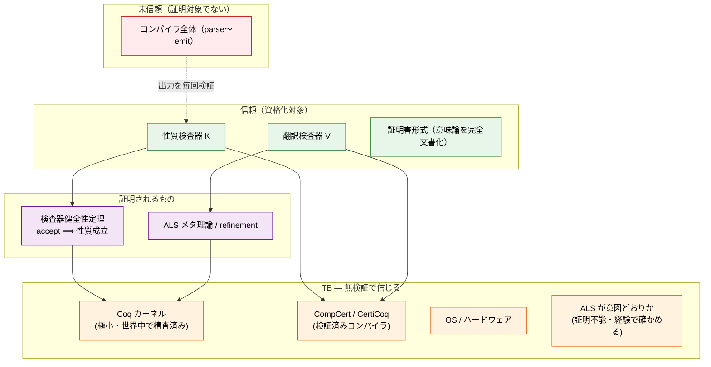
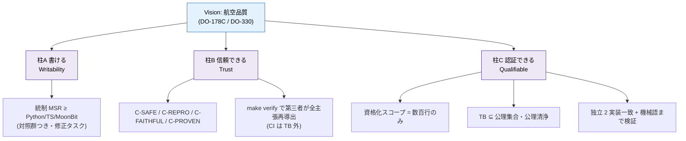
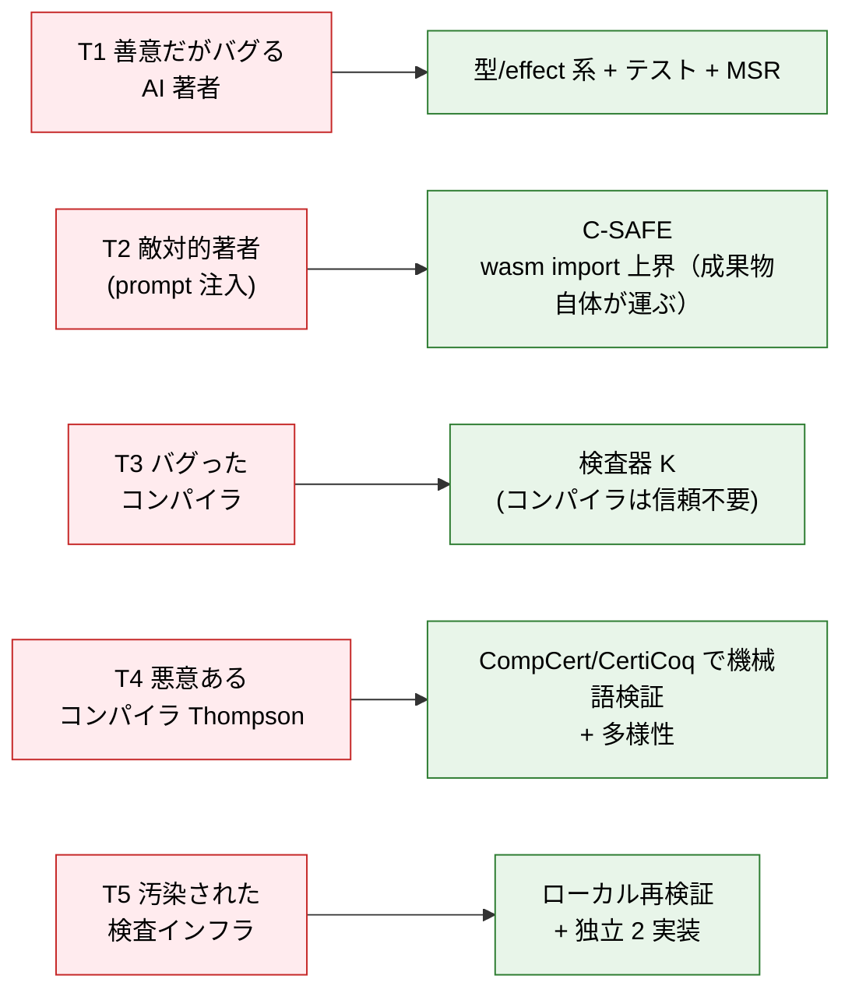
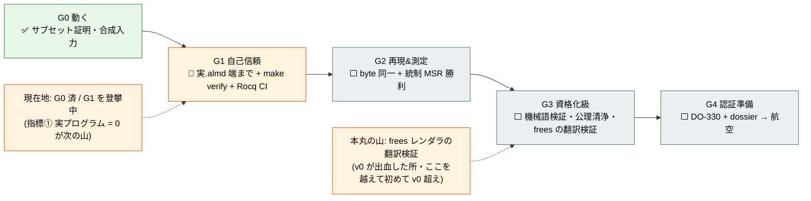
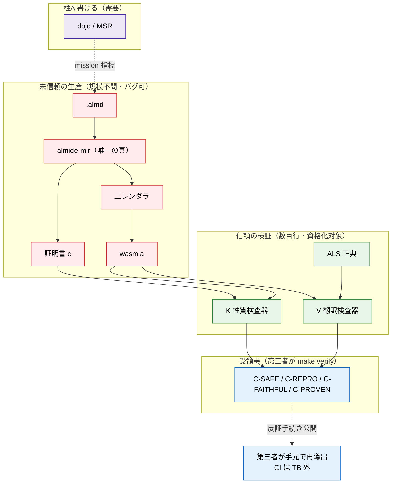

<!-- description: Intended v1 assurance architecture and historical maturity diagrams, not a completed trust-chain certificate -->

# v1 系统图 — 全貌（Mermaid）

  

> 非规范性、原本固定的历史设计图，不是已完成的安全、认证或性能保证。开头范围限定适用于下方每项绝对保障主张及图。Mermaid代码保持逐字节相同，代码外附图中文字翻译。未新执行证明、基准、部署或认证验证。不自动同步，以固定原文为准。 [Source](https://github.com/almide/almide/blob/35297a612fb29e3f78f6587aba253aa91d51f466/docs/roadmap/active/v1-system-map.md)

## 设计图，不是已完成的信任链证书

这些图把预期的保障架构与早期v1成熟度快照合在一起。“当前”、真实程序为零及已完成的信任箭头都不是当前测量。尤其是，证明witness检查器本身并不消除对事件记录、lowering、runtime主体、host行为或源语言语义的信任。

当前有范围限定的主张见[已证明与仍需信任](https://github.com/almide/almide/blob/35297a612fb29e3f78f6587aba253aa91d51f466/docs/contracts/proven-vs-trusted.md)和[receipt生成器](https://github.com/almide/almide/blob/35297a612fb29e3f78f6587aba253aa91d51f466/proofs/receipt.sh)。以下完整K/V/ALS精化链和资格化阶梯是目标；不能把图当作每个已发布产物都达到它们的证据。保留早期计分板和预期拓扑，不填入未经测量的新值。

> **这是什么**：逐图查看Almide v1信任架构的地图。
> 每个部件说明**是什么／为什么使用／保障Almide哪个领域**。
> 详细依据见兄弟文档：
> [v1-proof-architecture](https://github.com/almide/almide/blob/35297a612fb29e3f78f6587aba253aa91d51f466/docs/roadmap/active/v1-proof-architecture.md)（落点），
> [receipt-logic](https://github.com/almide/almide/blob/35297a612fb29e3f78f6587aba253aa91d51f466/docs/roadmap/active/receipt-logic.md)（receipt形式），
> [trust-layer](https://github.com/almide/almide/blob/35297a612fb29e3f78f6587aba253aa91d51f466/docs/roadmap/active/trust-layer.md)（L0–L4类别战略），
> [completeness-by-construction](https://github.com/almide/almide/blob/35297a612fb29e3f78f6587aba253aa91d51f466/docs/roadmap/active/completeness-by-construction.md)（语义台账）。

---

## 0. 骨架（所有图共有的一句话）

> **不证明编译器正确，只证明小型检查器健全；让编译器每次构建输出“证书”，检查器每次核对。**
> 检查比构造便宜几个数量级，因此信任范围从“十万行”缩到“几百行”。

---

## 1. 信任流（PCC链）

不受信任的编译器输出产物与证书，**只由必须信任的小型检查器**重验。重点是信任边界：红＝不必信任，绿＝信任。

图中文字：源.almd进入编译器（parse→check→lower→MIR→emit），位于无需信任、可有bug、规模不限（约十万行）的区域。编译器输出wasm字节a和证书束c（极小witness语言）。ALS是Coq规范语义、唯一正典。受信任、待资格化的几百行包括性质检查器K及翻译检查器V。K接受意味着a满足性质P，V接受意味着a精化ALS(s)。

**保障领域**：无论编译器输出什么，证书不成立就被检查器拒绝，即**编译器bug无法破坏产物的信任**。

---

## 2. 信任基础（Trusted Base栈）

越下层越是“未验证便信任的东西（TB）”，越上层越是被证明或检查的东西。这种堆叠的主张是把**必须相信的东西仅限于底层**。

图中文字自上而下：不受信任、不作为证明对象的整套编译器；受信任且待资格化的K/V和完整文档化语义的证书格式；被证明的检查器健全性定理及ALS元理论／精化；未经验证便信任的Coq内核（极小、经广泛审查）、CompCert/CertiCoq已验证编译器、OS／硬件，以及ALS是否符合意图（无法证明，以经验确认）。编译器输出每次检查；定理和元理论依赖内核，K/V依赖已验证编译器。

**保障领域**：使“Coq已证明”不成为虚言。以`Print Assumptions` ⊆标准假设，加上coqchk独立复验，每次机械确认TB没有混入额外内容。

---

## 3. 部件速查（是什么／为什么／保障）

| 部件 | 是什么 | 为什么使用 | 保障Almide哪个领域 |
|---|---|---|---|
| **ALS**（规范语义） | Coq内语言意义的唯一正典 | 所有backend的基准，防止重复定义语义 | 语义一致性（**C-FAITHFUL**） |
| **almide-mir** | 显式所有权＋布局的唯一真相 | 单一决策点，不让renderer重新决定 | 所有权决策一致性（`is_heap`/last-use/Repr的#643类） |
| **两个renderer**（wasm主权／Rust=Ferrocene） | 仅**翻译**MIR，不重新决定 | wasm是最小TCB的正典产物，Rust是Ferrocene跳板 | 字节可复现性（**C-REPRO**）及双路径等价 |
| **证书格式** | 极小witness语言，Metamath级 | 不受信任编译器与受信任检查器的**唯一接缝** | 验证独立性及语义无歧义 |
| **性质检查器K** | 核对证书的小程序，Coq已证明 | `accept ⟹ P`，把信任限于几百行 | 内存安全、name全域、capability上界、类型具体化、栈平衡、终止（**C-SAFE/C-PROVEN**） |
| **翻译检查器V** | 每次构建确认生成wasm精化ALS | 回答审查关键问题“证明的只是模型吗？” | 模型与实物对应（**C-FAITHFUL**） |
| **Coq/Rocq** | 写证明，由内核复验 | 将信任限于极小内核及长期审查积累 | 全部证明健全性（**C-PROVEN**） |
| **CompCert/CertiCoq** | 已验证编译器 | 将检查器验证到机器码，关闭提取漏洞和Thompson漏洞 | 检查器**本身**的正确性，威胁T4 |
| **差分oracle**（v0 corpus/contracts/interp） | 保留到parity达到的上层独立oracle | 拒绝盲目重写，退役前不删除 | 回归检测及**保存v0知识** |
| **dojo**（MSR） | 每日测量LLM可编写性 | 使命指标，唯一指标 | “能写”，支柱A的需求侧 |
| **make verify-trust** | 第三方重新导出所有主张的单一入口 | 把CI移到TB之外 | receipt的**可复现性** |

---

## 4. 三支柱与指标（全部指标归于这里）

图中文字：愿景是航空品质（DO-178C／DO-330）。支柱A可编写性目标为带对照组、修改任务的受控MSR≥Python/TS/MoonBit。支柱B可信任性包括C-SAFE/C-REPRO/C-FAITHFUL/C-PROVEN，以及第三方通过make verify重新导出所有主张，CI在TB外。支柱C可资格化性目标为范围仅几百行、TB包含于公理集合且公理洁净、两个独立实现一致并验证到机器码。

**保障领域**：A＝需求（机器能否正确写）、B＝产物（能否交付信任）、C＝认证（能否接受审查）。三者齐全才能称为“信任层”。

---

## 5. 威胁模型（哪个部件阻止哪种威胁）

图中文字：T1善意但出bug的AI作者→类型／effect系统＋测试＋MSR。T2敌对作者／prompt注入→C-SAFE和产物自身携带的wasm import上界。T3有bug的编译器→检查器K，无需信任编译器。T4恶意编译器／Thompson→CompCert/CertiCoq验证到机器码＋多样性。T5受污染的检查基础设施→本地复验＋两个独立实现。

**T2重点**：capability健全性不由“编译时检查”，而由**wasm import段，即产物自身携带的结构性上界**承担。因此**作者欺骗检查也无济于事**：import中没有的东西无法调用，由wasm规范保障。

---

## 6. 成熟度阶梯（攀向航空品质，含位置）

图中文字：G0可运行，子集证明／合成输入已完成；G1自我信任，真实.almd端到端＋make verify＋Rocq CI进行中；G2可复现及测量，字节相同＋受控MSR获胜待完成；G3资格化级，机器码验证、公理洁净、frees翻译验证待完成；G4认证准备，DO-330＋dossier→航空待完成。历史位置为G0完成／正在攀G1，指标①真实程序＝0是下一座山。核心难关为frees renderer的翻译验证，v0曾在此受挫，跨过才首次超越v0。

**路径现实**：G4航空最难、最后。**变现与资格化先经相邻市场**：CRA／密码学／AI agent基础设施（1～3年）→汽车及工业ISO 26262／IEC 61508（需要公司化）→**航空最后**。航空不是产品近期目标，而是带来纪律的北极星。

---

## 7. 汇总为一张图

图中文字：需求侧支柱A包含dojo/MSR。不受信任的生产可规模不限、允许bug：.almd→almide-mir（唯一真相）→两个renderer→wasm a；MIR也输出证书c。受信任的验证是几百行、待资格化，包括K、V与ALS正典。证书和wasm进入K，wasm与ALS进入V，两者产出C-SAFE/C-REPRO/C-FAITHFUL/C-PROVEN receipt。第三方用make verify在本地重新导出，有公开反证程序，CI在TB外。dojo向源生产提供使命指标。

**整体保障结构，一句话**：红色（不受信任）大量生产，绿色（几百行、待资格化）每次构建验证，蓝色（receipt）由第三方本地重新导出，即**把必须信任的对象缩到几百行，除此之外无需信任任何人**。这就是Almide v1整体保障架构。
